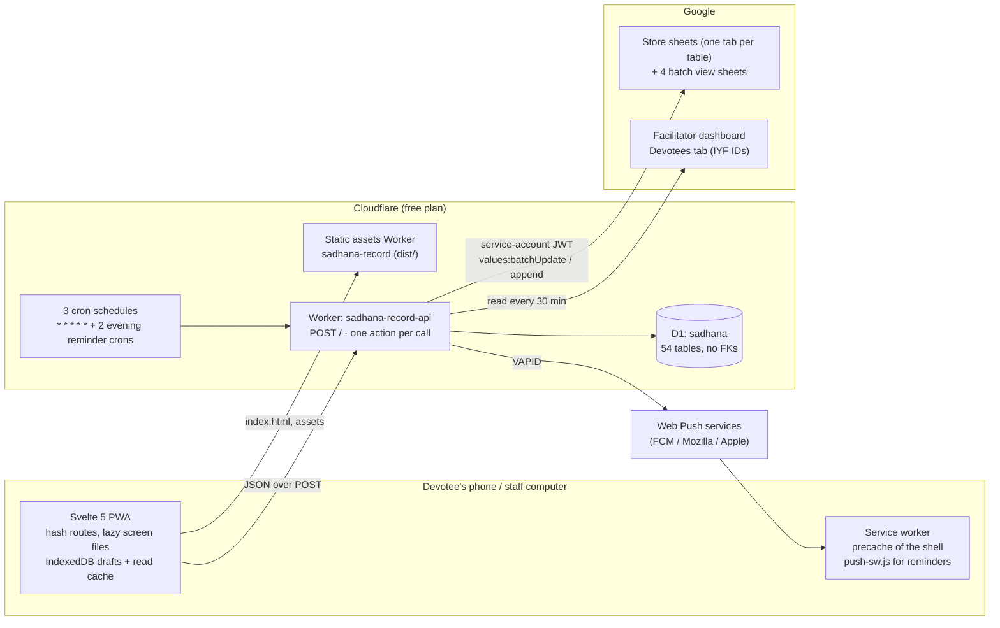
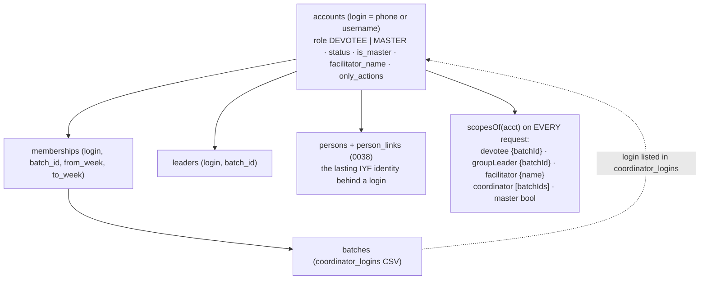

# Architecture — Sadhana Record

**12 October 2026 · verified against the code in this tree.** Where a statement is a design intention rather than
something the code enforces, it says so. Companion pages: `PROJECT_STRUCTURE.md` (where things are), `DATABASE.md`
(tables), `API_REFERENCE.md` (actions), `AUTHORIZATION.md` (who may call what), `INTEGRATIONS.md` (Sheets, push),
`OPERATIONS.md` (deploy, secrets, rollback), `FRONTEND_GUIDE.md` (the app), `LMP_ARCHITECTURE.md` (the proposed portal).

## 1. The system in one picture



Facts the picture rests on:

- **D1 is the only system of record.** Google Sheets receive a copy (row triggers → `mirror_log` → one scheduled run a
  minute, 300 rows at a time). A hand edit in a sheet is overwritten; nothing reads the sheets back except the
  IYF ID registry tab of the *facilitator dashboard*, which is a different spreadsheet (`worker/src/registry.js`).
- **Two Workers, one database.** The app is served as static files by one Worker (`frontend/wrangler.jsonc`); the API
  is a second Worker with the D1 binding (`worker/wrangler.toml`). They share nothing but the origin allow-list.
- **No runtime dependencies on either side.** Both `package.json` files list dev tooling only (wrangler, vite, svelte,
  tailwind, vitest, lighthouse, puppeteer-core). Google auth, Web Push and password hashing are hand-written on Web
  Crypto (`worker/src/google.js`, `push.js`, `crypto.js`).
- **Free-plan constraints shape the design**: 10 ms CPU per invocation, 50 outbound requests per run, daily D1 row
  budgets. They explain the per-request memo in `db.js`, the 300-row mirror cap, the sharded reminders and the
  "one view sheet per run" rule. The rules are written up in `../.claude/skills/sadhana-free-plan/SKILL.md`.

## 2. One request, end to end

```mermaid
sequenceDiagram
  participant S as Screen (Svelte)
  participant C as lib/api.js call()
  participant W as Worker fetch()
  participant H as api.js handle()
  participant M as module fn (e.g. weeks.saveDay)
  participant D as D1
  S->>C: call('week.saveDay', data)
  C->>C: requestId reused for a retry of the same action+data
  C->>W: POST / {v:1, action, token, app, requestId, data}  (text/plain → no preflight)
  W->>W: CORS allow-list (vars.ALLOWED_ORIGINS), body ≤ 400 KB, JSON parse
  W->>H: apiCall(body)
  H->>H: v == 1? action known? every data key in route.fields?
  H->>D: SELECT session by SHA-256(token) → account → scopesOf()
  H->>H: mustChange? allowed(roles, scopes)? only_actions?
  alt write && !noReplay
    H->>D: SELECT replies WHERE key = login:action:requestId
    D-->>H: cached body → returned as is
  end
  H->>M: fn(data, ctx, req)
  M->>D: reads (memoised per request), db.batch([...]) for atomic writes, audit() rows
  M-->>H: result
  H->>D: INSERT OR IGNORE replies (via waitUntil)
  H-->>W: {ok:true, data, serverTime}  — or {ok:false, error:{code,message,fields?}}
  W-->>C: HTTP 200 always
  C->>C: clock skew from serverTime; BUSY → retry ≤3; UNAUTHENTICATED → sign out; UPGRADE_REQUIRED → reload
  C-->>S: data, or ApiError
```

The gate order is fixed in `worker/src/api.js:166-200`: **version → action → field whitelist → session → forced
password change → role → service-account allow-list → replay → handler.** The field whitelist is the first line of
input validation: a key not listed for the action is rejected before anything else runs.

Three properties of the envelope matter to every caller:

1. **Every reply is HTTP 200**, including errors (`ok:false`). Monitoring by status code sees nothing; the Run Log
   (`run_log`) records internal errors and calls slower than 1.5 s.
2. **Writes are idempotent by `requestId`** (the `replies` table, 6-hour retention) except actions marked `noReplay`,
   which must be safe to repeat on their own (`week.saveDay` carries a version; `announcements.like` is a set, not a
   toggle). The app reuses the same id until the server answers (`frontend/src/lib/api.js:88-131`).
3. **There are no transactions, only `db.batch([...])`**, which D1 runs atomically. Any multi-statement write that
   must be all-or-nothing has to be one batch. Check-then-write races are prevented by `PRIMARY KEY`/`UNIQUE`, not by
   locks (`worker/src/db.js:1-2`).

## 3. Identity, scopes and permissions



- **A role is derived, never stored as a session fact** (`worker/src/db.js:77-88`). Deactivating an account removes
  its scopes on the next call; changing `accounts.role` ends its sessions (`session.js:20-23`).
- **Route `roles` is coarse** (`PUBLIC`, `ANY`, `DEVOTEE`, `LEADER`, `FAC`, `STAFF`, `MASTER`). Fine-grained narrowing
  (own record, own batches, own group, own students) is each handler's job. This is the single most important
  invariant to test; see `AUTHORIZATION.md` and the findings in `FULL_AUDIT_2026-10-12.md`.
- **Service accounts** (`only_actions`, migration 0041) are the allow-list pattern the LMP proposal reuses.
- **Identity for LMP**: `persons` (0038) is the anchor; a login is one of possibly several links to a person.

## 4. The weekly form (the core domain)

Weeks run Monday–Sunday and are named by their Monday (`util.mondayOf`). A week's life:

```mermaid
stateDiagram-v2
  [*] --> Filling: first saveDay (drafts.version = 1)
  Filling --> Filling: saveDay / saveWeekEnd (version + 1; STALE if the client's version is old)
  Filling --> Submitted: week.submit (scores computed once, written to submissions; weekjson)
  Filling --> Submitted: Monday 21:00 deadline (runDeadline): complete days count, missing = 0
  Filling --> Missed: deadline with nothing filled (missed_weeks)
  Submitted --> Filling: weeks.reopen (MASTER, openUntil) after reopen.request (STAFF)
  Submitted --> [*]
```



- **Scores are computed once at submit and never recomputed** (`shared/scoring.js`, `weeks.submit`). This is the
  precedent `LMP_ARCHITECTURE.md` follows for final reports.
- **Attendance** has three writers with a precedence: the devotee (`week.setAttendance`), the group leader
  (`group.mark`), staff (`attendance.set`, `attendance.override`); `classweek.js` holds the shared rule.
- **The app computes the same marks live** from the same code (`$shared/scoring.js` alias in `vite.config.js`).

## 5. The app shell

- **Hash router** (`#/path`) with view transitions, a leave guard for unsaved forms and per-entry scroll memory
  (`frontend/src/lib/router.svelte.js`). There is no server-side routing; `404.html` sends unknown paths to the app.
- **Screens are files loaded on demand** (`App.svelte:104-121`). Staff/master chunks are named `staff-*` and kept out
  of the precache (`vite.config.js:12,70,101`), so a devotee's phone never downloads coordinator code.
- **Session restore is optimistic**: the kept user from `localStorage` renders at once, `auth.me` confirms in the
  background; a mismatch clears every cached copy (`session.svelte.js:44-61`).
- **Reads go through one cache** (`cache.svelte.js`: memory → sessionStorage → IndexedDB, keyed by login, 2-minute
  freshness, pull-to-refresh forces). **Writes go through `call()` directly**, and the day form keeps a draft in
  IndexedDB and sends only the diff with its version (`saver.js`).
- **Offline is read-and-draft, not write**: a save with no connection stays `offline` on the phone and is sent when the
  person taps Save again or the phone is back online; it is never shown as saved (`saver.js` status machine).
- **Device tiers** (`tier.js`) switch off view transitions, blur and the darshan image on low-end phones; reduced
  motion is honoured everywhere (`motion.js`, `router.svelte.js:19-21`).

## 6. Scheduled work

One minutely cron does, in order and each in its own `try`: master-password recovery (if the secret is set) → every 30
minutes the registry refresh, otherwise: Monday deadline → 9 PM reminders → announcement pushes → attendance notices →
Sheets copy (300 rows) → erase for deleted devotees → one batch view sheet → nightly retention → hourly tidy
(`worker/src/index.js:49-110`). Two further crons only send reminders, each claiming its own shard of phones. Detail,
budgets and failure behaviour: `INTEGRATIONS.md`.

## 7. Build, release and environments

| | App | API |
|---|---|---|
| Build | `vite build` → `dist/` (build id in `build-id.js`, `/version.json`) | none (ES modules deployed as is) |
| Deploy | `npm run release` → `scripts/release.mjs` → `tools/release/gate.mjs` → `wrangler deploy` | `npx wrangler deploy` (after `npm test`, `npm run audit:sql`, `wrangler versions list`) |
| Migrations | — | `npm run migrate:local` for tests/dev; `migrate:remote` once, before the Worker that needs it |
| Environments | live only (local `vite` on the mock) | live, and `--env load` (separate Worker + D1, no secrets, no crons) |
| Rollback | redeploy the previous `dist/` | `wrangler rollback` / previous version; migrations are additive-only so the old code keeps working |

There is **no CI** and **no git history** for this tree (see `OPERATIONS.md`); the phase gate is the release control.

## 8. Architectural decisions (recorded in `DECISIONS/`)

| ADR | Decision | Status |
|---|---|---|
| 0001 | One POST endpoint with named actions, HTTP 200 envelope — **kept** | accepted |
| 0002 | D1 is the record; Sheets are a copy driven by triggers | accepted (in force since 2 Oct) |
| 0003 | No foreign keys; relationships enforced in code; additive migrations only | accepted (documented risk) |
| 0004 | Scores computed once at submit, never recomputed | accepted |
| 0005 | Roles derived per request; coarse route gate + handler narrowing | accepted; needs the invariant test |
| 0006 | LMP as a role-protected area with its own shell and tables, inside this app | proposed |
| 0007 | Put the tree under git before any further structural work | proposed |

## 9. What this document does not claim

- That every `STAFF`/`ANY` handler narrows correctly — see the per-action audit in `FULL_AUDIT_2026-10-12.md`.
- Any latency, CPU or bundle figure — those are in `PERFORMANCE.md`, marked measured or estimated.
- That `docs/sadhana-api-contract.md` matches the code: it predates ~25 actions and is kept for history.
