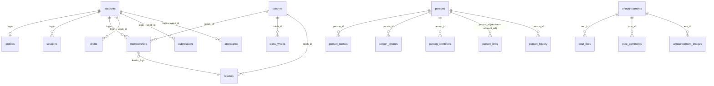

# Database — Sadhana Record

**Generated from `worker/migrations/*.sql` on 12 October 2026.** Every table, column, index and provenance below was
read from the migration files, not from memory. Production was not queried: D1's free-tier daily read limit was
already spent by the day's test runs, and the migrations are the authoritative source in any case.

**55 application tables · 490 columns · 38 indexes · 40 migrations.**
A live `sqlite_master` listing on 12 Oct returned 56 tables: these 54, plus `replies` (dropped and recreated in
0018, so it appears once here) and `d1_migrations` (Cloudflare's own).

> The historical figure of "43 tables, 28 migrations" in earlier briefs is **out of date**. Verified counts are above.

> **Corrected 13 Oct 2026.** This document first said 54 tables / 475 columns / 35 indexes. Those came from
> *parsing* the migration text, and the parser lost columns declared several to a line (`drafts` d1–d7,
> `push_subs.p256dh`, `mirror_log`/`mirror_rows` k1, k2) and three `persons` / `person_names` indexes; `replies`
> had no section at all. prompt-f0 reported the correct figures from executing the migrations, and I confirmed
> them independently with `node:sqlite`: **55 / 490 / 38**. The per-table sections below are regenerated from a
> fixed parser (487 columns) and so may still differ slightly from the executed schema — where they disagree,
> **the executed schema wins**. Rebuilding this file from `node:sqlite` rather than a regex is the right fix and
> is not done here.

## How to read this

- **In** — the migration that created the table. **Changed in** — migrations that added columns later.
- A table with many later `ALTER`s is where the schema has drifted most; `profiles` (+27 columns) and `accounts`
  (+14) are the two to read carefully before adding anything.
- **No index** means no `CREATE INDEX` exists for it. For a small reference table that is correct; for a growing
  one it is a risk, flagged per table below.

## Identity and access

### `accounts`

In **0001_init** · changed in `0006_people`, `0007_scopes`, `0012_contact_classday`, `0026_facilitators_posts`, `0038_identity_and_profile`, `0041_service_accounts` · 35 columns

| Column | Type | Notes |
|---|---|---|
| `login` | TEXT | PRIMARY KEY |
| `role` | TEXT | NOT NULL CHECK (role IN ('DEVOTEE','COORDINATOR','MASTER')) |
| `status` | TEXT | NOT NULL CHECK (status IN ('PENDING','ACTIVE','INACTIVE','DISABLED','REJECTED')) |
| `name` | TEXT | NOT NULL |
| `phone` | TEXT | NOT NULL DEFAULT '' |
| `iyf_id` | TEXT | — |
| `id_source` | TEXT | NOT NULL DEFAULT '' |
| `requested_batch` | TEXT | NOT NULL DEFAULT '' |
| `pw_hash` | TEXT | NOT NULL |
| `pw_salt` | TEXT | NOT NULL |
| `pw_iterations` | INTEGER | NOT NULL |
| `must_change_pw` | INTEGER | NOT NULL DEFAULT 0 |
| `failed_tries` | INTEGER | NOT NULL DEFAULT 0 |
| `locked_until` | TEXT | NOT NULL DEFAULT '' |
| `signed_up_at` | TEXT | NOT NULL DEFAULT '' |
| `decided_at` | TEXT | NOT NULL DEFAULT '' |
| `decided_by` | TEXT | NOT NULL DEFAULT '' |
| `reject_reason` | TEXT | NOT NULL DEFAULT '' |
| `last_login_at` | TEXT | NOT NULL DEFAULT '' |
| `updated_at` | TEXT | NOT NULL DEFAULT '' |
| `updated_by` | TEXT | NOT NULL DEFAULT '' |
| `requested_facilitator` | TEXT | NOT NULL DEFAULT '' |
| `requested_group_leader` | TEXT | NOT NULL DEFAULT '' |
| `is_master` | INTEGER | NOT NULL DEFAULT 0 |
| `email` | TEXT | NOT NULL DEFAULT '' |
| `whatsapp` | TEXT | NOT NULL DEFAULT '' |
| `requested_class_day` | TEXT | NOT NULL DEFAULT '' |
| `facilitator_name` | TEXT | NOT NULL DEFAULT '' |
| `signup_state` | TEXT | NOT NULL DEFAULT '' |
| `signup_at` | TEXT | NOT NULL DEFAULT '' |
| `approved_by` | TEXT | NOT NULL DEFAULT '' |
| `approved_at` | TEXT | NOT NULL DEFAULT '' |
| `phone_changed_from` | TEXT | NOT NULL DEFAULT '' |
| `only_actions` | TEXT | NOT NULL DEFAULT '' |
| `service_note` | TEXT | NOT NULL DEFAULT '' |

**Indexes**

- `accounts_one_per_iyf_id` — UNIQUE (iyf_id) WHERE iyf_id IS NOT NULL
- `accounts_by_status` — (status, requested_batch)
- `accounts_by_facilitator` — (facilitator_name) WHERE facilitator_name <> ''
- `accounts_signup_pending` — (signup_state) WHERE signup_state = 'PENDING'

### `sessions`

In **0001_init** · 9 columns

| Column | Type | Notes |
|---|---|---|
| `token_hash` | TEXT | PRIMARY KEY |
| `login` | TEXT | NOT NULL |
| `role` | TEXT | NOT NULL |
| `created_at` | TEXT | NOT NULL |
| `last_used_at` | TEXT | NOT NULL |
| `expires_at` | TEXT | NOT NULL |
| `device` | TEXT | NOT NULL DEFAULT '' |
| `ended_at` | TEXT | NOT NULL DEFAULT '' |
| `end_reason` | TEXT | NOT NULL DEFAULT '' |

**Indexes**

- `sessions_by_login` — (login)

### `persons`

In **0038_identity_and_profile** · 10 columns

| Column | Type | Notes |
|---|---|---|
| `id` | TEXT | PRIMARY KEY |
| `display_name` | TEXT | NOT NULL |
| `iyf_id` | TEXT | NOT NULL DEFAULT '' |
| `connected_since` | TEXT | NOT NULL DEFAULT '' |
| `connected_since_src` | TEXT | NOT NULL DEFAULT '' |
| `status` | TEXT | NOT NULL DEFAULT 'Inactive' CHECK (status IN ('Active','Inactive')) |
| `merged_into` | TEXT | NOT NULL DEFAULT '' |
| `import_batch` | TEXT | NOT NULL DEFAULT '' |
| `created_at` | TEXT | NOT NULL |
| `updated_at` | TEXT | NOT NULL DEFAULT '' |

**Indexes**

- `persons_iyf_id` — UNIQUE (iyf_id) WHERE iyf_id <> ''
- `persons_status` — (status)

### `person_names`

In **0038_identity_and_profile** · 7 columns

| Column | Type | Notes |
|---|---|---|
| `id` | INTEGER | PRIMARY KEY AUTOINCREMENT |
| `person_id` | TEXT | NOT NULL |
| `name` | TEXT | NOT NULL |
| `kind` | TEXT | NOT NULL CHECK (kind IN ('given','initiated','spelling_variant')) |
| `is_current` | INTEGER | NOT NULL DEFAULT 0 |
| `from_at` | TEXT | NOT NULL DEFAULT '' |
| `added_at` | TEXT | NOT NULL |

**Indexes**

- `person_names_one_current` — UNIQUE (person_id) WHERE is_current = 1

### `person_phones`

In **0038_identity_and_profile** · 5 columns

| Column | Type | Notes |
|---|---|---|
| `phone` | TEXT | PRIMARY KEY |
| `person_id` | TEXT | NOT NULL |
| `is_primary` | INTEGER | NOT NULL DEFAULT 0 |
| `active` | INTEGER | NOT NULL DEFAULT 1 |
| `added_at` | TEXT | NOT NULL |

**Indexes**

- `person_phones_person` — (person_id, is_primary DESC)

### `person_identifiers`

In **0038_identity_and_profile** · 8 columns

| Column | Type | Notes |
|---|---|---|
| `fid` | TEXT | PRIMARY KEY |
| `person_id` | TEXT | NOT NULL |
| `series` | TEXT | NOT NULL DEFAULT 'IYFD' |
| `state` | TEXT | NOT NULL DEFAULT 'current' CHECK (state IN ('current','superseded','retired')) |
| `superseded_by` | TEXT | NOT NULL DEFAULT '' |
| `issued_by` | TEXT | NOT NULL DEFAULT '' |
| `issued_at` | TEXT | NOT NULL |
| `ended_at` | TEXT | NOT NULL DEFAULT '' |

**Indexes**

- `person_identifiers_person` — (person_id, state)

### `person_links`

In **0038_identity_and_profile** · 4 columns

| Column | Type | Notes |
|---|---|---|
| `service` | TEXT | NOT NULL |
| `account_ref` | TEXT | NOT NULL |
| `person_id` | TEXT | NOT NULL |
| `linked_at` | TEXT | NOT NULL |

**Indexes**

- `person_links_person` — (person_id)

### `person_history`

In **0038_identity_and_profile** · 7 columns

| Column | Type | Notes |
|---|---|---|
| `id` | INTEGER | PRIMARY KEY AUTOINCREMENT |
| `person_id` | TEXT | NOT NULL |
| `kind` | TEXT | NOT NULL |
| `value` | TEXT | NOT NULL |
| `seq` | INTEGER | NOT NULL DEFAULT 0 |
| `source` | TEXT | NOT NULL DEFAULT '' |
| `recorded_at` | TEXT | NOT NULL |

**Indexes**

- `person_history_person` — (person_id, kind, seq)

### `id_sequences`

In **0038_identity_and_profile** · 4 columns

| Column | Type | Notes |
|---|---|---|
| `series` | TEXT | NOT NULL |
| `year` | TEXT | NOT NULL |
| `next_seq` | INTEGER | NOT NULL |
| `updated_at` | TEXT | NOT NULL |

_No index._ Small reference table; the primary key is enough.

### `app_ids`

In **0034_app_ids** · 11 columns

| Column | Type | Notes |
|---|---|---|
| `id` | INTEGER | PRIMARY KEY AUTOINCREMENT |
| `iyf_id` | TEXT | NOT NULL DEFAULT '' |
| `login` | TEXT | NOT NULL |
| `name` | TEXT | NOT NULL |
| `batch_id` | TEXT | NOT NULL DEFAULT '' |
| `created_by` | TEXT | NOT NULL |
| `created_at` | TEXT | NOT NULL |
| `reason` | TEXT | NOT NULL DEFAULT '' |
| `state` | TEXT | NOT NULL DEFAULT 'ACTIVE' CHECK (state IN ('ACTIVE', 'RETIRED')) |
| `replaced_by` | TEXT | NOT NULL DEFAULT '' |
| `retired_at` | TEXT | NOT NULL DEFAULT '' |

**Indexes**

- `app_ids_by_login` — (login)
- `app_ids_by_id` — (iyf_id)

### `reset_requests`

In **0001_init** · 9 columns

| Column | Type | Notes |
|---|---|---|
| `id` | INTEGER | PRIMARY KEY |
| `login` | TEXT | NOT NULL |
| `requested_at` | TEXT | NOT NULL |
| `new_pw_hash` | TEXT | NOT NULL |
| `new_pw_salt` | TEXT | NOT NULL |
| `new_pw_iterations` | INTEGER | NOT NULL |
| `status` | TEXT | NOT NULL CHECK (status IN ('PENDING','APPROVED','REJECTED','SUPERSEDED')) |
| `decided_by` | TEXT | NOT NULL DEFAULT '' |
| `decided_at` | TEXT | NOT NULL DEFAULT '' |

**Indexes**

- `reset_requests_by_login` — (login, status)

### `head_requests`

In **0035_head_requests** · 17 columns

| Column | Type | Notes |
|---|---|---|
| `id` | INTEGER | PRIMARY KEY AUTOINCREMENT |
| `kind` | TEXT | NOT NULL CHECK (kind IN ('CREATE', 'PROMOTE')) |
| `login` | TEXT | NOT NULL |
| `name` | TEXT | NOT NULL |
| `phone` | TEXT | NOT NULL DEFAULT '' |
| `pw_hash` | TEXT | NOT NULL DEFAULT '' |
| `pw_salt` | TEXT | NOT NULL DEFAULT '' |
| `pw_iterations` | INTEGER | NOT NULL DEFAULT 0 |
| `reason` | TEXT | NOT NULL |
| `requested_by` | TEXT | NOT NULL |
| `requested_at` | TEXT | NOT NULL |
| `needed` | TEXT | NOT NULL |
| `approved` | TEXT | NOT NULL DEFAULT '' |
| `state` | TEXT | NOT NULL DEFAULT 'OPEN' CHECK (state IN ('OPEN', 'DONE', 'REJECTED', 'WITHDRAWN', 'EXPIR |
| `decided_by` | TEXT | NOT NULL DEFAULT '' |
| `decided_at` | TEXT | NOT NULL DEFAULT '' |
| `note` | TEXT | NOT NULL DEFAULT '' |

**Indexes**

- `head_requests_open` — (state) WHERE state = 'OPEN'

### `registry`

In **0001_init** · 8 columns

| Column | Type | Notes |
|---|---|---|
| `iyf_id` | TEXT | PRIMARY KEY |
| `name` | TEXT | NOT NULL |
| `phone` | TEXT | NOT NULL DEFAULT '' |
| `level` | TEXT | NOT NULL DEFAULT '' |
| `facilitator` | TEXT | NOT NULL DEFAULT '' |
| `status` | TEXT | NOT NULL DEFAULT '' |
| `merged_into` | TEXT | — |
| `aliases` | TEXT | NOT NULL DEFAULT '[]' |

_No index._ Small reference table; the primary key is enough.

## People and structure

### `batches`

In **0001_init** · 13 columns

| Column | Type | Notes |
|---|---|---|
| `batch_id` | TEXT | PRIMARY KEY |
| `name` | TEXT | NOT NULL |
| `level` | TEXT | NOT NULL |
| `score_card` | TEXT | NOT NULL |
| `hearing_journal` | TEXT | NOT NULL |
| `sheet_tab` | TEXT | NOT NULL |
| `coordinator_logins` | TEXT | NOT NULL DEFAULT '' |
| `standing` | INTEGER | NOT NULL DEFAULT 1 |
| `active` | INTEGER | NOT NULL DEFAULT 1 |
| `pilot` | INTEGER | NOT NULL DEFAULT 0 |
| `view_sheet_id` | TEXT | NOT NULL DEFAULT '' |
| `updated_at` | TEXT | NOT NULL DEFAULT '' |
| `updated_by` | TEXT | NOT NULL DEFAULT '' |

_No index._ Small reference table; the primary key is enough.

### `memberships`

In **0001_init** · changed in `0006_people`, `0012_contact_classday`, `0023_group_leaders_address` · 15 columns

| Column | Type | Notes |
|---|---|---|
| `id` | INTEGER | PRIMARY KEY |
| `login` | TEXT | NOT NULL |
| `iyf_id` | TEXT | NOT NULL DEFAULT '' |
| `batch_id` | TEXT | NOT NULL |
| `state` | TEXT | NOT NULL CHECK (state IN ('ACTIVE','INACTIVE')) |
| `from_week` | TEXT | NOT NULL |
| `to_week` | TEXT | NOT NULL DEFAULT '' |
| `level_entry_date` | TEXT | NOT NULL DEFAULT '' |
| `group_leader` | TEXT | NOT NULL DEFAULT '' |
| `set_by` | TEXT | NOT NULL DEFAULT '' |
| `set_at` | TEXT | NOT NULL DEFAULT '' |
| `reason` | TEXT | NOT NULL DEFAULT '' |
| `facilitator` | TEXT | NOT NULL DEFAULT '' |
| `class_day` | TEXT | NOT NULL DEFAULT '' |
| `leader_login` | TEXT | NOT NULL DEFAULT '' |

**Indexes**

- `memberships_by_login` — (login)
- `memberships_by_batch` — (batch_id, to_week)
- `memberships_by_leader` — (leader_login, to_week)
- `memberships_by_facilitator` — (facilitator, to_week)

### `facilitators`

In **0006_people** · changed in `0017_facilitators_admin` · 9 columns

| Column | Type | Notes |
|---|---|---|
| `name` | TEXT | PRIMARY KEY |
| `in_cohort` | INTEGER | NOT NULL DEFAULT 0 |
| `order` | INTEGER | NOT NULL |
| `active` | INTEGER | NOT NULL DEFAULT 1 |
| `source` | TEXT | NOT NULL DEFAULT 'DASHBOARD' |
| `seen` | INTEGER | NOT NULL DEFAULT 1 |
| `deleted_at` | TEXT | NOT NULL DEFAULT '' |
| `changed_by` | TEXT | NOT NULL DEFAULT '' |
| `changed_at` | TEXT | NOT NULL DEFAULT '' |

_No index._ Small reference table; the primary key is enough.

### `leaders`

In **0023_group_leaders_address** · 4 columns

| Column | Type | Notes |
|---|---|---|
| `login` | TEXT | PRIMARY KEY |
| `batch_id` | TEXT | NOT NULL |
| `appointed_by` | TEXT | NOT NULL |
| `appointed_at` | TEXT | NOT NULL |

**Indexes**

- `leaders_by_batch` — (batch_id)

### `group_leaders`

In **0006_people** · 5 columns

| Column | Type | Notes |
|---|---|---|
| `batch_id` | TEXT | NOT NULL |
| `name` | TEXT | NOT NULL |
| `active` | INTEGER | NOT NULL DEFAULT 1 |
| `merged` | TEXT | NOT NULL DEFAULT '' |
| `order` | INTEGER | NOT NULL |

_No index._ Small reference table; the primary key is enough.

### `class_weeks`

In **0011_class_weeks** · 7 columns

| Column | Type | Notes |
|---|---|---|
| `batch_id` | TEXT | NOT NULL |
| `week_id` | TEXT | NOT NULL |
| `kind` | TEXT | NOT NULL CHECK (kind IN ('HOLIDAY','FESTIVAL','OTHER')) |
| `note` | TEXT | NOT NULL |
| `mode` | TEXT | NOT NULL CHECK (mode IN ('ALL_PRESENT','MARKED')) |
| `by` | TEXT | NOT NULL |
| `at` | TEXT | NOT NULL |

_No index._ Small reference table; the primary key is enough.

### `profiles`

In **0001_init** · changed in `0023_group_leaders_address`, `0028_address_state`, `0030_phase0`, `0036_address_parts`, `0038_identity_and_profile` · 41 columns

| Column | Type | Notes |
|---|---|---|
| `login` | TEXT | PRIMARY KEY |
| `iyf_id` | TEXT | NOT NULL DEFAULT '' |
| `name` | TEXT | NOT NULL |
| `dob` | TEXT | NOT NULL DEFAULT '' |
| `blood_group` | TEXT | NOT NULL DEFAULT '' |
| `emergency_name` | TEXT | NOT NULL DEFAULT '' |
| `emergency_relation` | TEXT | NOT NULL DEFAULT '' |
| `emergency_phone` | TEXT | NOT NULL DEFAULT '' |
| `photo_file_id` | TEXT | NOT NULL DEFAULT '' |
| `photo_updated_at` | TEXT | NOT NULL DEFAULT '' |
| `reading_pages_per_hour` | INTEGER | NOT NULL DEFAULT 20 |
| `current_book_id` | TEXT | NOT NULL DEFAULT '' |
| `updated_at` | TEXT | NOT NULL DEFAULT '' |
| `updated_by` | TEXT | NOT NULL DEFAULT '' |
| `addr_line` | TEXT | NOT NULL DEFAULT '' |
| `addr_area` | TEXT | NOT NULL DEFAULT '' |
| `addr_city` | TEXT | NOT NULL DEFAULT '' |
| `addr_pin` | TEXT | NOT NULL DEFAULT '' |
| `addr_state` | TEXT | NOT NULL DEFAULT '' |
| `parent_name` | TEXT | NOT NULL DEFAULT '' |
| `parent_phone` | TEXT | NOT NULL DEFAULT '' |
| `parent_consent_at` | TEXT | NOT NULL DEFAULT '' |
| `privacy_consent_at` | TEXT | NOT NULL DEFAULT '' |
| `addr_house` | TEXT | NOT NULL DEFAULT '' |
| `addr_street` | TEXT | NOT NULL DEFAULT '' |
| `addr_landmark` | TEXT | NOT NULL DEFAULT '' |
| `gender` | TEXT | NOT NULL DEFAULT '' |
| `marital_status` | TEXT | NOT NULL DEFAULT '' |
| `initiated_name` | TEXT | NOT NULL DEFAULT '' |
| `class_level` | TEXT | NOT NULL DEFAULT '' |
| `chanting_rounds` | TEXT | NOT NULL DEFAULT '' |
| `education` | TEXT | NOT NULL DEFAULT '' |
| `education_institute` | TEXT | NOT NULL DEFAULT '' |
| `profession` | TEXT | NOT NULL DEFAULT '' |
| `organization` | TEXT | NOT NULL DEFAULT '' |
| `skills` | TEXT | NOT NULL DEFAULT '' |
| `connected_since` | TEXT | NOT NULL DEFAULT '' |
| `connected_area` | TEXT | NOT NULL DEFAULT '' |
| `connected_by` | TEXT | NOT NULL DEFAULT '' |
| `person_id` | TEXT | NOT NULL DEFAULT '' |
| `imported_fields` | TEXT | NOT NULL DEFAULT '' |

**Indexes**

- `profiles_person` — (person_id) WHERE person_id <> ''

### `photos`

In **0010_phase4** · 5 columns

| Column | Type | Notes |
|---|---|---|
| `login` | TEXT | PRIMARY KEY |
| `jpeg` | TEXT | NOT NULL |
| `bytes` | INTEGER | NOT NULL |
| `updated_at` | TEXT | NOT NULL |
| `updated_by` | TEXT | NOT NULL |

_No index._ Small reference table; the primary key is enough.

### `duplicate_reviews`

In **0014_duplicate_reviews** · 5 columns

| Column | Type | Notes |
|---|---|---|
| `group_key` | TEXT | PRIMARY KEY |
| `why` | TEXT | NOT NULL |
| `decision` | TEXT | NOT NULL CHECK (decision IN ('NOT_DUPLICATE')) |
| `by` | TEXT | NOT NULL |
| `at` | TEXT | NOT NULL |

_No index._ Small reference table; the primary key is enough.

## Sadhana records

### `drafts`

In **0005_weeks** · 7 columns

| Column | Type | Notes |
|---|---|---|
| `login` | TEXT | NOT NULL |
| `week_id` | TEXT | NOT NULL |
| `batch_id` | TEXT | NOT NULL |
| `week_end` | TEXT | — |
| `created_at` | TEXT | NOT NULL |
| `updated_at` | TEXT | NOT NULL |
| `updated_by` | TEXT | NOT NULL |

**Indexes**

- `drafts_by_batch` — (batch_id, week_id)

### `submissions`

In **0005_weeks** · changed in `0023_group_leaders_address`, `0029_part_weeks` · 35 columns

| Column | Type | Notes |
|---|---|---|
| `id` | INTEGER | PRIMARY KEY |
| `submission_id` | TEXT | NOT NULL UNIQUE |
| `login` | TEXT | NOT NULL |
| `iyf_id` | TEXT | NOT NULL DEFAULT '' |
| `name` | TEXT | NOT NULL |
| `batch_id` | TEXT | NOT NULL |
| `week_id` | TEXT | NOT NULL |
| `submitted_at` | TEXT | NOT NULL |
| `submitted_by` | TEXT | NOT NULL |
| `on_behalf` | INTEGER | NOT NULL DEFAULT 0 |
| `request_id` | TEXT | NOT NULL DEFAULT '' |
| `rules_version` | TEXT | NOT NULL |
| `reopened` | INTEGER | NOT NULL DEFAULT 0 |
| `bed` | INTEGER | NOT NULL |
| `wake_up` | INTEGER | NOT NULL |
| `day_sleep` | INTEGER | NOT NULL |
| `japa` | INTEGER | NOT NULL |
| `pathan` | INTEGER | NOT NULL |
| `sravan` | INTEGER | NOT NULL |
| `seva` | INTEGER | NOT NULL |
| `attendance` | INTEGER | NOT NULL |
| `body` | INTEGER | NOT NULL |
| `soul` | INTEGER | NOT NULL |
| `overall` | INTEGER | NOT NULL |
| `seva_minutes` | INTEGER | NOT NULL |
| `avg_rounds` | TEXT | NOT NULL |
| `night_stay` | TEXT | NOT NULL |
| `principles` | TEXT | NOT NULL |
| `hearing_minutes` | INTEGER | NOT NULL |
| `reading_minutes` | INTEGER | NOT NULL |
| `days_json` | TEXT | NOT NULL |
| `marks_json` | TEXT | NOT NULL |
| `bridged_at` | TEXT | NOT NULL DEFAULT '' |
| `week_json` | TEXT | NOT NULL DEFAULT '' |
| `days_filled` | INTEGER | NOT NULL DEFAULT 7 |

**Indexes**

- `submissions_by_week` — (week_id, batch_id)

### `attendance`

In **0005_weeks** · changed in `0023_group_leaders_address` · 15 columns

| Column | Type | Notes |
|---|---|---|
| `login` | TEXT | NOT NULL |
| `week_id` | TEXT | NOT NULL |
| `batch_id` | TEXT | NOT NULL |
| `devotee_mark` | TEXT | NOT NULL DEFAULT '' |
| `coordinator_mark` | TEXT | NOT NULL DEFAULT '' |
| `mark_used` | TEXT | NOT NULL DEFAULT '' |
| `locked` | INTEGER | NOT NULL DEFAULT 0 |
| `changed_by` | TEXT | NOT NULL DEFAULT '' |
| `changed_at` | TEXT | NOT NULL DEFAULT '' |
| `reason` | TEXT | NOT NULL DEFAULT '' |
| `leader_mark` | TEXT | NOT NULL DEFAULT '' |
| `leader_by` | TEXT | NOT NULL DEFAULT '' |
| `master_mark` | TEXT | NOT NULL DEFAULT '' |
| `notice_at` | TEXT | NOT NULL DEFAULT '' |
| `notice_sent` | INTEGER | NOT NULL DEFAULT 0 |

**Indexes**

- `attendance_by_week` — (week_id, batch_id)
- `attendance_notices` — (notice_at) WHERE notice_at <> '' AND notice_sent = 0

### `missed_weeks`

In **0005_weeks** · 5 columns

| Column | Type | Notes |
|---|---|---|
| `login` | TEXT | NOT NULL |
| `week_id` | TEXT | NOT NULL |
| `batch_id` | TEXT | NOT NULL |
| `days_filled` | INTEGER | NOT NULL DEFAULT 0 |
| `at` | TEXT | NOT NULL |

**Indexes**

- `missed_by_batch` — (batch_id, week_id)

### `reopens`

In **0005_weeks** · 7 columns

| Column | Type | Notes |
|---|---|---|
| `login` | TEXT | NOT NULL |
| `week_id` | TEXT | NOT NULL |
| `reason` | TEXT | NOT NULL |
| `open_until` | TEXT | NOT NULL |
| `by` | TEXT | NOT NULL |
| `at` | TEXT | NOT NULL |
| `state` | TEXT | NOT NULL CHECK (state IN ('OPEN','SUBMITTED','EXPIRED')) |

_No index._ Small reference table; the primary key is enough.

### `reopen_requests`

In **0010_phase4** · 9 columns

| Column | Type | Notes |
|---|---|---|
| `login` | TEXT | NOT NULL |
| `week_id` | TEXT | NOT NULL |
| `batch_id` | TEXT | NOT NULL |
| `reason` | TEXT | NOT NULL |
| `by` | TEXT | NOT NULL |
| `at` | TEXT | NOT NULL |
| `state` | TEXT | NOT NULL DEFAULT 'PENDING' CHECK (state IN ('PENDING','DONE','REJECTED')) |
| `decided_by` | TEXT | NOT NULL DEFAULT '' |
| `decided_at` | TEXT | NOT NULL DEFAULT '' |

_No index._ Small reference table; the primary key is enough.

## Scoring rules

### `card_ranges`

In **0002_rules** · 8 columns

| Column | Type | Notes |
|---|---|---|
| `card` | TEXT | NOT NULL |
| `category` | TEXT | NOT NULL |
| `order` | INTEGER | NOT NULL |
| `label` | TEXT | NOT NULL |
| `from` | TEXT | NOT NULL DEFAULT '' |
| `to` | TEXT | NOT NULL DEFAULT '' |
| `marks` | INTEGER | NOT NULL |
| `version` | TEXT | NOT NULL |

_No index._ Small reference table; the primary key is enough.

### `seva_rules`

In **0002_rules** · 6 columns

| Column | Type | Notes |
|---|---|---|
| `card` | TEXT | NOT NULL |
| `rule` | TEXT | NOT NULL |
| `value` | TEXT | NOT NULL |
| `score` | INTEGER | NOT NULL DEFAULT 0 |
| `note` | TEXT | NOT NULL DEFAULT '' |
| `version` | TEXT | NOT NULL |

_No index._ Small reference table; the primary key is enough.

### `chetna_options`

In **0002_rules** · 4 columns

| Column | Type | Notes |
|---|---|---|
| `kind` | TEXT | NOT NULL CHECK ("kind" IN ('POSITIVE','NEGATIVE')) |
| `option` | TEXT | NOT NULL |
| `order` | INTEGER | NOT NULL |
| `active` | INTEGER | NOT NULL DEFAULT 1 |

_No index._ Small reference table; the primary key is enough.

### `lectures`

In **0002_rules** · changed in `0009_links` · 8 columns

| Column | Type | Notes |
|---|---|---|
| `lecture_id` | TEXT | PRIMARY KEY |
| `journal` | TEXT | NOT NULL |
| `week` | INTEGER | NOT NULL |
| `slot` | TEXT | NOT NULL |
| `title` | TEXT | NOT NULL |
| `audio_url` | TEXT | NOT NULL DEFAULT '' |
| `order` | INTEGER | NOT NULL |
| `link` | TEXT | NOT NULL DEFAULT '' |

**Indexes**

- `lectures_by_journal` — ("journal", "order")

### `books`

In **0002_rules** · 7 columns

| Column | Type | Notes |
|---|---|---|
| `book_id` | TEXT | PRIMARY KEY |
| `title` | TEXT | NOT NULL |
| `level` | TEXT | NOT NULL |
| `words` | INTEGER | — |
| `language` | TEXT | NOT NULL DEFAULT '' |
| `order` | INTEGER | NOT NULL |
| `link` | TEXT | NOT NULL DEFAULT '' |

_No index._ Small reference table; the primary key is enough.

### `book_files`

In **0009_links** · 4 columns

| Column | Type | Notes |
|---|---|---|
| `book_id` | TEXT | NOT NULL REFERENCES books("book_id") |
| `order` | INTEGER | NOT NULL |
| `label` | TEXT | NOT NULL |
| `url` | TEXT | NOT NULL |

_No index._ Small reference table; the primary key is enough.

## Announcements

### `announcements`

In **0008_announcements** · changed in `0032_scheduled_posts` · 12 columns

| Column | Type | Notes |
|---|---|---|
| `id` | INTEGER | PRIMARY KEY |
| `title` | TEXT | NOT NULL |
| `body` | TEXT | NOT NULL |
| `audience` | TEXT | NOT NULL |
| `pinned` | INTEGER | NOT NULL DEFAULT 0 |
| `expires_at` | TEXT | NOT NULL DEFAULT '' |
| `author_login` | TEXT | NOT NULL |
| `author_name` | TEXT | NOT NULL |
| `created_at` | TEXT | NOT NULL |
| `updated_at` | TEXT | NOT NULL |
| `removed_at` | TEXT | NOT NULL DEFAULT '' |
| `publish_at` | TEXT | NOT NULL DEFAULT '' |

**Indexes**

- `announcements_recent` — (removed_at, created_at)

### `announcement_images`

In **0016_announcement_images** · 6 columns

| Column | Type | Notes |
|---|---|---|
| `ann_id` | INTEGER | PRIMARY KEY |
| `jpeg` | TEXT | NOT NULL |
| `bytes` | INTEGER | NOT NULL |
| `w` | INTEGER | NOT NULL |
| `h` | INTEGER | NOT NULL |
| `updated_at` | TEXT | NOT NULL |

_No index._ Small reference table; the primary key is enough.

### `post_likes`

In **0026_facilitators_posts** · 3 columns

| Column | Type | Notes |
|---|---|---|
| `ann_id` | INTEGER | NOT NULL |
| `login` | TEXT | NOT NULL |
| `at` | TEXT | NOT NULL |

_No index._ **Growing table with no index — see Risks.**

### `post_comments`

In **0026_facilitators_posts** · 7 columns

| Column | Type | Notes |
|---|---|---|
| `id` | INTEGER | PRIMARY KEY AUTOINCREMENT |
| `ann_id` | INTEGER | NOT NULL |
| `login` | TEXT | NOT NULL |
| `name` | TEXT | NOT NULL |
| `body` | TEXT | NOT NULL |
| `at` | TEXT | NOT NULL |
| `removed_at` | TEXT | NOT NULL DEFAULT '' |

**Indexes**

- `post_comments_by_post` — (ann_id, id) WHERE removed_at = ''

### `post_reports`

In **0030_phase0** · 10 columns

| Column | Type | Notes |
|---|---|---|
| `id` | INTEGER | PRIMARY KEY AUTOINCREMENT |
| `ann_id` | INTEGER | NOT NULL |
| `comment_id` | INTEGER | NOT NULL DEFAULT 0 |
| `reporter` | TEXT | NOT NULL |
| `reason` | TEXT | NOT NULL CHECK (reason IN ('spam', 'abusive', 'inappropriate', 'other')) |
| `note` | TEXT | NOT NULL DEFAULT '' |
| `at` | TEXT | NOT NULL |
| `state` | TEXT | NOT NULL DEFAULT 'OPEN' CHECK (state IN ('OPEN', 'DISMISSED', 'REMOVED')) |
| `decided_by` | TEXT | NOT NULL DEFAULT '' |
| `decided_at` | TEXT | NOT NULL DEFAULT '' |

**Indexes**

- `post_reports_once` — UNIQUE (ann_id, comment_id, reporter)
- `post_reports_open` — (ann_id, comment_id) WHERE state = 'OPEN'

### `post_mutes`

In **0030_phase0** · 5 columns

| Column | Type | Notes |
|---|---|---|
| `id` | INTEGER | PRIMARY KEY AUTOINCREMENT |
| `viewer` | TEXT | NOT NULL |
| `author` | TEXT | NOT NULL |
| `by` | TEXT | NOT NULL |
| `at` | TEXT | NOT NULL |

**Indexes**

- `post_mutes_once` — UNIQUE (viewer, author)

## Notifications

### `push_subs`

In **0013_push** · changed in `0015_push_devices` · 8 columns

| Column | Type | Notes |
|---|---|---|
| `endpoint` | TEXT | PRIMARY KEY |
| `login` | TEXT | NOT NULL |
| `auth` | TEXT | NOT NULL |
| `created_at` | TEXT | NOT NULL |
| `last_sent` | TEXT | NOT NULL DEFAULT '' |
| `last_status` | INTEGER | NOT NULL DEFAULT 0 |
| `fails` | INTEGER | NOT NULL DEFAULT 0 |
| `pending` | TEXT | NOT NULL DEFAULT '' |

**Indexes**

- `push_subs_by_login` — (login)

### `push_jobs`

In **0015_push_devices** · changed in `0033_post_reach` · 12 columns

| Column | Type | Notes |
|---|---|---|
| `id` | INTEGER | PRIMARY KEY |
| `ann_id` | INTEGER | NOT NULL |
| `audience` | TEXT | NOT NULL |
| `title` | TEXT | NOT NULL |
| `created_at` | TEXT | NOT NULL |
| `cursor` | INTEGER | NOT NULL DEFAULT 0 |
| `state` | TEXT | NOT NULL DEFAULT 'OPEN' CHECK (state IN ('OPEN', 'DONE')) |
| `sent` | INTEGER | NOT NULL DEFAULT 0 |
| `tried` | INTEGER | NOT NULL DEFAULT 0 |
| `gone` | INTEGER | NOT NULL DEFAULT 0 |
| `failed` | INTEGER | NOT NULL DEFAULT 0 |
| `done_at` | TEXT | NOT NULL DEFAULT '' |

**Indexes**

- `push_jobs_ann` — (ann_id)

### `reminder_progress`

In **0021_reminder_shards** · changed in `0025_reminder_claim` · 4 columns

| Column | Type | Notes |
|---|---|---|
| `shard` | INTEGER | PRIMARY KEY |
| `day` | TEXT | NOT NULL DEFAULT '' |
| `cursor` | INTEGER | NOT NULL DEFAULT 0 |
| `prev` | INTEGER | NOT NULL DEFAULT 0 |

_No index._ Small reference table; the primary key is enough.

## Google Sheets copy

### `mirror_state`

In **0001_init** · changed in `0004_mirror_chunks`, `0018_mirror_keyed` · 8 columns

| Column | Type | Notes |
|---|---|---|
| `tbl` | TEXT | PRIMARY KEY |
| `dirty` | INTEGER | NOT NULL DEFAULT 1 |
| `last_id` | INTEGER | NOT NULL DEFAULT 0 |
| `synced_at` | TEXT | NOT NULL DEFAULT '' |
| `gen` | INTEGER | NOT NULL DEFAULT 0 |
| `mode` | TEXT | NOT NULL DEFAULT '' |
| `rows` | INTEGER | NOT NULL DEFAULT 0 |
| `cursor` | TEXT | NOT NULL DEFAULT '' |

_No index._ Small reference table; the primary key is enough.

### `mirror_log`

In **0022_mirror_log** · 2 columns

| Column | Type | Notes |
|---|---|---|
| `id` | INTEGER | PRIMARY KEY |
| `tbl` | TEXT | NOT NULL |

_No index._ **Growing table with no index — see Risks.**

### `mirror_rows`

In **0018_mirror_keyed** · 2 columns

| Column | Type | Notes |
|---|---|---|
| `tbl` | TEXT | NOT NULL |
| `row` | INTEGER | NOT NULL |

_No index._ Small reference table; the primary key is enough.

### `mirror_free`

In **0022_mirror_log** · 2 columns

| Column | Type | Notes |
|---|---|---|
| `tbl` | TEXT | NOT NULL |
| `row` | INTEGER | NOT NULL |

_No index._ Small reference table; the primary key is enough.

### `view_state`

In **0010_phase4** · changed in `0020_view_sheets` · 9 columns

| Column | Type | Notes |
|---|---|---|
| `view` | TEXT | PRIMARY KEY |
| `sig` | TEXT | NOT NULL DEFAULT '' |
| `synced_at` | TEXT | NOT NULL DEFAULT '' |
| `note` | TEXT | NOT NULL DEFAULT '' |
| `mode` | TEXT | NOT NULL DEFAULT 'build' |
| `focus` | TEXT | NOT NULL DEFAULT '' |
| `last_id` | INTEGER | NOT NULL DEFAULT 0 |
| `blocks` | TEXT | NOT NULL DEFAULT '[]' |
| `board_at` | TEXT | NOT NULL DEFAULT '' |

_No index._ Small reference table; the primary key is enough.

### `view_dirty`

In **0020_view_sheets** · 2 columns

| Column | Type | Notes |
|---|---|---|
| `view` | TEXT | NOT NULL |
| `part` | TEXT | NOT NULL |

_No index._ Small reference table; the primary key is enough.

### `view_keys`

In **0020_view_sheets** · 3 columns

| Column | Type | Notes |
|---|---|---|
| `view` | TEXT | NOT NULL |
| `part` | TEXT | NOT NULL |
| `keys` | TEXT | NOT NULL |

_No index._ Small reference table; the primary key is enough.

## Operations

### `settings`

In **0001_init** · 5 columns

| Column | Type | Notes |
|---|---|---|
| `key` | TEXT | PRIMARY KEY |
| `value` | TEXT | NOT NULL DEFAULT '' |
| `note` | TEXT | NOT NULL DEFAULT '' |
| `changed_by` | TEXT | NOT NULL DEFAULT '' |
| `changed_at` | TEXT | NOT NULL DEFAULT '' |

_No index._ Small reference table; the primary key is enough.

### `audit_log`

In **0001_init** · 11 columns

| Column | Type | Notes |
|---|---|---|
| `id` | INTEGER | PRIMARY KEY |
| `at` | TEXT | NOT NULL |
| `who` | TEXT | NOT NULL |
| `role` | TEXT | NOT NULL |
| `action` | TEXT | NOT NULL |
| `target` | TEXT | NOT NULL DEFAULT '' |
| `batch_id` | TEXT | NOT NULL DEFAULT '' |
| `before` | TEXT | NOT NULL DEFAULT '' |
| `after` | TEXT | NOT NULL DEFAULT '' |
| `reason` | TEXT | NOT NULL DEFAULT '' |
| `request_id` | TEXT | NOT NULL DEFAULT '' |

_No index._ **Growing table with no index — see Risks.**

### `run_log`

In **0001_init** · 8 columns

| Column | Type | Notes |
|---|---|---|
| `id` | INTEGER | PRIMARY KEY |
| `at` | TEXT | NOT NULL |
| `action` | TEXT | NOT NULL |
| `ms` | INTEGER | NOT NULL |
| `ok` | INTEGER | NOT NULL |
| `error_code` | TEXT | NOT NULL DEFAULT '' |
| `detail` | TEXT | NOT NULL DEFAULT '' |
| `app_build` | TEXT | NOT NULL DEFAULT '' |

_No index._ **Growing table with no index — see Risks.**

### `counters`

In **0001_init** · 3 columns

| Column | Type | Notes |
|---|---|---|
| `key` | TEXT | PRIMARY KEY |
| `n` | INTEGER | NOT NULL |
| `expires` | INTEGER | NOT NULL |

_No index._ Small reference table; the primary key is enough.

---

## Relationships

No foreign keys are declared (one `REFERENCES` exists, in `0009_links`). Relationships are **by convention and
enforced in application code**. That is a deliberate fit for D1 — but it means a join column is only as reliable as
the code that writes it, and an orphan row is possible. Do not infer a relationship from a matching column name
alone; the pairs below were read from the queries that use them.

**Identity is the newest and most careful part.** `persons` is the lasting record of a human being;
`person_identifiers` holds every IYF ID they have ever had, superseded ones included, so an old ID keeps resolving.
`accounts.iyf_id` is the app's copy of the current one. Person ≠ identifier ≠ name: all three are separate on
purpose (migration 0038).

## Risks and findings

Classified per the audit brief. Nothing here was changed; this is a read-only finding list.

### Maintainability concern — `group_leaders` is dead

`group_leaders` (migration 0006) has **zero** read or write references in `worker/src/`; `leaders` (0023) replaced
it under design decision 41 and has 11. The migration comment says the old table "is kept only as history". It is
still copied to Google Sheets and still counted in every "how many tables" figure.
**Evidence:** `grep -rn "group_leaders" worker/src/*.js` → no matches.
**Suggested:** leave the data, document it as historical (done here), and exclude it from the Sheets copy only if
someone confirms nobody reads that tab.

### Probable bottleneck requiring measurement — growing tables with no index

`audit_log`, `run_log`, `replies`, `post_likes`, `photos`, `class_weeks`, `reopens` and `counters` have no index.
Each is an `INTEGER PRIMARY KEY` table, so inserts and id lookups are fine. The question is whether anything filters
them by a non-key column at size. `audit_log` is the one to watch: it grows with every write action and is read by
the admin screens.
**Needs measurement** before any index is added — `npm run audit:sql` already reports query plans and flags new
full scans, and reports 24 approved growing-table scans today.

### Confirmed finding — schema drift concentrates in two tables

`profiles` has gained **27** columns by `ALTER` and `accounts` **14**. Both are wide, both are read on nearly every
request. This is the natural result of an app that grew honestly, not a defect, but it is where a new developer is
most likely to add a 28th column rather than a related table. Read `docs/DATA_DICTIONARY.md` before extending
either.

### Migration safety — the rule that has held

Every migration here is **additive**: `ALTER TABLE … ADD COLUMN` with a `DEFAULT`, or a new table. Two `DROP`s exist
(`mirror_changes`, `replies`) and both were of tables the code no longer used. Old code therefore keeps working
against a newer schema, which is what makes a Worker deploy and a migration safe in either order.
**Keep this rule.** It is the single most valuable property of this schema.

### For LMP

The identity tables (`persons`, `person_identifiers`, `person_links`) are exactly the foundation a training portal
needs: enrolment can reference `persons.id` and never duplicate a member. See `docs/LMP_ARCHITECTURE.md`.

---

## Review notes — 12 October 2026 (second pass, computed from the migrations on an in-memory SQLite)

A second session applied all 40 migrations to `node:sqlite` (the same way `worker/tests/harness.mjs` does) and read
`sqlite_master` and the PRAGMAs. Corrections to the page above, with evidence:

1. **Counts:** **55 tables · 490 columns · 38 indexes · 128 triggers** (29 keyed tables × 4 mirror triggers + 12 view
   triggers) · 1 declared foreign key (`book_files.book_id → books`, `0009:3`) · 1 table with no primary key
   (`seva_rules`, `0002:3`). The page says 54 / 475 / 35: `replies` has no section although it is live
   (`api.js:195-198`); the 15 missing columns are `drafts.d1..d7`, `push_subs.p256dh`, `mirror_log.k1,k2`,
   `mirror_rows.k1,k2` and `replies` × 3; the missing indexes are `persons_batch`, `person_names_person`,
   `person_names_search` (`0038:28,44-45`).
2. **`drafts`** has 14 columns (`d1…d7` omitted); **`push_subs`** 9 (`p256dh`); **`mirror_log`** 4 (`k1`, `k2`);
   **`mirror_rows`** 4 (PK `(tbl, k1, k2)`). **`submissions`** also has `UNIQUE (login, week_id)` (`0005:24`), whose
   auto-index serves every `WHERE login = ?` on the table.
3. **`head_requests.state`** CHECK is truncated at line 276; it ends `'EXPIRED'` (`0035:19`).
4. **"No index"** is written against tables whose composite PRIMARY KEY *is* the index (`class_weeks`, `drafts`,
   `attendance`, `missed_weeks`, `reopens`, `reopen_requests`, `post_likes`, `view_*`, `mirror_rows`, `mirror_free`,
   `id_sequences`, `person_links`, `card_ranges`, `chetna_options`, `book_files`, `group_leaders`). `post_likes`'s PK
   `(ann_id, login)` serves both of its queries (`announcements.js:105-106`); the "growing table with no index" risk
   does not apply to it.
5. **`seva_rules`** "the primary key is enough" — it has none.
6. **`group_leaders` is not copied to Sheets**: it is not in `MIRRORS` (`mirror.js:22-63`) and has no `mirror_state`
   row. It is dead (0 references in `worker/src`).
7. **`registry`** is not a "small reference table": ≈1,600 rows and growing, loaded whole by four staff actions and
   joined on `phone` with no index (`admin.js:436`, `requests.js:25`, `admin.js:360,366`, `coord.js:742`).
8. **"Every migration is additive"** is not quite true: `0018` drops and recreates `replies` (live cache, 6-hour TTL),
   `0022` drops 56 triggers and `mirror_changes` and deletes from `mirror_rows`, `0007` and `0037` are data transforms.
   Only `0019` and `0031` can be re-applied. `0020`'s `view_att_upd` column list predates `leader_mark`/`master_mark`
   (`0023`), masked because `writeMark` always sets `mark_used`.
9. **The 0040 gap:** `0040_hobbies.sql` was written and deleted before release (`RELEASE-16-NOTES.md:25-28`);
   `setup/schema.mjs:307-308` still lists a `hobbies` Sheets column. **Unverified:** whether it was ever applied
   remotely — check `wrangler d1 migrations list sadhana --remote` before the next migration. Never reuse 0040.
10. **Dead schema** (never read or written by code): `accounts.signup_state/signup_at/approved_by/approved_at/
    phone_changed_from/requested_group_leader`; 12 of the 15 `profiles` columns from 0038 plus `photo_file_id` and
    `person_id`; `memberships.group_leader`; `batches.view_sheet_id`; `submissions.bridged_at`; `mirror_state.cursor`;
    `card_ranges`/`seva_rules` (the cards are hard-coded in `cards.js:31`); `reminder_progress` shard 2; indexes
    `accounts_signup_pending`, `profiles_person`, `announcements_recent`.
11. **The ER diagram** omits eleven joins the code makes and the one declared FK; `announcement_images` is one-to-one.
12. **"24 approved scans"** is unverified (the suite's allow-list has 34 entries; an earlier run recorded 18). The
    `GROWING` list in `tests/query-plans.mjs:7-8` omits `mirror_log`, `person_*`, `post_comments`, `post_reports`,
    `app_ids`, `head_requests`, `view_keys`.
13. **"persons … exactly the foundation a training portal needs"** needs qualification: most accounts are never
    linked to a person (sign-up and approval write no identity table; `syncPerson` links only when `iyf_id` is
    already set, `coord.js:679`), `person_names` gains a duplicate row on every profile save (`coord.js:671` —
    `INSERT OR IGNORE` with `is_current = 0` can never conflict), and a phone can never move between persons
    (`INSERT OR IGNORE INTO person_phones`). See `FULL_AUDIT_2026-10-12.md` §5 and §14.

The full computed inventory, per-table reader/writer map and index recommendations are in
`FULL_AUDIT_2026-10-12.md` §4–§5.
