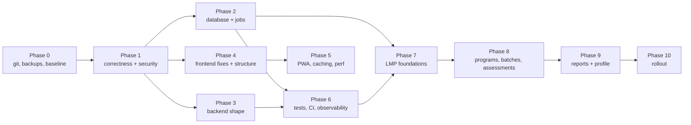

# Implementation roadmap — Sadhana Record and the Leaders Management Portal

> ## Status banner — corrected 18 October 2026
>
> **Phases 0–6 are LIVE.** Until today this file said in seven places that they were "committed, not deployed,
> migrations not applied remotely". That was true when each section was written on 13 October and nobody updated it
> when the tree shipped. It misled at least one session into telling the head that five phases of finished work
> were still waiting — so it is corrected here, with what was checked:
>
> - **Migrations applied.** `d1_migrations` holds 0050–0057, which includes phase 2.3's `0043_registry_phone_index`
>   and `0044_log_and_reopen_indexes`. `wrangler d1 migrations list sadhana --remote` reports "No migrations to apply".
> - **Code in the live tree.** Phase 6.1's `GATE_OF_RECORD` in `worker/tests/roles.test.mjs`; phase 2.4's
>   `GROUP BY a.login` at `worker/src/weeks.js:574`; phase 4.2's `frontend/src/lib/wallstore.js`.
> - **Confirmed in production, not inferred.** The live bundle (`index-GViiI2CY.js`, 76 chunks) was fetched and
>   searched: the 13 Oct audit fixes are in it — `getRandomValues` (the `requestId` fallback, FE-8) and
>   `sr.signupDraft` (the log-out sweep, FE-3).
>
> **Why it drifted.** Every deploy ships the tree as it stands on disk, so work becomes live without anyone editing
> the document that tracks it. A "not deployed" line is only true on the day it is written. Check
> `wrangler d1 migrations list` and the live bundle before repeating one.
>
> **Still genuinely open:** 6.5 rollback, 6.6 observability, 6.7 fixtures, 6.8 staging (all deliberately after the
> release); 0.3–0.5; 1.1, 3.8 and 4.6, which wait on the head's decisions. 5.5 Lighthouse is now unblocked.

**12 October 2026 · a plan, not a change.** Every task names its evidence in `FULL_AUDIT_2026-10-12.md` (finding
ids: F = backend, B = database, J = jobs, FE = frontend, T = tests/ops). Effort: S ≤ 1 day · M ≤ 1 week · L ≤ 3
weeks · XL more. Priority: P0 before the next release · P1 this month · P2 next quarter · P3 housekeeping.
Rollback for every code task is the previous Worker version / previous `dist/` (additive migrations never need
undoing). "LMP-pre" marks a prerequisite for the portal.

Sequence changed from the brief's default where dependencies demanded it: **version control and backups come
first** (nothing else is reviewable or recoverable without them), and the identity-link fix moves ahead of LMP.

## Phase 0 — Verified baseline (P0, S–M) · 0.1 done, 0.2 script done, 0.3–0.5 open

| # | Task | Problem / evidence | Solution | Alternatives | Risks | Tests | Done when |
|---|---|---|---|---|---|---|---|
| 0.1 | **DONE 13 Oct** — `sadhanaRecord/` under git (ADR 0007) | T F-01: one `phase0` commit, tree untracked, 25 GB incl. videos and an Android SDK | root `.gitignore` (node_modules, dist, .wrangler, .vite, `.env*.local`, `.dev.vars`, `loadtest/out`, `tools/video`, `tools/devices`, `tools/brand/esr`, screenshots, PDFs optional); un-link `docs/` from the revamp tree; one "baseline 12 Oct 2026" commit; decide LFS or exclusion for `public/darshan` (118 MB) | keep snapshots in folders (status quo) | committing a secret — check `.dev.vars`, `.env.production.local`, `loadtest/out/.pepper` are ignored first | `git status` clean of secrets | the tree is committed and pushed to a private remote |
| 0.2 | **SCRIPT DONE 13 Oct, first run pending (owner)** — automate the weekly D1 export | T F-03: runbook target folder does not exist; Time Travel is 7 days | `tools/ops/export.sh` (`wrangler d1 export … --output`) + a calendar reminder or launchd job; keep 8 weekly + monthly | rely on Sheets copy only | export reads every row (≈1 % of the daily budget) | drill: restore the file into `sadhana-load` | an export file dated this week exists |
| 0.3 | Record the current baseline | three Lighthouse scores for the same day, none stored (T F-17); load-test memo vs final run (T F-07) | commit `docs/perf/` with one Lighthouse JSON per page and the final `summary-profile.json`; note the 0813 vs 0740 build difference | — | — | — | `PERFORMANCE.md` cites stored files |
| 0.4 | Pin tooling | T F-06, F-22: Worker deploys use a global wrangler 4.149; no `.nvmrc` | `.nvmrc` (24), `worker/package-lock.json`, `npx wrangler` from `worker/node_modules` | — | — | `npm ci` on a clean clone | both deploys use the declared wrangler |

**0.4 — DONE 14 Oct 2026: `worker/package-lock.json` committed, wrangler pinned EXACTLY to 4.151.0 (the `^` had already drifted 4.147 → 4.149 → 4.151 between runs), and every wrangler call in both `package.json` files goes through `npx --no-install wrangler`, which fails loudly rather than silently fetching a different version. `.nvmrc` (24) was already there.**

| 0.5 | Check 0040 remotely | B: `0040_hobbies.sql` deleted; applied remotely? unverified | the owner runs `wrangler d1 migrations list sadhana --remote` and `PRAGMA table_info(profiles)`; reconcile `setup/schema.mjs:307-308` | — | — | — | disk and `d1_migrations` agree |

## Phase 1 — Critical correctness, security, data integrity (P1, M)

| # | Task | Evidence | Solution | Risks | Tests | Done when |
|---|---|---|---|---|---|---|
| 1.1 | **Reset flow: the server makes the password, shown once (decision 46, 14 Oct 2026)** | F1 (P1): the requester chose the password, so anyone knowing a phone number could queue one; no forced change afterwards | `auth.requestReset` stops taking `newPassword` (field dropped from the whitelist; the columns stay for history). `resets.approve` generates a temporary password, stores only its hash, sets `must_change_pw=1`, ends the account's sessions, and returns it **once** in the approval response — never stored in clear, never re-readable, no second endpoint to fetch it. The coordinator hands it over in person or on their own WhatsApp. Expires in 24 h (`temp_pw_expires_at`); an expired or lost one is recovered only by the devotee sending a **new** request. Also: a successful `auth.login` marks that login's PENDING resets `SUPERSEDED`; `requests.list` shows request time and count; Web Push tells the devotee a reset was approved **without the password** | changes approver UX; the coordinator must not close the dialog before handing it over, so the dialog says so and needs an explicit "I have shared it" to dismiss — confirmed by the head 14 Oct 2026: no backdrop tap, no Escape, no X; an accidental tap must not cost the devotee a second request | new `resets` cases in `phase1`/`security-roles`: no `newPassword` accepted; the approval response carries a password and the second approval of the same request does not; `must_change_pw` forced; login after expiry refused | a requester cannot choose a password; the coordinator sees it once; the devotee is forced to change it at first sign-in |

**1.1 — BUILT 14 Oct 2026 (decision 46, audit F1).** `auth.requestReset` takes the phone number only (`newPassword` stays whitelisted and is ignored, because an unknown field is a hard BAD_REQUEST and removing it would break every installed app; a test asserts the handler never reads it). `resets.approve` generates the password with `newTempPassword()` (28-symbol alphabet with 0/O, 1/l/I, 5/S, 8/B dropped, three groups of four, rejection-sampled; measured flat to 1.05x over 20,000 draws), stores only the hash, sets `must_change_pw`, ends the sessions, and returns it ONCE. Expiry 24 h and `pw_source` in migration **0048**; a successful `auth.login` supersedes pending requests. UI: `coord/TempPassword.svelte` with `dismiss`/`escapeCloses`/`closeButton` all false, so only "I have shared it" closes it; `screens/Forgot.svelte` collects no password. Tests: `worker/tests/reset-decision46.test.mjs` (44) and `frontend/tests/reset-decision46.test.js` (16), each protection verified by breaking it. **Not built: the push notice** telling the devotee a reset was approved — all push goes through scheduled jobs (`push_jobs`), and adding a job type is its own change; `mustChangePassword` already reaches the app, so the forced change works without it.

| 1.2 | **`devotees.delete` guard** | F2 (P2) | `managed(ctx, login, { allowPending: true, change: true })`; drop the inline check | — | a coordinator deleting a facilitator-linked devotee → FORBIDDEN | test green |
| 1.3 | **Replay cache reserve-first** | F5 (P2) | `INSERT OR IGNORE INTO replies (key, '', at)`; `changes=0` and empty body → `BUSY`; run; `UPDATE … SET body`; await it | a crashed handler leaves an empty reservation → add a 60 s expiry on empty bodies | concurrent same-`requestId` `announcements.comment` → one row | test green |
| 1.4 | **Mirror append idempotency** | J1 (P1) | commit each append table's `last_id` in its own batch right after its append (or write to a computed row from `sheetGrid`) | — | failure between two appends → no duplicate | test green; `sync-audit` shows no duplicates |
| 1.5 | **Outbound call budget + timeouts** | J2, J7, F8 | `AbortSignal.timeout` on Google (10 s) and push (5 s); run-scoped counter; skip the mirror when `used + planned > 45`; `mirror_lock` row | measure first on a Sunday evening in Logs | scheduled-run matrix (`TESTING.md` §5 13) | no "Too many subrequests" in a week of logs |
| 1.6 | **Master-reset hash** | J3/F8 (P2) | store `HMAC(PW_PEPPER, pw)`; exclude `master_reset_applied` in `LOG_WHEN` | — | `setup.test.mjs` | the Rules sheet no longer carries the hash |
| 1.7 | **Deadline catch-up** | J4/F28 (P2) | loop `due` from the oldest week after `deadline_done` whose deadline passed, bounded by `tracking_from`, one week per run | — | two-week gap test | test green |
| 1.8 | **Attendance notices > 35 phones** | J5 (P2) | limit rows to ~15 a run or mark only fully delivered logins | — | notices test | test green |
| 1.9 | **Erase completeness** | B3 (P2) | scrub `attendance.changed_by` for own marks; delete `app_ids` rows for the login; data-fix migration for existing `deleted-%` rows | — | `account-delete` asserts no phone anywhere incl. `changed_by`, `app_ids` | test green |
| 1.10 | **`person_names` duplicates** | B1 (P2) | `WHERE NOT EXISTS` or `UNIQUE(person_id, name)` after a de-dup data migration | — | profile save twice → one row | test green |
| 1.11 | **Profile address parts** | FE-1 (P2) | carry `house/street/landmark` through `fromServer`, `OWNS.address`, `cleanAddress` | — | client test with a comma in the house | saved parts unchanged after an unrelated edit |
| 1.12 | **One name rule** | FE-2/F17 (P2) | `shared/name.js` with `/^\p{L}[\p{L}\p{M} .'\-]{1,59}$/u`, imported by both sides; also `facilitators.add` | existing ASCII-only data unaffected | parity test | IAST and "A. Kumar" both accepted everywhere |
| 1.13 | **Log-out hygiene** | FE-3 (P2) | `endHere()` deletes `photo:`, `ann:`, `journals:` prefixes and `sr.rules.*`, `sr.book.*`, `sr.signupDraft` | — | `deletion.test.js` extended | test green |
| 1.14 | **`randomUUID` fallback** | FE-8 | `crypto.randomUUID?.() ?? v4()` | — | unit | — |
| 1.15 | Small P3 defects in one batch | F6 (audit args), F11, F14, F15, F18, F19, F22, FE-4, FE-5, FE-6, FE-9, J10, J12 | as listed in the audit | — | per item | — |
| 1.16 | Decisions needed from management (see §18 of the audit) | F3 `hasAccount`, F12 lockout order, F31 coordinator names in `meta.get`, F10 past-week policy | implement the chosen answers | — | — | — |

## Phase 2 — Database access, query efficiency, migration safety (P1–P2, M)

| # | Task | Evidence | Solution | Done when |
|---|---|---|---|---|
| 2.1 | `stats.all` summary (LMP-pre: frees CPU headroom) | T F-08 measured 55–83 ms | a per-batch summary row refreshed in the minutely run; `stats.all` reads it | ≤ 15 ms CPU in the load Worker |
| 2.2 | `stats.batch`, `devotees.list`, `members.list` | 2–13 k rows per call | same summary rows; count only on page 1; bound `q` | ≤ 3,000 rows |
| 2.3 | Indexes | B10, §6 | `registry(phone)`, `person_names(person_id, name)` UNIQUE, `reopens(week_id, state)`, `audit_log(who)`, `(target)`, `(at)`; drop dead indexes | `audit:sql` 0 new; `GROWING` list extended |
| 2.4 | Deadline overlap safety | B5 | `GROUP BY login` in the pending query; a guard test with two open memberships | test green |
| 2.5 | Timestamp hygiene | B9 | `isoIst()` in `registry.js:102,108`, `mirror.js`; a data migration for existing UTC rows | one format per column |
| 2.6 | Trigger hygiene | B14, P-9, J12 | `LOG_WHEN` guards for `failed_tries`, `last_login_at`, `registry_refresh`, `registry_sig`, `master_reset_applied`; fix `view_att_upd` columns (B16) | fewer Sheets writes per login |
| 2.7 | Registry safety | J8 | header assertion from `A1:Q1`; refuse > 10 % deletions; write the refusal to `settings.registry_refresh`; rate-limit the in-request refresh (F23/J13) | test with a shifted tab |
| 2.8 | Migration procedure | B §8 | `0042+`, `IF NOT EXISTS` / `DROP TRIGGER IF EXISTS`, Sheets tab first, bookmark before `migrate:remote`, data fixes in their own files, mid-point test | documented in `OPERATIONS.md`; test exists |
| 2.9 | `mirror_log` AUTOINCREMENT | J10 | new migration | — |
| 2.10 | Dead schema | B §1i | document as unused now; drop in a later rebuild-free way (never `DROP COLUMN` while code may read) | `DATA_DICTIONARY.md` marks them |

## Phase 3 — Backend modularity and API consistency (P2, M)

| # | Task | Evidence | Solution |
|---|---|---|---|
| 3.1 | Split `coord.js` (ADR 0008) | F27 | `board.js`, `attendance.js`, `devotees.js`, `profile.js`, `oversight.js`; `jpegSize` → `util.js`; same SQL |
| 3.2 | Shared helpers | F§8 | one `batchNames`, one `COLS`, one devotee-lookup helper with one error policy |
| 3.3 | Error-code registry | F26 | `codes.js`; generate the table in `API_REFERENCE.md` from it; the client's `errorMessage` imports the list |
| 3.4 | `managed()` order | F4 | `requireBatch` first; collapse to `NOT_FOUND` for non-staff |
| 3.5 | Policy: past weeks on behalf | F10 | one rule for `week.get`/`history.list` and `devotees.week` (management decision) |
| 3.6 | `profile.update` in one batch; `requests.approve` + app ID in one batch | F16, F20 | collect statements |
| 3.7 | `mirror_status` setting + `mirrorBacklog` wired or deleted | J9 | pattern of `registry_refresh` |
| 3.8 | `identity` link at approval (LMP-pre) | B7/F29 | `syncPerson` at `requests.approve` when `auth.lookup` matched; backfill tool for existing accounts; record `KT/GP/JN/SR` ids in `person_identifiers` as `superseded` |
| 3.9 | Merge path for persons (LMP-pre) | B8 | `identity.merge` (master): `merged_into`, identifiers `retired`, phones re-pointed with `INSERT … ON CONFLICT DO UPDATE` |
| 3.10 | `auth.logoutAll` | F21 | `endSessions` keeping the current hash |

## Phase 4 — Frontend maintainability and UX (P2, M)

| # | Task | Evidence | Solution |
|---|---|---|---|
| 4.1 | `routes.js` + consistency test | FE-20 | one table consumed by App, Shell, nav, area, prefetch |
| 4.2 | Split `Wall.svelte`, `Ids.svelte`; extract Day's sheets and the leave guard | FE §9 | `devotee/wall/`, `master/ids/`, `lib/leaveguard.svelte.js`, `ui/DayChips.svelte` |
| 4.3 | Timers, `$derived`, `sr.meta` shape, IndexedDB failure message | FE-10, 11, 6, 12 | as listed |
| 4.4 | Touch targets ≥ 44 px in Wall menus and comment Send | FE §6 | `btn-sm` → 44 px hit area |
| 4.5 | `announcements.get {id}` for old shared posts; audience filter in SQL | FE-17, F9 | new read action; push the predicate into the query |
| 4.6 | Notification prompt timing (product decision) | FE-14 | ask after the first saved day |
| 4.7 | Revamp plan of record (`docs/revamp/`) | — | continue as planned; nothing in this audit contradicts it |

## Phase 5 — PWA, caching, runtime performance (P2, S–M)

| # | Task | Evidence | Solution |
|---|---|---|---|
| 5.1 | Precache budget enforced | T F-09 | check in `size.mjs`: ≤ 800 KB, no `staff-*`/`darshan/`/`icons/` |
| 5.2 | Staff-only code out of the devotee precache | FE-15 | widen the `staff-` test to `ui/WeekRead`, `ui/Export*`, `master/Reopens` and their CSS |
| 5.3 | `UPGRADE_REQUIRED` through the busy-aware reload | FE-9 | reuse `sw.js`'s path |
| 5.4 | Report month view | FE-7 | per-day percents in `history.list` |
| 5.5 | Lighthouse weekly, stored | T F-17 | `docs/perf/lh-<date>-<page>.json` |
| 5.6 | PBKDF2 iterations measured and raised | F13 | measure on the load Worker; set `pbkdf2_iterations` |

## Phase 6 — Testing, CI, observability, operations (P1–P2, M)

| # | Task | Evidence | Solution |
|---|---|---|---|
| 6.1 | **Generated role + ownership matrices** | T F-04, AUTHORIZATION notes | `roles.test.mjs` from `ROUTES`; ownership table for `ANY`/`STAFF` |
| 6.2 | Never-called actions, replay race, two-week deadline, overlapping memberships, mirror append failure, notices > 35, scheduled-run matrix, migration mid-point | `TESTING.md` §5 | as listed |
| 6.3 | **CI**: fast job (< 2 min), nightly browser job against the built `dist/` with `_headers`, manual deploy gate | T F-02, F-12 | GitHub Actions or equivalent; `CHROME` from env; `registry-parity` skip |
| 6.4 | Browser checks: replace fixed sleeps; add `screenreader`/`space-audit` to the gate; fingerprint covers `tools/browser`, `wrangler.toml`, `scripts/` | T F-11, F-13, F-23 | — |
| 6.5 | Release: rollback step after a failed `wrangler deploy`; Worker deploy gate (`audit:sql` enforced by a script, not a rule) | T F-14, OPERATIONS §4 | `release.mjs` failure path; `worker/scripts/deploy.mjs` |

**6.5 — DONE 14 Oct 2026: `worker/scripts/deploy.mjs` is the Worker deploy gate — `audit:sql` first, refuses on failure (exit 1), `--skip-checks` demands a written reason (exit 2 without one), records the serving version and writes `docs/deploy-log.json`; `--dry-run` proven. `release.mjs` now reads the serving version BEFORE publishing (from `deployments list`, oldest-first, the 100 % version of the LAST entry — checked against the live Worker: `cc1ccc75`) and rolls back automatically if any post-deploy check fails, printing the manual command if the rollback also fails.**

| 6.6 | Observability: `mirror_status`, `reminder_status`; counts of `FORBIDDEN`/`UNAUTHENTICATED`/`STALE` per hour in `run_log` (sampled); a Cloudflare notification on Worker exceptions; monthly usage read scripted | T F-10, J9, J11 | — |

**6.6 — DONE 14 Oct 2026: `src/api.js` counts FORBIDDEN / UNAUTHENTICATED / STALE per hour, sampled 1 in 10 (a flood must not become a flood of writes, and 10 ms of CPU leaves no room for a row each time), in one `settings` row per code; migration 0047 keeps those rows out of the Sheets copy; `settings.get` returns a `refusals` block and the head's home shows "About N calls turned away this hour" at 100+, warning at 500+. Tests: `phase6-observability.test.mjs` (14) and `phase6-trigger-parity.test.mjs` (12), the second written because removing the exclusion from the generator left every suite green — the generator and the migrations had nothing comparing them.**

| 6.7 | Test fixtures: phones in the `60000000xx` range; harness `RETURNING` and D1 limits | T F-15, F-18 | — |

**6.7 — DONE 14 Oct 2026: `tools/test/phones.mjs` is both the sweep and the guard. 718 occurrences of 129 dialable numbers rewritten into the reserved range across 44 files, keeping the last two digits so cross-references still read; mapping kept in `tools/test/phones.map.json`. Wired into `audit:sql` and CI, and proven to fail (exit 1) on a planted number. Four suites broke on the rewrite and each was a real find: a `+91 98111 00298` input the regex could not see, a `6000000310|rl` alias, a `09876543210` login, a `q: '100031'` substring search, a `98111 00032` confirm, and six logins built by string concatenation in `mirror.test.mjs`.**

| 6.8 | Staging: a `--env staging` Worker + D1 with crons on and no Google/VAPID keys, or a documented decision not to | T F-19 | — |

**6.8 — DONE 14 Oct 2026: `[env.staging]` in `wrangler.toml` — own database, **crons on**, no Google or VAPID secrets, `SHEETS_COPY=off`, so the scheduled work (the every-minute copy, the Monday deadline, retention) can be rehearsed where it cannot reach a person or a sheet. The load Worker has `crons = []` on purpose, which is why it was never a substitute. Config validated with `--dry-run`; the live config re-checked unchanged. Setup commands in `docs/OPERATIONS.md` §1; needs the owner to create the D1 database and set a distinct `PW_PEPPER`.**

## Phase 7 — LMP foundations (P2, M) — after 1, 2.1–2.3, 3.8–3.9, 6.1

| # | Task | Solution |
|---|---|---|
| 7.1 | Decisions from management recorded (see §18 of the audit) | ADR 0009 |
| 7.2 | Tables: `programs`, `program_versions`, `criteria`, `training_batches`, `enrollments` (person_id), `assessments`, `assessment_revisions`, `final_reports`, `program_grants` — with constraints, IST timestamps, mirror triggers, tabs built first | migration `0042+`, Sheets tabs, `mirrorkeys.js`, `PRIORITY` last, a 4th cron for the LMP copy |
| 7.3 | `program_grants` check beside the scopes; `program.*` actions in `ROUTES`; role matrix covers them | `api.js`, a `program.js` module |
| 7.4 | Scoring evaluator: fixed named methods (`weighted_sum` first), configurable weights, maxima, rounding, bands | `shared/program-scoring.js` (shared with the app for live totals) |
| 7.5 | **No separate sign-up, and training hangs off a batch membership (decision 47).** There is NO LMS registration and no second account: enrolment is a coordinator picking someone who is already in the app. The LMS adds a row about an existing person and never creates one — `enrollments` takes a `person_id` that must already exist. `enrollments` requires an ACTIVE `memberships` row for that person at enrolment: there is no MTP member who is not also a batch devotee. The enrolment screen offers only people who have one; leaving the batch ends the enrolment with it. And the other direction: NOTHING in the LMP may write to `memberships` — finishing a programme never moves anyone between batches, never changes a score card, class day or weekly form. Enforced in `program.js`, not only in the UI, and tested both ways | a guard beside the `program_grants` check; tests: enrol someone with no membership → refused; finish a programme → membership unchanged |
| 7.6 | **VL-2 and VL-3 as batch levels.** `batches.level` is an enum of SPS/DPS/BSS/BVS today, so both need adding, with their own score cards: VL-2 records **attendance only**, VL-3 **attendance and chanting**. The weekly form, scoring and the Sheets cards all branch on the card, which currently has two variants | migration + `score_card` enum + `shared/scoring.js`; a form test per level |

## Phase 8 — Programs, batches, enrolment, assessments, and PROMOTION (P2, L)

**Promotion belongs here (14 Oct 2026).** The app cannot promote anyone today: the "Promotion eligible" list the
head sees lives in the facilitator dashboard, a different project, and it only SHOWS who qualifies — nothing moves
them. Promotion is the same shape as enrolment and assessment (a person, criteria, a decision, a record), so it is
built with them rather than twice.

What it is, and what it is not: promotion moves a person's **sadhana batch** (VL-3 → SPS and so on) and is decided
on attendance and chanting. Training (MTP/ETP/iLS) moves nothing — decision 47. They share the machinery and must
not share the outcome.

| # | Task | Note |
|---|---|---|
| 8.1 | `promotion.candidates` — who meets the criteria for a batch and window, server-side, from attendance and chanting | the dashboard's rule, moved into the app and tested against it |
| 8.2 | `promotion.decide` — records the decision, writes the new `memberships` row, closes the old, audits it. Idempotent, head or coordinator per the scope rules | the ONLY place a promotion writes `memberships` |
| 8.3 | A promotion screen under the batch board: who qualifies, why, decide one or many, with an undo window | browser checks at 320 and 1024 px |
| 8.4 | Promotion history on the person: what they were promoted from and to, when, by whom | reads the audit, no new table if the audit carries it |

Admin screens under `#/lmp/…` as `lmp-*` chunks; programs and versions (publish freezes); batches freeze the
version id; enrolment picks existing persons (human-confirmed link, never by phone); assessment entry per batch by
granted evaluators; every change writes a revision and an audit row; Sheets copy per table; browser checks for the
new screens at 320 and 1024 px.

## Phase 9 — Final reports and profile integration (P2, M)

Finalise (program.admin): compute with the frozen version, store `computed_from`, reopen writes a new row and keeps
the old; `program.summaryFor` (few rows) and `program.historyFor` (on demand); the profile accordion only when the
summary is non-empty; permissions per viewer as decided; tests from `TESTING.md` §5 (LMP).

## Phase 10 — Rollout and continuous optimisation (P2)

Release through the gate with a new phase number; `audit:sql` 0 new; precache and startup budgets hold; Sheets
`sync-audit` clean; a load profile on the load Worker with the LMP actions; the monthly usage read; management
sign-off on the first finalised batch.

## Dependencies and risks

| Risk | Phase | Mitigation |
|---|---|---|
| Source loss before 0.1 | 0 | commit today |
| Reset-flow abuse before 1.1 | 1 | coordinators told to check request time and call the person |
| Duplicate rows already in the Sheets append tabs | 1.4 | `sync-audit` to count; one-off clean-up by the owner |
| `stats.all` exceeding the CPU cap at 3,000+ devotees | 2.1 | before the next batch intake |
| Identity backfill linking the wrong person | 3.8 | human review list; `duplicate_reviews` pattern |
| LMP tables flooding the Sheets copy | 7.2 | own cron; `PRIORITY` last; keyed, not append |
| Free-plan limits (requests, rows, 5 crons) | all | the four §9b numbers read monthly; upgrade at 70 % |

## Essential vs optional

**Essential:** 0.1, 0.2, 1.1–1.13, 2.1–2.4, 2.8, 3.8–3.9, 6.1–6.3, 7–9.
**Optional:** 0.3–0.5, 1.14–1.15, 2.5–2.10, 3.1–3.7, 3.10, 4.*, 5.*, 6.4–6.8.

## Recommended first implementation phase (narrow)

1. Commit the tree (0.1) and run the first export (0.2) — one afternoon, zero code.
2. One code release, phase 18: 1.2 `devotees.delete` guard, 1.6 master-reset hash, 1.8 notices, 1.11 address parts,
   1.12 shared name rule, 1.13 log-out hygiene, 1.14 UUID fallback, plus the generated role matrix (6.1) so the
   release proves no regression. All S, all with a test, all additive. Then 1.1 (reset provenance) as its own
   release because it changes approver UX.

## Status update — 13 October 2026

Session prompt-75 verified the five doc corrections independently and reports it has **implemented FE-1, FE-2,
FE-3, FE-4, FE-5, FE-6, FE-8, FE-11, FE-12 and FE-15 in the live tree** (`sadhanaRecord/frontend`), with 322
client tests passing (one new test, shown to fail without the fix). **Not committed (no git yet), not released, not
yet copied into `sadhanaRecord-revamp/`.** These were made outside this audit's "no implementation" rule; the user
decides whether they ship in release phase 18 as planned in §"Recommended first implementation phase".

Three corrections to the task text above, learned from that implementation:
- **1.12 (name rule):** the client function is `isName` (`lib/validate.js:15`); neither old rule was a superset of
  the other (client rejected O'Brien, server rejected कृष्ण). The shared rule lives in `shared/names.js` and must
  include `\p{M}` as well as `\p{L}`, or Devanagari names fail.
- **1.13 (log-out hygiene):** **not** a prefix sweep — that deletes other logins' keys and the existing
  `deletion.test.js` catches it. The fix is to call the existing `forgetLogin()` (`lib/forget.js`) from
  `session.endHere()`, which until now only account deletion called.
- **5.2 (staff code out of the precache):** `chunkFileNames` does not name CSS; `assetFileNames` is needed too.
  Measured effect: 69 KB → 29 KB of staff-only precache.

Remaining from the first-phase list: 1.2 (`devotees.delete` guard), 1.6 (master-reset hash), 1.8 (notices),
1.14 confirmed done (FE-8), 6.1 (role matrix), the `registry(phone)` index, and 0.1/0.2 (git, export) — still open.
For F1 (reset flow) prompt-75 recommends the structural fix: do not accept a password from the requester at all;
approval generates a temporary one with forced change, as `coordinators.resetPassword` already does. That is a
better answer than the mitigations in 1.1 and should be the option put to management (decision 1 in the audit §18).

## Phase 0 progress — 13 October 2026

| Task | Status |
|---|---|
| 0.1 git | **done** — own repo in `sadhanaRecord/`, baseline `c44db31` (1,391 files, 133 MB), `.gitignore` at the app root; paintings in, PDFs and 271 MB of device recordings out; no secrets staged (verified). Details in `OPERATIONS.md` §"Phase 0 applied" |
| 0.2 backups | **script done** (`tools/ops/export.sh`, commit `e8d891a`), retention dry-tested; **the first run needs the account owner** — `sh sadhanaRecord/tools/ops/export.sh` |
| 0.3 baseline figures | open — needs one Lighthouse run stored under `docs/perf/` and the final `summary-profile.json` committed |
| 0.4 pin tooling | open — `.nvmrc`, `worker/package-lock.json`, so both deploys use the declared wrangler instead of the global 4.149 |
| 0.5 check 0040 remotely | open — **owner only**: `npx wrangler d1 migrations list sadhana --remote` and `PRAGMA table_info(profiles)` |

Tests on the committed tree: worker 30 suites / 2,080 assertions, frontend 24 files / **322** tests (the extra one
is the peer session's log-out hygiene test). Nothing deployed.

## Phase 1 progress — 13 October 2026

Done in the tree (committed; **live since 18 Oct 2026** — see the banner at the top):

| Task | Status | Commit |
|---|---|---|
| 1.2 `devotees.delete` facilitator guard (F2) | **done** — `managed({ change: true })` + `facilitator_name` in the head's inline guard | `ba649ef` |
| 1.6 master-reset marker (J3) | **done** — `crypto.markOf()` keyed with `PW_PEPPER`; migration **0042** also keeps `master_reset_applied`, `registry_refresh`, `registry_sig` out of the Sheets copy (J12) | `ba649ef` |
| 1.8 attendance notices (J5) | **done** — the run cuts at a person boundary and marks only fully pushed people | `ba649ef` |
| 1.12 one name rule (FE-2 / F17) | **done** — `shared/names.js` (peer session) + `facilitators.add` now uses it, the third copy is gone | baseline + `ba649ef` |
| 2.3 `registry(phone)` index (B10) | **done** — migration **0043**; EXPLAIN went from an AUTOMATIC per-call index and a full SCAN to `registry_phone` | `ba649ef` |
| 1.11 address parts (FE-1), 1.13 log-out hygiene (FE-3), 1.14 UUID fallback (FE-8), FE-4/5/6/11/12/15 | **done** by the peer session, in the baseline commit | `c44db31` |

Checks after the work: worker **31 suites / 2,096 assertions**; `audit:sql` **0 new scans, 0 new mass writes**;
client **24 files / 322 tests**. New suite `worker/tests/phase1-fixes.test.mjs` (16 assertions), each verified to
fail with its fix reverted.

**Correction to task 1.6 as written above:** the plan said "store `HMAC(PW_PEPPER, pw)`". What matters more is the
*other* half — the key must also leave the mirror, which needs a trigger migration, because `LOG_WHEN` in
`mirrorkeys.js` only describes the triggers; the SQL in the database is what runs. 0042 does both. Also: do not
blank the marker row. `applyMasterReset()` treats an empty value as "not applied yet", so blanking it would reset
the head's password again on the next minute's run if the secret is still set.

**Still open in phase 1:** 1.1 (reset-request provenance — needs the management answer to decision 1, and the peer's
stronger option: approval generates the temporary password, the requester supplies none), 1.3 (replay-cache
reserve-first), 1.4 (mirror append idempotency), 1.5 (outbound budget + timeouts, after a Sunday of log
measurement), 1.7 (deadline catch-up), 1.9 (erase completeness: `attendance.changed_by`, `app_ids`), 1.10
(`person_names` duplicates), 1.15 (the P3 batch), 1.16 (the four management decisions).

**Before this can be released:** migrations 0042 and 0043 applied remotely (owner), the browser suites green, the
phase number bumped in `frontend/release-phase.json`, and the changes copied into `sadhanaRecord-revamp/` the same
day (two-trees rule).

## Phase 2 progress — 13 October 2026

Committed in both trees; **live since 18 Oct 2026** (banner at the top). One full test pass was planned after
phase 6, per the user's instruction, so phases 2–6 accumulate before release.

| Task | Status | What was done |
|---|---|---|
| 2.1 `stats.all` | **done** `c61f10e` | counted in SQL; 85 statements → 15, rows at 5,000 devotees 16,318 → 148 (flat, no longer grows with devotees). Output proven identical to the old implementation on a seed covering every board status |
| 2.2 staff list actions | **partly done** `c61f10e` | `statsBatch`'s trend reads membership ranges instead of one row per devotee, and its week queries are bounded at both ends. `stats.batch` and `devotees.list` still grow with the batch **by design** — both screens list every devotee; recorded, not "fixed" |
| 2.3 indexes | **done** `a6d9d22` + `7b79259` | migrations 0043 (`registry(phone)`) and 0044 (`audit_log` who/target/at, `reopens(week_id,state)`, `sessions(last_used_at)`). Every one chosen from an EXPLAIN that said SCAN; the audit's approved-scan list fell from 24 to 20 |
| 2.4 deadline overlap | **done** `7b79259` | `GROUP BY a.login`. Two open memberships used to abort the whole atomic run every minute, for ever, so nobody's week closed |
| 2.5 timestamps | **done** `9791fd8` | `isoIst()` in `registry.js` and `mirror.js`; migration 0045 converts stored UTC rows, checked on samples for same-instant, idempotency and the dropped-millisecond difference |
| 2.6 trigger hygiene | **done** `73cdf32` | migration 0046 extends the attendance → view trigger to `leader_mark`/`master_mark`. The suggested `accounts` churn suppression was **measured and rejected**: those columns really are copied to the Accounts tab, and the cost is 0.66 % of weekly copy capacity |
| 2.7 registry safety | **done** `73cdf32` | header check on the six columns actually read, and a refusal when a refresh would delete more than 10 % and more than 25 IDs. Both leave the copy untouched and explain themselves |
| 2.8 migration procedure | **done** `9b43ecc` | written up in `OPERATIONS.md` §5, and `tests/phase2-migrations.test.mjs` applies the files in halves with real rows at three split points, proving a stepped database matches a fresh one. Proven to catch an unsafe migration |
| 2.9 `mirror_log` ids | **done** `9b43ecc` | `erase.js` appends a non-mirrored placeholder before deleting, so the log never empties and ids keep rising. `AUTOINCREMENT` was rejected: it needs a table rebuild. Keeping the last real entry was rejected too — a test showed it holds the deleted person's phone |
| 2.10 dead schema | **done** `9b43ecc` | recorded in `DATA_DICTIONARY.md` with why nothing is dropped |

**Checks across both trees:** worker **35 suites / 2,166 assertions**, client 24 files / 322 tests,
`audit:sql` **0 new scans, 0 new mass writes**. New migrations awaiting remote application: **0042–0046**.

**Two findings closed by measurement rather than code**, worth keeping in mind when reading the audit:
`stats.batch`/`devotees.list` row counts (inherent to screens that list people) and the `accounts` mirror churn.

## Phase 3 progress — 13 October 2026

Committed in both trees; **live since 18 Oct 2026** (banner at the top). The full test pass followed phase 6, per your instruction.

| Task | Status | What was done |
|---|---|---|
| 3.1 split `coord.js` | **done** `e860871` | 967 lines → seven files, largest 230. Proven a move, not a rewrite: all 36 function bodies are byte-identical after whitespace. `coord.js` re-exports, so no caller changed |
| 3.2 shared helpers | **done** `9788706` | `COLS` had four definitions, now one in `weeks.js`; the JPEG check had two copies, now `image.js` — which also ends `announcements.js` importing from a coordinator module |
| 3.3 error-code registry | **done** `1e9f549` | `codes.js` describes all 22 codes; `tools/docs/codes.mjs` generates the table in `API_REFERENCE.md` (`--check` for the gate); `tests/codes.test.mjs` fails on drift either way |
| 3.4 `managed()` order | **done** `979d405` | the existence oracle through `photo.get` / `photo.remove` is closed: seven probes now give one identical code **and message** |
| 3.5 past weeks | **done** `5d9ece7` | **your decision: head only.** `week.get` and `history.list` now match `devotees.week`. One softening: the week the boards are ON stays readable past its deadline, or a coordinator would lose the week they were supervising mid-job |
| 3.6 `profile.update` atomic | **done** `4ba901e` | four batches → one. The test had to be rewritten twice before it could actually tell the versions apart |
| 3.7 `mirror_status` | **done** `1083c5d` | `mirrorBacklog()` had no caller; the copy now writes a durable status the head's Settings shows. This is what was missing when the 7–10 Oct stall went unnoticed for three days |
| 3.8 identity link at approval | **deferred to phase 7, your decision** | sign-up and approval still write no identity table, and the comment in `auth.js` still overstates it. Phase 7 carries this with the portal |
| 3.9 merge path | **done** `154d381` | `identity.merge`, head only, audited. An old IYF ID keeps resolving across a merge, which is what migration 0038 promised. Also fixed F6: four identity `audit()` calls were shifting their arguments |
| 3.10 `auth.logoutAll` | **done** `1083c5d` | sign out every device. Found a real gap in `frontend/tests/writes.test.js` on the way: its regex missed any route with `mustChangeOk`, so a new write action could ship without a request id |

**Checks:** worker **39 suites / 2,249 assertions**, client 322, `audit:sql` 0 new scans and 0 new mass writes.
API now **123 actions** (`auth.logoutAll`, `identity.merge` added), recorded in `API_REFERENCE.md`.

**Two tests fixed because they were not testing what they claimed:** the write-contract regex above, and my own
first attempt at the atomicity test, which passed against the old code until it targeted the right failure.

## Phase 4 progress — 13 October 2026

Committed in both trees; **live since 18 Oct 2026** (banner at the top). The one full test pass followed phase 6.

| Task | Status | What was done |
|---|---|---|
| **Sheets copy paused** (your instruction, not in the original plan) | **done** `b0ddaf5` | the four outbound writers are off behind `SHEETS_COPY`; the inbound dashboard read stays on. Paused, not deleted: changes still queue, the position marker does not move, `mirror_status` says so |
| 4.1 `routes.js` | **done** `9074d9b` | five hand-kept lists became one table. The test was written first and compares it against what the old lists produced |
| 4.2 Wall split | **partly done** `a0af9fd` | the cache patching is now `lib/wallstore.js` with its own tests. The markup split (compose / feed / comments / report) is **open**: it is presentation, and the cache shape is where the bugs were |
| 4.3 leave guard, timers, `$derived`, `sr.meta`, IndexedDB | **done** `350c22d` + peer's baseline | `lib/leaveguard.svelte.js`; the other four were already fixed by the peer session |
| 4.4 touch targets | **done** `ba286bb` | 44 px tap area on touch devices without changing the design |
| 4.5 old shared links + audience filter | **done** `ba286bb` | `announcements.get`, and the audience test moved into the query |
| 4.6 notification prompt timing | **open, needs your decision** | the prompt still fires on the first tap, signed out. A product choice, not a defect |
| 4.7 revamp plan of record | unchanged | nothing in this audit contradicts `docs/revamp/` |

**Checks:** worker **41 suites / 2,278 assertions**, client **352 tests** (30 new this phase), `audit:sql` 0 new
scans, startup JS 55.64 KB and CSS 13.69 KB both inside budget, precache 118 entries / 692 KB.

**Three tests this phase were written because the suite stayed green while the code was broken:** the wall store
(the pin path called two deleted helpers), the leave guard (one screen had the call without the import), and the
wall limit (a devotee's wall came back empty past 200 posts). Each was verified to fail against the broken state.

## Phase 5 progress — 13 October 2026

Committed in both trees; **live since 18 Oct 2026** (banner at the top). The one full test pass followed phase 6.

| Task | Status | What was done |
|---|---|---|
| 5.1 precache budget | **done** `37dbe7e` | `npm run size` measures it (800 KB budget) and fails if a staff-only file or a painting is in it, naming the file and the fix |
| 5.2 staff code out of the precache | **done** `37dbe7e` | the rule is derived from the source folder, not a hand-kept name list — which is why the earlier fix missed five files. 118 entries / 692.9 KB → **111 / 645.7 KB**, none staff-only |
| 5.3 `UPGRADE_REQUIRED` reload | **done** `29c676a` | shares the service worker's busy-aware reload, so an upgrade no longer discards a half-filled day form or double-reloads |
| 5.4 Report month | **done** `29c676a` | `history.list` carries `dayPct`; a month costs one request instead of up to seven. The SQL was checked against `shared/scoring.js` on the same week, which caught two errors in it |
| 5.5 Lighthouse stored | **open — now unblocked** | it measures the **live** app. It was blocked while phases 1–5 sat undeployed; they went live on 18 Oct, so a run now scores the right build |
| 5.6 PBKDF2 iterations | **measured** `tools/perf/pbkdf2.mjs` | 10,000 → 0.78 ms, 50,000 → 3.54 ms, 100,000 → 7.08 ms per hash. **Recommend 50,000**, a settings change not a deploy. Re-measure on the load Worker first; see `PERFORMANCE.md` |

**Checks:** worker **41 suites / 2,278 assertions**, client **356 tests**, `audit:sql` 0 new scans, startup JS
55.64 KB and CSS 13.73 KB within budget, precache 111 entries / 645.7 KB.

**One test deliberately not kept.** A client test driving the mock through the API client could not see a seeded
week — the mock the test imports is a different module instance from the one `api.js` loads — so it passed whether
or not `dayPct` existed. That is the third time this programme has met a test that proves nothing, so instead of
leaving it there, the numbers are proven server-side and the screen's own code path is asserted. Verified to fail
if the per-week fetch loop returns.

## Phase 6 progress — 13 October 2026

Committed in both trees; **live since 18 Oct 2026** (banner at the top). Work stopped here at your instruction; the full test pass and the release
are the next session's work (see `TESTING.md` and the memory note).

| Task | Status | What was done |
|---|---|---|
| 6.1 generated role matrix | **done** `87d3ab3` | every action × every scope, read from `ROUTES`: **726 cells**. The audit's highest-value gap (F-04) is closed |
| 6.2 ownership matrix | **done** `80c5a79` | 23 actions called by the wrong coordinator and the right one; the head is never narrowed; every STAFF action is either checked or recorded as having nothing to narrow |
| 6.3 CI | **done** `bd24d09` | `fast` on every push (under 2 min), `browser` nightly; deploying stays manual and the file says why |
| 6.4 browser checks portable | **done** `bd24d09` | all four tools honour `$CHROME`; the parity test skips without the sibling project; `.nvmrc` and `engines` |
| 6.5 release rollback, 6.6 observability, 6.7 fixtures, 6.8 staging | **open** | for after the release |

**The thing worth remembering from this phase.** My first role matrix passed 726 green cells and proved **nothing**:
it computed "who should be allowed" from `ROUTES[action].roles`, the very thing under test, so weakening
`settings.update` from MASTER to STAFF moved the expectation with it. I only found out by sabotaging the gate and
watching the test stay green. The expectation is now `GATE_OF_RECORD`, an independent list of all 125 intended
gates, and both sabotages fail two assertions each.

That is the fourth test in this programme that proved nothing until it was checked against a broken state. It is
now the habit: write the test, break the code, confirm the test notices.

**Checks:** worker **43 suites / 2,337 assertions**, client **356 tests**, `audit:sql` 0 new scans and 0 new mass
writes, startup JS 55.64 KB and CSS 13.73 KB, precache 111 entries / 645.7 KB. Migrations **0042–0046** still
await remote application.
