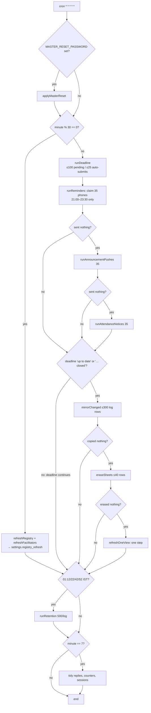

# Integrations and scheduled jobs — Sadhana Record

**12 October 2026 · verified in `worker/src/index.js`, `mirror.js`, `mirrorkeys.js`, `views.js`, `erase.js`,
`registry.js`, `push.js`, `retention.js`, `google.js`, `setup.js`, `weeks.js` (`runDeadline`), the migrations and
the six job test suites.** Line numbers are from this tree. Findings are classified; nothing was run against Google
or Cloudflare to write this.

## 1. The three crons and the minutely run

| Cron (`worker/wrangler.toml:34`) | IST | Runs |
|---|---|---|
| `* * * * *` | all day | the full run below |
| `0-59 14-17 * * *`, `0-59 15-17 * * *` (UTC) | 19:30–23:29, 20:30–23:29 | **reminders only** (`index.js:28,51-55`) — two extra senders, each claiming its own 35 phones |

1,860 cron invocations a day (not the 1,440 in `docs/load-test-report.md:75`).

Every step has its own `try/catch`; a failure is logged to the console and the run continues (`index.js:56-110`).
Steps are sequential within one invocation. **Cloudflare does not serialise cron invocations**: a run that takes over
60 s overlaps the next minute's run (see finding J7).

Budgets per run: 35 pushes (`push.js:21`), 300 `mirror_log` entries (`mirror.js:132`), 40 erase rows
(`erase.js:105`), one view step (`views.js:30`), 100 pending devotees / 25 auto-submits in the deadline
(`weeks.js:405`). The free plan's limits are 10 ms CPU and 50 outbound requests per invocation; **neither is enforced
in code** — the arithmetic is in §6.

## 2. Google Sheets — the copy

**Auth.** Service-account JWT (RS256 over the `GOOGLE_SA_KEY` JSON) exchanged for a bearer token, cached per isolate
until 60 s before expiry (`google.js:15-27`). No retry, no timeout, no `AbortSignal` on any call (`google.js:21,30`).
A non-2xx throws `Sheets <status>` and the rows wait for the next minute (an effective 60 s fixed backoff; tested in
`tests/mirror.test.mjs:88-93`).

**Files** (`setup/files.json`): store sheets `access`, `profiles`, `rules`, `drafts`, `submissions2026`; four view
sheets `viewSPS/DPS/BSS/BVS`. Read-only inbound: the facilitator dashboard's `Devotees!A2:Q` and `NameMap!A2:C`
(`registry.js:69,123`).

**Mechanism** (`mirror.js`, migrations 0018/0022/0024/0027/0039):
1. Four triggers per copied table (insert/update/key-change/delete) append `(tbl, k1, k2)` to `mirror_log`.
   Exclusions live in `mirrorkeys.js` `LOG_WHEN` (today only `reminder_cursor`/`reminder_day` in `settings`).
2. `mirrorChanged` reads ≤300 entries after `mirror_state.last_id` (with recovery from SQLite rowid reuse,
   `mirror.js:224-227`, the cause of the 7–10 Oct stall), groups keys per table, re-reads each row's **current** state
   (45 keys a query) and writes it to its remembered row (`mirror_rows`), a freed row (`mirror_free`) or the end.
3. Tables in `build` mode are copied whole; `append` tables (`submissions`, `audit_log`, `run_log`) are appended
   from their own `last_id`; the six reference lists are rewritten when `dirty` (`db.js:37-41`).
4. Per file: `sheetGrid` → `growTabs` if needed → one `values:batchUpdate` → one `batchClear` → one `append` per
   append table → **then** the D1 bookkeeping batch (`mirror.js:283-295`). The log position advances only when every
   file succeeded (`mirror.js:301`).
5. Nightly: Announcements recopied whole at 02:01 IST for like counts; the log trimmed Wed–Sat keeping the position.

**Guarantees, stated plainly:**
- **Keyed tabs: at-least-once and idempotent** — a re-copy writes the same values to the same row.
- **Append tabs: at-least-once and NOT idempotent** — see J1.
- **Lost rows:** none found for keyed tables.
- **Ordering:** per-minute consistency across tables; within a key the latest state always wins.
- **Hand edits in a store sheet are overwritten.** Nothing reads the store sheets back.

**Backlog arithmetic:** 300 entries a minute; a 5,000-entry burst drains in ≥17 minutes. On Monday the copy is
**paused while the deadline step "continues"** (`index.js:85`); at 5,000 devotees with ~1,000 unsubmitted that is
10–40 runs, so the Sheets lag at the Monday deadline is 30–60 minutes, not the "up to about 7 minutes" of
`docs/sadhana-app-design.md:105` (J6).

**Personal data in the store sheets** (`setup/schema.mjs`): Accounts (phone, email, WhatsApp), Profiles (DOB,
emergency contact, full address, parent name/phone), Persons/PersonPhones/PersonNames, AuditLog (`before`/`after`
JSON of every change, free-text reasons). The four view sheets carry name, IYF ID, batch, class day, scores and
**no phone** (`views.js:38-43`). Hashes, salts and tokens are blanked (`mirror.js:10`). The store sheets must stay
owner-only; nothing in code can enforce a sharing list.

**Registry refresh** (`registry.js:68-92`, every :00/:30): reads the whole Devotees tab positionally (A id, B name,
C phone, G level, H facilitator, J status, P/Q alias), fingerprints, writes diffs, deletes IDs gone from the tab,
then `followMerges` moves accounts whose ID reads "Merged into X". An empty tab throws and leaves the copy untouched
(tested, `registry-refresh.test.mjs:26-28`). There is **no header check and no deletion threshold** (J8). The same
refresh also runs synchronously inside an API call for an unknown ID (`registry.js:209`).

**Erase** (`erase.js`): a deleted devotee's rows in the append-only tabs are found by "row ≈ 1 + id" with a search
window and blanked, 40 rows a run, queued in `counters` with a 90-day expiry (`erase.js:23,105,119-121`).

## 3. Web Push

- **VAPID** ES256 from `VAPID_PRIVATE_JWK`, one JWT per push-service origin cached 12 h (`push.js:110-122`; signature
  verified in `tests/push.test.mjs:69-73`).
- **No payload.** Every push is `Content-Length: 0`, `Urgency: high`, TTL 3 h (reminder) / until the deadline / 24 h.
  There is no payload encryption to audit; the phone fetches its words with `push.message` (`public/push-sw.js`).
- **Storage:** `push_subs(endpoint PK, login, p256dh, auth, fails, pending)`; sharding state in `reminder_progress`.
- **Claiming is atomic:** one `UPDATE … RETURNING` (`push.js:208-214`); three concurrent runs reach 300 phones exactly
  once in `push.test.mjs:117-131`.
- **Gone endpoints:** 404/410 → row deleted; 7 consecutive failures → deleted (`push.js:141-144`, tested).
- **Not done by 23:30:** remaining phones are dropped silently; capacity is ~15,000 phones in the window, so this only
  bites after an outage (J11).
- **Attendance notices** truncate phones to 35 but mark all 35 rows sent (J5).
- **PUBLIC push actions** (`api.js:143-148`) are keyed solely by `endpoint`, which is treated as a bearer secret (the
  Web Push model): with a known endpoint one can read the pending words and whether that login filled today
  (`push.message`), delete the subscription, or move the attached login to another device (`push.renew`). Endpoints
  are high-entropy, host-validated (`push.js:29-32`); `register`/`renew` are rate-limited 60/h/IP; `message` and
  `unsubscribe` are not. Acceptable; record it as a decision.

## 4. The Monday deadline (`weeks.js:416-481`)

`due` = last week once `now ≥ closes` (`submit_closes`, default Monday 21:00), else the week before; returns "up to
date" when `settings.deadline_done ≥ due`. Per run: ≤100 active devotees without a submission, missed row or open
reopen; those with ≥1 complete day get a `DEADLINE` submission (≤25/run; decision 45, part weeks), the rest a
`missed_weeks` row, the draft deleted and a `week.dropped` audit — one atomic `db.batch`. When nothing is pending:
attendance locked, drafts ≤ due deleted for non-reopened logins, reopens past `open_until` expired, `deadline_done`
set. Re-running is safe (`submission_id UNIQUE`, `INSERT OR IGNORE`). **Only the single most recent due week is
handled** (J4).

## 5. Retention and tidy

| What | When | Rule | Note |
|---|---|---|---|
| `audit_log`, `run_log` | 01:12/22/42/52 IST | older than `log_retention_months` (default 6), 500 a run, **only rows already copied** (`retention.js:43-44`, tested) | sound |
| `push_jobs` DONE | same | older than cutoff | reach counts go with them |
| Sheets AuditLog/RunLog | 01:52 IST | leading rows by `at`, ≤1,000 a tab | an unparseable `at` stops the trim for that tab for ever (`retention.js:72`) |
| `replies` | :07 hourly | older than 6 h | the replay window |
| `counters` | :07 hourly | expired | includes queued erase jobs (90 days) |
| `sessions` | :07 hourly | ended/expired, unused > 60 days | sound |
| `mirror_log` | Wed–Sat 02:xx | copied entries below the position | sound |

Nothing deleted is still needed by code.

## 6. Budget arithmetic (free plan)

| Limit | Worst realistic minute | Enforced? |
|---|---|---|
| 50 outbound requests / invocation | reminders 35 + token 1 + 3 files × ~4 Sheets calls = 48; five files → ~58 | **no** (J2) |
| 10 ms CPU / invocation | deadline step alone measured 8–16 ms (`docs/load-test-report.md:140-142`); a run with pushes + mirror is past it | no; Cloudflare tolerates short overruns, `exceededCpu` kills the invocation mid-step |
| 100k requests / day | ~1,860 cron + API traffic | fine |
| 5M D1 rows read / day | idle run ≈ 60–80 rows/min ≈ 100k/day | fine |
| Google Sheets 300 writes/min/project | ≤ ~20/min | fine |

**Unverified:** whether D1 statements count toward the 50-subrequest limit on the free plan. If they do, an evening
run (claim + select + 35 pushes + batch, then the mirror's ≥10 D1 calls) is already over. Check Workers Logs for
"Too many subrequests" on a Sunday 21:00–22:00 before relying on the current arithmetic.

## 7. Findings

| # | Class | Sev | Where | Finding | Fix shape |
|---|---|---|---|---|---|
| J1 | **Confirmed defect** | P1 | `mirror.js:283-295` | Append tabs are at-least-once without idempotency: a failure after one `appendRows` and before the file's `db.batch(f.stmts)` (second append failing, D1 error, `exceededCpu`, overlapping run) appends the same rows again. Duplicates also break `erase.js`'s row-finding, leaving a deleted devotee's name in Submissions/AuditLog. No test covers a failure between two appends. | Commit each append table's `last_id` in its own batch right after its append; or write to a computed position (`'Tab'!A{rows+2}` from `sheetGrid`), which is idempotent. |
| J2 | Probable bottleneck, needs measurement | P1 | `index.js:79-94` | Reminders and the mirror share one invocation; worst case ~58 outbound calls > 50. | Run-scoped counter; skip the mirror when `used + planned > 45`; or make the evening crons the only reminder senders. Measure first. |
| J3 | **FIXED 13 Oct** (`ba649ef`, migration 0042) · was Confirmed security risk | P2 | `setup.js:14,29-30`, `mirrorkeys.js:44` | Unsalted SHA-256 of the temporary master password is stored in `settings` and mirrored to the Rules sheet's Settings tab. | Store `HMAC(PW_PEPPER, pw)` or a random nonce; exclude `master_reset_applied` in `LOG_WHEN`. |
| J4 | **Confirmed defect** | P2 | `weeks.js:418-420` | Two or more missed Monday deadlines (outage, cron off, late `tracking_from`): only the latest week closes; older weeks stay open for ever, attendance never locks. No test for a two-week gap. | Loop from the oldest week after `deadline_done` whose deadline passed, bounded by `tracking_from`. |
| J5 | **FIXED 13 Oct** (`ba649ef`) · was Confirmed defect | P2 | `push.js:314,323` | Attendance notices: phones sliced to 35, all rows marked sent. | Limit rows to ~15 a run, or mark only logins whose phones were all delivered. |
| J6 | Probable bottleneck | P2 | `index.js:85`, `weeks.js:405` | Copy, erase and views pause for the whole deadline run (10–40 min at 5,000 devotees). | Let the mirror run after the deadline step regardless; both are bounded. |
| J7 | Maintainability concern | P2 | `google.js:21,30`, `push.js:138` | No timeout on any outbound fetch; runs are not serialised, so a hung call overlaps the next run (→ J1 double appends; duplicate inserted rows in views, `views.js:210-218`). | `AbortSignal.timeout(8000)`; a `mirror_lock` row claimed by `UPDATE … WHERE locked_at < now-90s RETURNING`. |
| J8 | Unverified assumption | P2 | `registry.js:40-54,85` | Positional parsing of the dashboard tab with no header check or deletion threshold; a shifted or filtered tab silently corrupts the local registry and `followMerges` auto-moves accounts. | Assert header names from `A1:Q1`; refuse a refresh deleting >10 % of IDs; write the refusal to `settings.registry_refresh`. |
| J9 | Proposed enhancement | P2 | `index.js:87`, `mirror.js:319` | No durable status for the copy; `mirrorBacklog()` has no caller (dead code); the 7–10 Oct stall was found by hand. | Write `settings.mirror_status` each run (pattern of `registry_refresh`), excluded from the log. |
| J10 | Confirmed defect | P3 | `erase.js:130-131` | Deleting log entries up to the current max id can empty `mirror_log` → rowid reuse; recovered unless > `pos` entries arrive during a deadline pause. | `AUTOINCREMENT` on `mirror_log.id` in a new migration, or never delete the entry at `last_id`. |
| J11 | Proposed enhancement | P3 | `push.js:176-178,197-200` | Reminders unfinished by 23:30 or a chunk that threw after claiming are dropped without a count. | Log `unreached: N`; one retry of the failed chunk. |
| J12 | **FIXED 13 Oct** (migration 0042) · was Maintainability concern | P3 | `index.js:68`, `mirrorkeys.js:44` | `registry_refresh` written every 30 min and mirrored → 48 Settings-tab writes a day when idle. | Write only when the status changes, or exclude it. |
| J13 | Maintainability concern | P3 | `registry.js:209` | A full Google tab read inside an API request for any unknown ID. | Rate-limit via a settings timestamp. |
| J14 | Maintainability concern | P3 | `setup.js:1`, `wrangler.toml:45`, `sadhana-app-design.md:105`, `load-test-report.md:75` | Stale statements ("5-minute run", "≤7 min lag", "1,440 runs"). | Doc sweep. |
| J15 | Unverified assumption | P3 | `push.js:208-214` | `push_subs` rowid reuse could skip one phone for one night. | `AUTOINCREMENT`; negligible. |

Covered by tests already (no action): atomic chunk claim, gone endpoints, rowid-reuse stall recovery, Google failure
and retry for keyed tables, empty registry/NameMap, retention never deleting uncopied rows, view equality with a full
build, service-account scope.

## 8. What the Leaders Management Portal would add here

| Integration | Work | Budget effect |
|---|---|---|
| Store sheets (keyed) | per table: tab in `setup/schema.mjs` **built before the migration**, entry in `mirrorkeys.js` + `MIRRORS` (`mirror.js:22`), triggers from `setup/build-mirror-sql.mjs`, a `mirror_state` row in `build` mode (pattern: migration 0039). Composite keys fit `k1,k2`. | shares the 300 entries a run; a 2,000-row enrolment import is ~7 minutes of copy; one new file costs 3–5 calls a run when touched (worsens J2). Put LMP tables late in `PRIORITY`. |
| Append tabs (reports) | only after J1 is fixed; otherwise keyed | — |
| Erase | any table with `login`/`person_id` joins `eraseDevotee`; append tabs need `IDENT`/`MINE` entries | — |
| A fifth view sheet | `FILES`, `VIEWS`, `view_state`, `view_dirty` triggers, a new step set in `views.js` | one view step a run; consider a 4th cron (5 allowed, 3 used) |
| Push kinds | join the `!rm && !an` chain or share `push_jobs` with a new `audience` grammar | 35 a run shared; 21:00–21:50 is taken by reminders |
| Assessment close job | a bounded step gated by its own `settings` key like `deadline_done` | ≤25 scored rows a run |
| Retention | new logs in `LOGS` (`retention.js:23`) and `trimSheetLogs` | — |
| Identity | trainees and evaluators link to `persons` (0038), never to the dashboard registry | — |

**Before building LMP:** fix J1 and J2, add J9 so the new copy is observable from day one, and decide whether LMP
gets its own cron.

---

## The copy to Google Sheets is PAUSED — 13 October 2026

**Decision (the head, phase 4): the app is the system of record.** Coordinators read a batch from the app's own
screens — Batch board, Members, Stats, all live — anything wanted as a file comes from the export screen, and
anything unusual is a query against D1. So the jobs that write to Google are switched off.

| Job | State | Why |
|---|---|---|
| store sheets copy (`mirror.js`) | **paused** | the app shows this live |
| the four batch view sheets (`views.js`) | **paused** | same; the sheets are now a frozen snapshot |
| deleted-devotee scrub in the append-only tabs (`erase.js`) | **paused** | nothing new is appended while the copy is off |
| AuditLog / RunLog tab trimming (`retention.js trimSheetLogs`) | **paused** | a Sheets write. **D1's own retention still runs**, which is what keeps the database tidy |
| **read of the dashboard Devotees tab (`registry.js`)** | **running, every 30 minutes** | IYF allocates IYF IDs and facilitator names in the dashboard; the app still has to learn them |

**The switch.** `worker/wrangler.toml` → `[vars] SHEETS_COPY`. `"on"` copies; anything else, or absent, pauses.
Nothing was deleted: every module is intact and still tested (`mirror.test.mjs`, `views.test.mjs`,
`retention.test.mjs`, and `phase4-sheets-paused.test.mjs` asserts the pause itself).

**While it is off, nothing is queued (migration 0075, 27 Oct 2026).** Every mirror trigger carries
`WHEN … AND (SELECT state FROM mirror_switch WHERE id = 1) = 'on'`, and every scheduled run keeps `mirror_switch`
equal to `SHEETS_COPY` (`mirror.js syncCopySwitch`). Paused, a change writes no `mirror_log` row: a devotee's week is
23 rows written instead of 35, and the suite's writes fall by about a third. Each guarded write costs one read of
`mirror_switch` by its primary key.

**Resuming the copy is "switch on, then a full re-copy" — never "drain the queue".**

1. Set `SHEETS_COPY = "on"` in `worker/wrangler.toml` and deploy the Worker. Nothing else, no SQL by hand.
2. The next scheduled run, in **one atomic batch**: turns `mirror_switch` on (every later change is queued again);
   puts every row-by-row table in `build` (copied whole, in rowid order, over its tab); marks every reference list
   changed (rewritten in place); and moves the queue position to the end of `mirror_log`, so the queue left from
   before is skipped — the whole copies cover it. A change made after the batch is queued; one made before it is in
   the whole copy; so no row can be skipped. If the batch fails it is retried the next minute.
3. The `append` tabs (Submissions, AuditLog, RunLog) carry on from their own position, as after any outage. Log rows
   older than the head's period that retention erased while paused (`retention.js`, G1) are simply not copied.
4. Expect a few hours of whole copies (300 rows a minute) during which the sheets are partly old and partly new, and
   a rebuild of the four view sheets. `settings.mirror_status` shows progress.

Switching off again (`"off"` or no var) turns the triggers off at the next run.

**What `settings.mirror_status` says now:** `paused · the app is the system of record · switching on re-copies every
tab whole`, written once an hour, visible on the head's Settings screen. It no longer counts the queue (nothing is
queued). It is deliberately not silent — a blank status is what made the 7–10 October stall invisible for three days.

**Retention while paused (G1):** the night clean-up erases Activity-log and Run-log rows older than the head's period
(3/6/12/24 months) whether or not they were copied; with the copy on, a row not yet copied is still never erased.

**If someone reads a store or view sheet meanwhile, they are reading a frozen snapshot** of the moment the copy
stopped. Tell the coordinators, and consider a note in the sheets' header rows; nothing in the code can enforce it.
