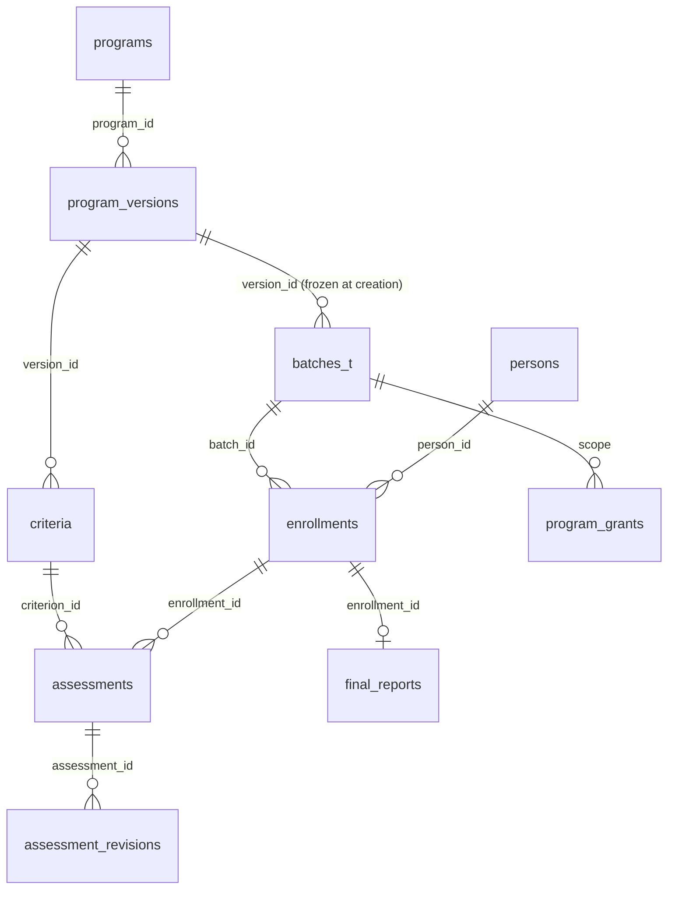

# Leaders Management Portal (LMP) — proposed architecture

**12 October 2026 · a design proposal. Nothing here is built.**

**Status of every statement below:** proposed, unless it cites an existing file. Verified facts about the current
system are in `docs/DATABASE.md`, `docs/API_REFERENCE.md` and `docs/AUTHORIZATION.md`.

**Supersedes nothing.** `docs/lms-knowledge-base-proposal.md` (7 Oct) covers *courses and lessons* — teaching
material, attendance, quizzes. LMP is a different problem: **assessing people against fixed criteria over a batch,
and producing a final report that stays true for ever.** The two could share a "Learn" area; they are not the same
design, and the earlier proposal does not answer the versioning question that dominates this one.

---

## 1. Summary

**Recommendation: a role-protected area inside the existing app, with its own shell and its own tables.**

Not a separate application. Not a separate database. Not microservices.

| Option | Verdict |
|---|---|
| Separate app, shared backend | **No.** A second deployment, a second service worker, a second sign-in to keep working. The audience is the same people, already signed in. |
| Separate shell in the same frontend | **Partly** — adopted. One deployment, one session, but LMP gets its own routes and navigation rather than cluttering the daily sadhana screens. |
| Role-protected section | **Yes**, as the authorization model: `program_grants` beside the existing scopes. |
| Microservices | **No.** No evidence of a scaling or ownership boundary that would justify it. |

**Why this is the simplest thing that works:** the identity, sessions, roles, batches and Sheets copy already
exist and are already the hard parts. LMP needs tables, a domain model and a handful of screens — not a platform.

**The one thing that genuinely needs care** is that a finalised report must remain reproducible after the program's
rules change. That is section 4, and it drives most of the model.

---

## 2. What LMP reuses, unchanged

| Existing | LMP use |
|---|---|
| `persons` + `person_links` (0038) | enrolment references a **person**, never a duplicate member record |
| `accounts`, `sessions` | same sign-in; no second login |
| The route table in `api.js` | `program.*` actions alongside the rest; same validation and idempotency |
| `only_actions` (0041) | the pattern `program_grants` follows |
| `dirty()` → `mirror_log` | training tables copy to Sheets like everything else |
| `audit_log` | assessment changes are audited by the existing mechanism |

**Nothing about sadhana changes.** No existing table is altered; no existing action changes meaning.

---

## 3. Domain model



**TRAINING IS SIDEWAYS, AND IT DOES NOT STAND ALONE (decision 47, the head, 14 Oct 2026).**

**Every programme the LMS runs** — MTP, ETP and iLS today, and whatever is added later — is training a
person takes **while they carry on with their ordinary batch class**. This is a property of training itself, not
of those three programmes. Two rules
follow, and phase 7 has to enforce both:

0. **NO SEPARATE SIGN-UP. EVER.** There is no LMS registration, no second account, no "join this programme"
   form. A person is already in the app — they signed up once, their coordinator approved them, they have a
   batch and a login — and enrolment is a COORDINATOR picking them from the people who are already there. The
   LMS adds a row about an existing person; it never creates one. This is the whole reason the portal is built
   INTO this app instead of beside it: the person, their phone, their batch, their attendance and their sadhana
   are here already, and a second system would mean a second copy of all of it, drifting.

1. **A person in a training programme MUST be in a sadhana batch.** There is no such thing as an MTP member who
   is not also an SPS, DPS, BSS, BVS, VL-2 or VL-3 devotee. `enrollments` therefore requires an ACTIVE row in
   `memberships` at the moment of enrolment, and the enrolment screen offers only people who have one. A person
   who leaves their batch has their enrolment ended with them — training cannot outlive the membership it hangs
   off.
2. **Training never moves anyone between batches.** Finishing MTP does not promote a devotee from VL-3 to SPS and
   does not change their score card, class day or weekly form. Nothing in the LMP may write to `memberships`.
   Promotion is a separate mechanism, decided on attendance and chanting (see `IMPLEMENTATION_ROADMAP.md`
   phase 8), and it moves the sadhana batch.

So a person has **at most one** sadhana membership and **any number of concurrent** training enrolments. The two
meet only on the profile, where the training summary sits beside the sadhana record.

| Table | Holds | Note |
|---|---|---|
| `programs` | MTP, ETP, iLS — the lasting idea | name, code, active |
| `program_versions` | one **frozen** set of rules | `version_no`, `published_at`, `scoring` (JSON) |
| `criteria` | the fields assessed in that version | label, weight, max, kind, order |
| `training_batches` | "Batch 40" | `version_id` **copied at creation**, dates, `state` |
| `enrollments` | a person in a batch | `person_id`, `batch_id`, `state` |
| `assessments` | one evaluator's value for one criterion | `enrollment_id`, `criterion_id`, `evaluator`, `value`, `at` |
| `assessment_revisions` | every earlier value | append-only; corrections never overwrite |
| `final_reports` | the finalised outcome | `enrollment_id`, `score`, **`computed_from` (JSON)**, `finalised_by`, `at` |
| `program_grants` | who may do what, per program/batch | `login`, `scope`, `grant` |

**Candidate concepts I deliberately did not make tables:** `AssessmentTemplate` (it *is* `program_versions` +
`criteria` — a separate template adds a join and no meaning), `ProgramCompletion` (a `state` on the batch),
`ReportApproval` (two columns on `final_reports` until someone needs multi-party approval).

---

## 4. The versioning problem — the heart of the design

> *"Changes to assessment rules must not silently change the meaning of previously finalized results."*

Three defences, because one is not enough:

**1. A batch freezes its version at creation.** `training_batches.version_id` is copied, never followed. Editing a
program creates `program_versions` *n+1*; Batch 40 keeps pointing at *n*. Batches already running are untouched.

**2. A published version is immutable.** Once `published_at` is set, its rows and its `criteria` are never updated
— only a new version is created. Enforced in code, as every other rule here is (there are no foreign keys in this
schema; see `docs/DATABASE.md`).

**3. A final report stores its own arithmetic.** `final_reports.computed_from` holds the criteria, weights,
values and formula **as they were at finalisation** — not a reference to them.

That third one is what makes the report *reproducible rather than recomputable*. Even if a version were somehow
altered, or a criterion deleted, the report still says exactly how its number was reached. Re-opening and
re-finalising writes a new row and keeps the old; a report is never edited in place.

This mirrors a rule the codebase already follows: **`week.submit` writes the score and nothing recomputes it
afterwards.** LMP is the same instinct applied to a harder case.

---

## 5. Scoring rules without code changes

`program_versions.scoring` is JSON, interpreted by a small evaluator:

```json
{ "method": "weighted_sum", "round": 1, "pass_mark": 60,
  "bands": [ { "min": 85, "label": "Distinction" }, { "min": 60, "label": "Pass" } ] }
```

**The trade-off the brief asks about, answered honestly:** a fully configurable formula language would let
management invent any rule without a developer — and would be a small programming language inside a JSON column,
with no type checking, no tests, and failures that appear only at finalisation.

**Recommended:** a **fixed set of named methods** (`weighted_sum` first; others added as asked for) with
configurable weights, maxima, rounding and bands. Management configures programs, criteria, weights and bands
freely. A genuinely new *method* is a small, tested code change — which is the right amount of friction for
something that decides a person's result.

---

## 6. Permissions

Full matrix in `docs/AUTHORIZATION.md` §"Proposed — LMP permissions". The principle:

**An existing organisational role grants nothing in LMP.** A coordinator coordinates a sadhana batch; whether they
may assess an MTP trainee is a separate question with a separate answer. `program_grants` holds that answer per
program or batch, checked beside the existing scopes.

**Needs management's decision (§9).**

---

## 7. The member profile

> *"If a member has no program records, no empty program accordion should be displayed."*

One action, `program.summaryFor`, returning **at most a few rows per person**: program, batch, state, dates, final
score, visible-to-this-viewer. The About area renders the accordion only when that array is non-empty.

The full assessment history is a **second** action, `program.historyFor`, fetched when the accordion opens.
A profile view must never pull every assessment row.

---

## 8. Roadmap

| Phase | Delivers | Prerequisite |
|---|---|---|
| L0 | tables + `program_grants`; no UI | migration (additive) |
| L1 | programs, versions, criteria (admin UI) | L0 |
| L2 | batches, enrolment from existing persons | L1 |
| L3 | assessment entry, revisions, audit | L2 |
| L4 | finalisation, `computed_from`, reports | L3 |
| L5 | profile accordion, both actions | L4 |
| L6 | Sheets copy for the training tables | L0 |

L0–L2 are safe to build with nothing user-visible. **L4 is the one to review carefully** — it is where a mistake
becomes permanent.

---

## 9. Decisions management must make

These block design, not implementation, and are listed for the user to take to IYF Delhi:

1. **Who may see a member's training scores?** Specifically: may a devotee's sadhana facilitator see their MTP
   assessment? My recommendation is **no by default**, granted explicitly.
2. **May an evaluator change a submitted assessment?** Recommended: yes until the batch is finalised, always with
   a revision row and an audit entry.
3. **May a finalised batch be reopened?** Recommended: yes, head-only, writing a new report and keeping the old.
4. **Is a final report shown to the trainee?** And does "published" differ from "finalised"?
5. **Do MTP, ETP and iLS share one criteria shape**, or is each genuinely different? The model assumes different.
6. **What do ETP and iLS stand for**, and what are their durations and evaluator roles? (Still open from
   `lms-knowledge-base-proposal.md` §10.)

---

## 10. What I did not verify

- **No assessment of effort.** Sizing this would require the questions in §9 answered.
- **No performance measurement.** No LMP code exists to measure. The read patterns above (a summary action
  separate from a history action) are designed to avoid the obvious problem, not validated against one.
- **D1 limits.** `docs/load-test-report.md` covers sadhana load; LMP's volume (hundreds of trainees, not thousands
  of daily rows) is far smaller, but that is reasoning, not measurement.

---

## Review notes — 12 October 2026 (second pass)

A second session reviewed this proposal against the database and backend audits. The recommendation stands
(role-protected area in this app, own shell and tables, `program_grants`, frozen program versions, reports that
store their own arithmetic — recorded as `DECISIONS/0006`). Five qualifications change the plan's order and shape:

1. **`persons` is sound as a table, not yet as an anchor.** Sign-up and approval write no identity table; only
   `profile.update → syncPerson` links, and only when the account already carries an `iyf_id` (`coord.js:679`).
   Most accounts are therefore unlinked today. **Prerequisite L-0a:** link at approval (and backfill), or LMP
   enrolment "by person" will have to mint persons for most trainees. See `FULL_AUDIT_2026-10-12.md` §5 B7.
2. **Three ID series are not reconciled.** `person_identifiers` holds only `IYFD-…`; dashboard `KT/GP/JN` and app
   `SR` ids live in `accounts.iyf_id` / `app_ids` / `registry`. A final report that prints "the person's IYF ID" must
   say which. **L-0b:** record the other series in `person_identifiers` as `superseded` when a person is linked.
3. **Data hygiene before enrolment:** `person_names` gains a duplicate row on every profile save (B1) and a phone can
   never move between persons (B4) — a family phone binds every sibling to the first person. Enrolment must go
   through a human-confirmed link, never `resolve()` by phone. Fix B1 and add a merge path (B8) before L2.
4. **Jobs and budgets:** every LMP table copied to Sheets needs its tab built before the migration, a `mirrorkeys.js`
   entry, generated triggers and a `mirror_state` row; the copy budget is 300 rows a minute shared with sadhana, and
   the minutely run is already near the 50-call limit on Sunday evenings (J1, J2). Fix J1/J2, add `mirror_status`
   (J9), and give LMP its own cron (the 4th of 5) for its copy and any assessment-close job.
5. **Store `person_id`, never `login`, in LMP tables.** Sadhana deletes accounts and anonymises records; `persons` is
   permanent. A report keyed on `person_id` stays true after the account is gone.

Two additions to the model:

- **`program_grants` must carry a scope**: `(login, program_id, batch_id NULL, grant)` with `grant` in
  `program.admin | program.manager | evaluator | viewer`; an evaluator's grant is per batch. The generated role-matrix
  test (`TESTING.md` §5 item 1) must enumerate the `program.*` actions from day one.
- **Timestamps:** use `isoIst()` everywhere in LMP tables; the existing schema already mixes IST and UTC strings (B9).

Proposed route and chunk shape (nothing built): `#/lmp/programs`, `#/lmp/batches/<id>`, `#/lmp/assess/<batch>`,
`#/lmp/reports/<batch>`, `#/lmp/people/<personId>`; chunks named `lmp-*` and excluded from the devotee precache
like `staff-*`; a "Leaders" area in `nav.js` shown only when `program_grants` has a row for the login; the profile
accordion rendered by `screens/Profile.svelte` only when `program.summaryFor` returns rows.

Open decisions for management are in §9 above and `FULL_AUDIT_2026-10-12.md` §18.
