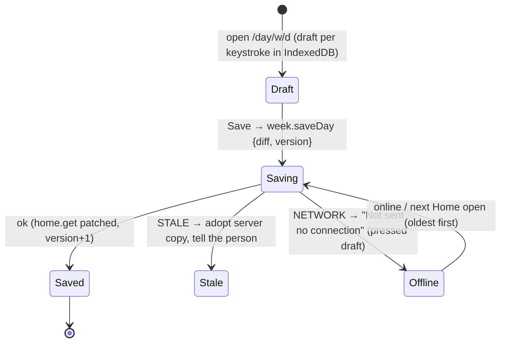

# User flows — Sadhana Record

**12 October 2026 · each flow traced through the app and the Worker.** For every important journey: the screens,
the actions, what the server writes, the states, and what is wrong today (with its finding id from
`FULL_AUDIT_2026-10-12.md`). The known historical issues are re-verified in `DEFECTS_VERIFIED.md` and its review notes.

## 1. Sign-up and approval

```mermaid
sequenceDiagram
  participant P as Person (signed out)
  participant A as App /signup
  participant W as Worker
  participant C as Coordinator /requests
  P->>A: step 1 phone → auth.lookup (masked name only, hasAccount)
  P->>A: steps 2–4 name, batch, facilitator, class day, DOB, address, consents, password (draft kept in localStorage)
  A->>W: auth.signUp → accounts(status PENDING, requested_batch…), profiles
  W-->>A: PENDING → "Waiting for your coordinator's approval"
  C->>W: requests.list (own batches) → requests.approve {phone, link?, levelEntryDate, facilitator, classDay, groupLeader}
  W->>W: CAS status PENDING→ACTIVE, memberships row, optional app ID, audit
  P->>A: auth.login → session; home.get
```

- **Allowed:** PUBLIC to sign up; `STAFF` of the requested batch to approve; two coordinators approving at once:
  one wins (`requests.js:81-89`).
- **States:** PENDING → ACTIVE / REJECTED; a rejected phone may sign up again.
- **Problems:** the name rule differs between client and server (FE-2) so IAST/Devanagari names fail at the last
  step; `auth.lookup` reveals `hasAccount` (F3, accepted design to review); the identity record (`persons`) is
  **not** linked at sign-up or approval although the code comment says it is (B7/F29); the sign-up draft with DOB and
  parent phone stays in `localStorage` until success (FE-3).
- **Tests:** `phase1`, `phase0`, `about`, `address9`, `coord` (approval), `lookup`.

## 2. Sign-in, session restore, sign-out

- **Cold open:** `restore()` shows the kept user from `localStorage` at once, `auth.me` confirms in the background;
  offline stays on the kept screen and rechecks on `online`; a server-ended session clears everything and explains
  itself on the sign-in screen, returning to the page afterwards (`session.svelte.js:44-61`, `Login.svelte:19,28`).
- **Lockout:** 5 wrong tries → 15 minutes; checked *before* the password, so `LOCKED_OUT` reveals existing logins and
  anyone can lock any phone (F12, P3).
- **Sign-out:** `push.detach`, `auth.logout` (current session only — no "sign out everywhere", F21), local clear.
  Leaves other people's photos, images and the sign-up draft on the phone (FE-3).
- **Forced password change:** only `auth.me/logout/changePassword` allowed until done; screen stands alone.
- **Tests:** `phase1-session.test.js`, `security`, `phase1`.

## 3. Daily sadhana recording (the core)



- Only today can be filled (`FUTURE_DAY`); live marks from `$shared/scoring.js`; hearing and reading from the batch's
  journal; the current book kept on the server (`books.setCurrent`).
- **Problems:** `UPGRADE_REQUIRED` reloads without the unsaved-day guard (FE-9); a failed IndexedDB write is silent
  (FE-12); overlapping retries of the same `requestId` can execute twice for non-`noReplay` writes (F5 — `saveDay`
  itself is version-guarded and safe).
- **Tests:** `weeks.test.mjs`, `frontend/tests/weeks.test.js`, `scoring`.

## 4. Week-end, attendance and submit

- Saturday 18:00 IST opens the week-end answers (`saveWeekEnd`, version-guarded); Sunday 00:00 opens own attendance
  (`setAttendance`); submit allowed in [opens, closes) or a reopen window; `INCOMPLETE` lists the gaps as tappable
  items; a part week with ≥ 1 complete day may be submitted (decision 45); the same Submit again returns the first
  answer; a new Submit is refused.
- **Monday 21:00 deadline:** `runDeadline` auto-submits complete-day weeks, marks the rest missed, locks attendance.
  Only the latest due week is handled; two missed Mondays leave the older week open for ever (J4/F28).
- **Attendance precedence:** devotee → group leader (`group.mark`) → coordinator (`attendance.set`) → head
  (`attendance.override`); notices to the devotee when a mark changes (truncated at 35 phones, J5).
- **Tests:** `weeks`, `groups`, `coord`, `classweek` paths in `phase0`.

## 5. History and reports (devotee)

`/history` lists submitted weeks (`history.list`, paged by `before`); `/report` draws a month calendar and bars with
one `week.get` per submitted week in view (FE-7). Share builds WhatsApp text on the phone (`lib/share.js`).
CSV export is staff-only (§8).

## 6. Profile and account

- Profile edit (`profile.update`): name, DOB (12–80), blood group, emergency contact, address, class day, reading
  pace, email, WhatsApp, facilitator (from the list), profession, skills. Photo: 400 px JPEG ≤ 150 KB, cropped on
  the phone (`photo.upload`). The server links the identity record only here and only if an `iyf_id` is already
  set (`syncPerson`, B7) — and appends a duplicate `person_names` row every time (B1).
- **Address edit loses house/street/landmark on every save** (FE-1, P2).
- **Account deletion** (`account.delete`): password + the word DELETE, 5 tries per 15 min; weeks kept and
  anonymised; sessions, push, photos, drafts removed; Sheets append-only tabs scrubbed by the erase job. Leaves the
  phone in `attendance.changed_by` (own marks) and in `app_ids` (B3). Public `/delete-account` page for the stores.
- **Tests:** `account-delete`, `deletion.test.js`, `about`, `address9`.

## 7. Group leader

`/group`: the leader's devotees for the week (`group.list`), marks attendance levels (`group.mark`, only logins in
their group, window rules). Appointed by staff (`leaders.set`, `leaders.assign`). Loses the scope on deactivation.
**Tests:** `groups` (90).

## 8. Coordinator

- **Home "Needs you"**: pending sign-ups and resets (`requests.list`), reopen requests, birthdays.
- **Batch board** (`/batch`): `devotees.list` per week with states; attendance marks in bulk (`attendance.set`, 250
  per call); no-class weeks (`weeks.setClass`); polls every 2 minutes while attendance is open.
- **Members** (`/members`): filters, search, paging (`members.list` — reads 13 k rows per page today, P-2).
- **Devotee detail**: set inactive from a week / disable / delete / change facilitator or class day / request a
  reopen / fill their day or week on their behalf (`/fill/<login>/…`, `onBehalfOf`, audited).
- **Exports**: catalogue by role, one page per call, rate-limited, logged in Activity; CSV on the phone with
  injection-safe cells.
- **Problems:** `devotees.delete` lacks the facilitator guard (F2, P2); coordinators may read any past week via
  `week.get onBehalfOf` while `devotees.week` refuses (F10).
- **Tests:** `coord` (118), `exports` (44), `facilitator`, `security-roles`.

## 9. Facilitator

`/my-devotees`: read-only list of the devotees with that facilitator name (`fac.devotees`), one devotee, one week.
Logins are created, linked and reset by the head (`facLogins.*`, six actions missing from the first API doc).
Posts to own students only. **Tests:** `facilitator` (75), `phase9-posts`.

## 10. IYF head (master)

Overview and stats (`stats.all` — 55–83 ms CPU, P-1), coordinators and batches, facilitators and their logins,
IYF IDs (registry search, app IDs, identity record, duplicates review), reopen decisions, attendance override,
Activity (audit and run logs), Settings (submit window, tracking start, reminder time, retention). Appointing another
head needs every other active head's approval; the recovery login `master` is never asked. Password recovery for
`master` goes through the `MASTER_RESET_PASSWORD` secret (its SHA-256 lands in a Google Sheet today, J3).
**Tests:** `heads`, `identity`, `appids`, `facilitators`, `retention`, `setup`.

## 11. Announcements and the wall

Post (master to all; coordinator to own batches; facilitator to own students) with an optional picture and
schedule; like (set, not toggle), comment, report, mute for self or (head) for everyone; head's queue. Share builds
a WhatsApp message with `#/wall?post=<id>`, which scrolls to and highlights the post after sign-in (the first pass
of `DEFECTS_VERIFIED.md` missed it). Posts beyond the 50 newest show "no longer on the wall" (FE-17); `LIMIT 200`
is applied before the audience filter (F9). **Tests:** `announcements`, `phase9-posts`, `phase0`, `wall.test.js`.

## 12. Requests and approvals (one inbox)

`/requests` holds sign-ups, password resets, reopen requests and (head) reports. Reset approval installs the
password **the requester chose** with no forced change; a newer request supersedes the owner's pending one, and the
approver sees no provenance (F1, P1 — the accepted no-OTP design needs the cheap mitigations listed in the roadmap).

## 13. Mobile navigation and states

One navigation model (`lib/nav.js`): bottom bar < 600 px, rail 600–1023, sidebar ≥ 1024; the scopes decide the
items; one bell, one Requests inbox. Every lazy screen shows a skeleton while loading, a `Banner` with retry on
error, an `EmptyState` when empty; offline shows the kept copy or "No connection". Verified at 320–1920 px by the
browser suite (1,809 checks, green on 12 Oct).

## 14. Print and PDF

No print stylesheet or PDF export exists in the app; sharing is WhatsApp text and CSV. The documentation PDFs are
made offline by `tools/docs`. (Unverified assumption in the brief; nothing to audit.)
