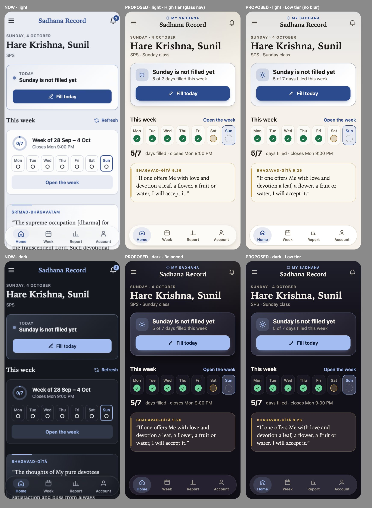
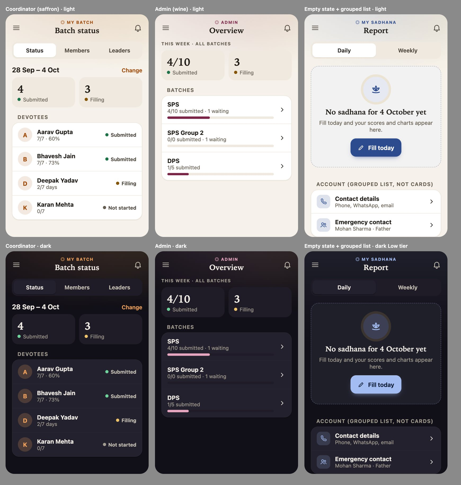

# Sadhana Record: modernization audit and roadmap

**IYF Delhi · audit only, no code changed · 4 October 2026 · updated the same day with the visual audit (sections 9 and 16)**

> **Counts re-verified 12 Oct 2026.** This audit was written on 4 October. Its structural figures were stale and
> have been corrected in place: **54 tables** (not 43), **40 migrations** (not 28), **116 API actions** (not 95).
> Four reference documents now carry the detail, generated from source rather than memory:
> `docs/DATABASE.md`, `docs/DATA_DICTIONARY.md`, `docs/API_REFERENCE.md`, `docs/AUTHORIZATION.md`.
> The historical defect list is verified in `docs/DEFECTS_VERIFIED.md`; the training-portal design is
> `docs/LMP_ARCHITECTURE.md`. The rest of this document — the assessments, the roadmap, the risks — was **not**
> re-audited on 12 Oct and still reads as of 4 October.

> **Superseded for UI/UX planning (8 Oct 2026):** the final revamp set in `docs/revamp/` (start at `revamp/README.md`) is now the plan of record; its open UI findings were merged; its performance and store sections still apply. This document is kept for history.

This audit covers the whole app: the phone app (`frontend/`), the server (`worker/`), the database (D1), the Google Sheets copy, and the tests and tools. Each finding was checked in the code or measured. Where a number comes from a measurement, the method is given. Nothing here is built until it is approved.

The visual audit, section 9, uses 28 fresh screenshots: 11 screens, light and dark, at 390 px, plus 3 at 1280 px. Its proposal in section 16 includes mockups of the new look next to today's screens.

---

## 1. Executive summary

**Verdict: no rewrite.** The stack is already the light one this brief asks for, and it measures well. What it needs is a set of targeted fixes, mainly for poor networks and wider screens, plus an adaptive-look system. These build on what is there.

**Measured today (live app, Lighthouse mobile profile: Moto G class phone, 4× slower CPU, slow 4G)**

| Page | Performance | Accessibility | First paint | Largest paint | Blocking | Layout shift | Total download |
|---|---|---|---|---|---|---|---|
| Welcome | 92 | 100 | 2.1 s | 2.6 s | 10 ms | 0 | 146 KB |
| Login | 98 | 100 | 1.9 s | 1.9 s | 0 ms | 0 | 141 KB |

The rest of the baseline:
- **Startup download:** 55.4 KB of JavaScript (limit 60 KB) and 14.45 KB of CSS (limit 15 KB), both compressed.
- **No runtime libraries:** Svelte compiles away. There are no web fonts.
- **Server time:** devotee actions take 3–9 ms of server CPU each.

**The six things that matter most** (section 13 has the full ranking):
1. **Opening the app offline shows the logged-out Welcome screen**, even though the person is still logged in. The 9 PM fill-in often happens on poor networks.
2. **Every app launch starts cold.** Saved data lives only for the browser session, so each open waits for the network before showing anything.
3. **Launch makes two network round trips in a row** (`auth.me`, then `home.get`). One is enough.
4. **The first install downloads about 1.5 MB in the background.** About 530 KB of that is home-screen icons the app never shows.
5. **Wide screens (tablet and laptop, 768–1023 px) get the phone layout, stretched.** There is no adaptive tier system beyond a simple "lite" switch.
6. **The look is clean but generic:**
   - Light mode is blue on white; dark mode is pale blue on three near-identical blacks.
   - About 55 sections across 20 screens are drawn as the same bordered card.
   - The three role areas differ only in small accent touches.
   - Warmth (the gold, the serif, the devotional quotes) appears only on the login and quote cards.

   The fix is a new colour and surface system, not more blur (section 16).

**What this audit does not recommend:**
- Changing the framework, the single-endpoint API, the database or the Sheets copy.
- Hash routing changes.
- Native rewrites.
- A separate TV interface. There is no TV use case yet; section 10 explains.

---

## 2. Application architecture map

```
Phone / desktop browser (PWA, installable)
  ├─ index.html + startup bundle: 55 KB JS + 14 KB CSS (compressed)
  │    App.svelte ─ hash router ─ Shell (top bar, bottom nav / side bar, drawer)
  │    lib/api.js ── POST JSON ──►  Cloudflare Worker  sadhana-record-api
  │    lib/cache.svelte.js (2-min read cache, sessionStorage)        │
  │    lib/saver.js + idb.js (day drafts, photos in IndexedDB)        ├─ api.js: 116 actions, one table of routes
  │    service worker: precache + push-sw.js (push → push.message)    ├─ D1 (SQLite): 54 tables, 40 migrations
  └─ lazy screen chunks: devotee/*, coord/* + master/* ("staff-")     ├─ cron every minute: deadline, reminders,
                                                                      │   posts, attendance notices, Sheets copy,
                                                                      │   batch view sheets, clean-up
                                                                      └─ Google Sheets (service account): store
                                                                          sheets + batch view sheets
shared/: scoring.js, places.js (used by both the app and the server)
```

Components and versions:
- **App:**
  - Svelte 5.57 and Vite 8.3.
  - Tailwind 4.3, utilities only, with no reset.
  - vite-plugin-pwa 1.3, which uses Workbox 7.4.
  - npm.
- **Server:** one Cloudflare Worker and one D1 database (APAC).
  - Free plan; Smart Placement and logs are on.
  - Three cron schedules.
  - Secrets: `PW_PEPPER`, `GOOGLE_SA_KEY`, `VAPID_PRIVATE_JWK`, `MASTER_RESET_PASSWORD`.

---

## 3. Route and page map

Roles:
- **D** = devotee
- **GL** = group leader
- **F** = facilitator
- **C** = coordinator
- **M** = the head (master)

"Calls" are the server actions the screen makes. Every screen has a loading skeleton, an error banner with Retry, and an empty state where a list can be empty; exceptions are noted.

| Route | Purpose | Who | Calls | Notes |
|---|---|---|---|---|
| `/welcome` | First screen, quote | logged out | none | In the startup bundle; LCP 2.6 s, the slowest page |
| `/login` | Login | logged out | auth.login | Returns to the deep link afterwards (`sr.return`) |
| `/signup` | Create account | logged out | meta.get, auth.signUp | Long form; wheel pickers; address validated |
| `/forgot` | Ask for a password reset | logged out | auth.requestReset | Approved by a person |
| `/change-password` | Forced or voluntary change | all | auth.changePassword | |
| `/home` | Today, week ring, quotes, birthdays | all | home.get (D), birthdays.today | Static import; role decides the content |
| `/week`, `/week/:id` | The week: days, end-of-week answers, submit | D | week.get, week.saveWeekEnd, week.setAttendance, week.submit | One draft per day |
| `/day/:w/:d` | One day's sadhana | D | week.saveDay (IndexedDB draft first) | Largest screen (330 lines) |
| `/history`, `/report` | Past weeks; month calendar and charts | D | history.list, week.get | |
| `/hearing`, `/reading` | Lectures and books | D | journals.get (version-checked) | |
| `/account` | Name, photo, class day, contact, address, emergency | all | profile.get/update, photo.upload/remove | |
| `/wall` (`?post=id`) | Posts: like, comment, share | all | announcements.* | Share link opens the post |
| `/group` | Group leader's group, Sunday marks | GL | group.list, group.mark | |
| `/my-devotees[/…]` | Facilitator's students, read-only reports | F | fac.devotees, fac.devotee, fac.week | |
| `/requests` | Sign-up and reset approvals | C, M | requests.list, registry.search, requests.approve/reject | Chunk prefetched for staff |
| `/batch` | Board: status and attendance | C, M | devotees.list, attendance.set, weeks.setClass | |
| `/members`, `/stats`, `/leaders` | Members, filling chart, group leaders | C, M | members.list, devotees.delete, stats.batch, leaders.* | |
| `/devotee/:login[/week/:id]` | Devotee details, read a week, mark attendance | C, M | devotees.get, devotees.week | Coordinator: open week only |
| `/fill/:login/…` | Fill on someone's behalf | C, M | week.* with onBehalfOf | |
| `/overview` … `/settings` (10 routes) | Admin: overview, devotees, groups, coordinators, facilitators, batches, IDs, reopens, activity, settings | M | stats.all, coordinators.*, facLogins.*, ids.*, weeks.reopen, audit.list, runlog.list, settings.* | One "Admin" chunk |
| anything else | – | – | – | **Falls back to Home silently; no "not found" or "not allowed" screen** |

**How screens depend on shared code:**
- **Shared shell:** Shell, Menu, Icon, Toaster, Skeleton and Banner are in the startup bundle.
- **Form pieces:** TextInput, Seg, WheelSelect, DateInput, NumInput, TimePicker and AddressFields.
- **Week-reading screens:** WeekRead (staff and facilitator), WeekPicker (board, group, facilitator) and Bars/Trend (report, stats).
- **Repeated patterns that should be one component:**
  - **List rows:** five separate styles (`.lrow`, `.rowlink`, `.mrow`, `.brow`, `.bk-row`), plus `.list` and `.mb-list`.
  - **Pop-up windows:** three separate implementations (the standard sheet, image zoom and photo zoom). "Tap outside to close" exists on only some of them.
  - **Native selects still in use:** the side-menu batch picker and the admin Settings `Select`.

---

## 4. Frontend architecture: assessment

**Keep.** It is lean and well organised:
- Screens are split by role: devotee screens are precached, staff screens are fetched when first needed.
- One small design system with area colours (devotee, coordinator, admin) and a JS-set light or dark theme.
- A request cache that merges duplicate calls and patches itself after writes.
- Write requests carry a request ID that is reused until success, so a retry never saves twice.
- Day drafts are kept in IndexedDB.
- Page transitions use `startViewTransition`, skipped under reduced motion. Focus moves to the page title on each route change, with a spoken announcement.

**Weak spots, all confirmed in the code:**
- `session.restore()` treats any `auth.me` failure, including no network, as logged out (`lib/session.svelte.js:30-41`).
- The read cache lives in sessionStorage, so it is lost when the app closes (`lib/cache.svelte.js:43-65`).
- No request timeout. On a stalled network a spinner can wait for minutes (`lib/api.js`; no AbortController). The only automatic retry is for `BUSY`.
- Name validation differs from the server. The app accepts any script, so a name in Devanagari passes. The server accepts ASCII only (`worker/src/util.js:73`), so that name fails at submit time.
- `ui/Mark.svelte` is never imported (dead code).
- `.env.example` still describes the retired Apps Script server.

## 5. Backend and server: assessment

**Keep.**
- One POST endpoint with a declarative route table: role, allowed fields, write flag and replay flag per action.
- Unknown fields are rejected, internal errors never reach the client, and CORS is limited to exact origins.
- Passwords: PBKDF2-SHA-256 with a pepper and per-user salt; hashes are upgraded at login; unknown logins still run a hash so timing reveals nothing.
- Sessions: only the token's SHA-256 is stored; 30 days, sliding.
- Rate limits: atomic per-IP counters, plus an account lockout.
- Writes are grouped into one `db.batch`, so each action saves all or nothing.
- The Sheets copy is incremental and moves forward only after Google accepts.
- Reminder work is shared between cron runs with an atomic claim.

**Points worth acting on:**

| Current problem | Proposed change | Expected benefit | Possible risk | Worth it? |
|---|---|---|---|---|
| The head's Overview (`stats.all`) measured **55 ms CPU** in the load test. The free plan allows 10 ms per request; it works today because short overruns are tolerated. | Have the cron keep a small overview summary up to date; `stats.all` reads it. | Stays within the free plan's CPU limit as data grows | Summary up to a minute old (acceptable for an overview) | **Yes**, before about 3,000 devotees |
| A failed reminder chunk is not retried that night (`push.js:184-187`) | Put the failed chunk back for one retry | Fewer missed 9 PM reminders | Rare duplicates (each phone shows one notification per tag) | Yes, small |
| Five wrong passwords lock an account for 15 minutes. Anyone who knows the phone number can lock its owner out. | Count failures per (account, IP); lock only that pair, keep a high global ceiling | Strangers can't lock people out | Slightly weaker against attacks spread over many IPs (the per-IP limit already applies) | Yes |
| `replies` (the replay cache) is written after the action, with `waitUntil` | Leave it. UNIQUE constraints already stop double saves. | – | – | No |
| Every login updates `accounts`, so a trigger adds a Sheets copy row | Leave it. Sessions last 30 days, so logins are rare. | ~1 write per login | – | No |
| API contract says 77 actions; there are 116 (12 Oct) | **Done 12 Oct:** `docs/API_REFERENCE.md`, generated from `api.js` | Correct documentation | None | Yes, trivial |

## 6. Database and API: assessment

**What is in place:**
- 54 tables with 35 indexes, some of them partial (verified 12 Oct; see `docs/DATABASE.md`).
- Every statement the tests run is checked by `tests/query-plans.mjs`, which fails on a full scan of a growing table. Writes are classified by `write-audit.mjs`.
- Paging:
  - `history.list` and `audit.list` use keyset paging.
  - `members.list` uses OFFSET, capped at 200. That is fine for one batch.
  - IN lists are chunked at 90.

**Free-plan headroom** (from the load test, at 5,000 devotees): the tightest limit is **writes on Sunday, about 80–85k of 100k**. The load report's plan stands:
- Plan the US$5 plan at 70k writes or 4,500 devotees.
- Upgrade at 80k.

**API shape for the app:**
- Launch makes two calls in sequence (`auth.me`, then `home.get`).
- Each screen makes one read, with writes patching the cache, which is good. The exceptions are Report (`history.list` + `week.get`) and Wall, which loads images lazily.
- There are no ETags. Rules and journals already use a `have`-version check, so they return "not modified" cheaply.

## 7. Performance assessment

| What | Measured | Comment |
|---|---|---|
| Startup JS (compressed) | 55.4 KB of 60 KB | 92% used; every new startup feature must pay for itself |
| Startup CSS (compressed) | 14.45 KB of 15 KB | **96% used**: the tightest budget |
| Largest lazy chunks (compressed) | Devotee 27 KB, Admin 20 KB, DevoteeDetail 7.9 KB, Batch 7.7 KB, Wall 7.7 KB | Staff chunks are not precached (fetched once, then cached) |
| First-install precache | **1.53 MB uncompressed, 79 files** | ~530 KB is PNG icons (icon-512 213 KB, maskable-512 160 KB, both 192s, favicon-192), only needed by the OS at install |
| Fonts | none (system serif + system-ui) | Zero font cost; keep |
| Images | WebP emblem with `srcset`; photos cropped to 400 px JPEG ≤ 150 KB, loaded when seen, cached in IndexedDB | Good. Announcement images have no `loading="lazy"`; they rely on scroll position. |
| Launch waterfall | `auth.me` → `home.get` | One extra round trip (≈150–400 ms on Indian mobile networks) |
| Repeat open | Cache gone, so everything is refetched | No instant first paint from saved data |
| Rendering | Svelte 5 fine-grained updates; no list over ~200 rows (members are paged) | No virtual lists needed |
| Blur and shadows | Blur on 4 rule sites (nav, sheet, drawer, top bar); turned off by `.lite`, reduced transparency or lack of support | `.lite` is set when cores ≤ 4, which catches many mid-range phones (too eager) |

**Priority of the performance work:**

| Bucket | Items |
|---|---|
| High impact, low risk | Keep logged-in state when offline at launch; persist key reads (home, profile, rules) between launches; run `home.get` alongside `auth.me`; request timeout (15 s) with a clear message; keep install icons out of the precache and compress them |
| High impact, medium risk | Adaptive tiers that react to measured slowness (section 16); Save-Data mode (no prefetch, images on tap) |
| High impact, high risk | none needed |
| Low impact, low risk | `loading="lazy"` on post images; drop the dead component; restrict hover styles to devices that can hover |
| Low impact, not worth doing | Virtual lists; swapping Svelte for a smaller framework; HTTP/ETag layer over the single POST API; image CDN |

## 8. UI and UX assessment

Checked against the screenshot sets taken this week: 21 screens at 320–1280 px, light and dark, plus the browser checks for no sideways scrolling at 10 widths.

- **Consistent already:**
  - One button set, one field style, one card or section style.
  - Area colours shown together with words, never by colour alone.
  - Skeletons, toasts and an offline bar.
  - 44 px controls; safe areas respected; reduced motion respected everywhere.
- **Inconsistent:**
  - Five list-row styles.
  - Three pop-up implementations; "tap outside to close" only on some.
  - Two native selects left (side-menu batch picker, admin Settings).
  - Breakpoints scattered over 13 values (360, 399, 420, 480, 560, 639/640, 720, 768, 900, 1024 …).
  - 33 hover styles not limited to devices that can hover, so they "stick" after a tap on phones.
- **Wide screens:**
  - Below 1024 px every width is the phone layout: bottom nav, one column. A 900 px tablet shows phone cards stretched.
  - From 1024 px there is a side bar and content capped at 1,120 px.
  - The coordinator board and members list would read better as list plus detail side by side on wide screens. Today the detail opens as a new page.
- **Small screens:**
  - Narrow-width problems found in the wheel work were fixed today: the Report filter bar at 320 px, and the Requests date field at 375 px.
  - Still to verify: long names and long post text at 320 px across all screens. That needs a dedicated test with long strings.
- **Missing:**
  - A "page not found / not allowed" screen.
  - Pull-to-refresh: there is a Refresh button, which is enough.
  - Typography: headings use `clamp()`, but body, small and label sizes are fixed rem. That is acceptable, since system font sizes follow the phone's text-size setting.

## 9. Design-system and visual assessment

**Tokens exist and are used:**
- Colours: per-area accents, semantic surfaces, text, status and chart colours, mixed with `color-mix()` with a fallback.
- Spacing on a 4 px grid (`--sp-1..8`), radii `--r-xs..xl`, motion `--d-1..3` + `--ease`, and z-index layers.
- Control height `--ctl-h` = 44 px, and `--glass-blur`.
- Light and dark modes on `:root[data-theme]`.

The structure is sound. The problem is what the tokens are set to and how screens use them.

**Gaps in the system:**
- No breakpoint tokens.
- Elevation and blur are not tied to a capability tier.
- No container queries for cards that sit in both narrow and wide columns.
- Motion tokens exist, but some components hard-code durations.

**Visual findings** (fresh screenshots of 11 screens per theme; `app.css:11-124`):

1. **Colour lives only in the accent.**
   - Today's neutrals are cool greys: light background `#f4f5f8`, surfaces `#ffffff`/`#eceef3`, text `#181b21`; dark background `#0e1014`, surface `#171a20`.
   - They take 1.5–6% of the area accent mixed in.
   - The result is exactly "blue + white" and "blue + black". There is no warm tone anywhere, though the brand has one: the emblem's gold and the royal purple of the login.
2. **Dark mode has almost no depth.** Background to surface is a contrast step of only 1.09. Cards are separated by their borders, not by tone, so every dark screen reads as one black plane with outlines.
3. **Everything is a card.**
   - 55 `section` blocks in 20 screens are the same bordered white or near-black rectangle.
   - Inside them, the Week list, Day form and Account are further boxes: lists in boxes, fields in boxes, rows in boxes.
   - Nothing signals what matters most on a screen. The "Today" call to action is the same card type as the quote.
4. **Areas look like one app with different button colours.** Coordinator (saffron) and admin (wine) screens differ from devotee screens only in buttons, the active tab and small icons. That is the right instinct (one app), but too faint to orient a person who uses two roles.
5. **Status is said with grey pills repeated down a list.** For example "Not filled" appears 7 times on the Week screen. Colour and shape could carry status at a glance; today it is all text in identical grey chips.
6. **Typography is good at the top, flat below.** Serif page titles and greetings are distinctive, and they are the strongest part of the identity. Below them it is flat:
   - Section headings are 17 px sans with an icon.
   - Metadata, pills and day labels are 12 px.
   - Numbers (scores, counts) are not given any typographic weight, except on the admin overview.
7. **Empty states are text-correct but visually bare.**
   - There are about 30, and most have a title and a reason.
   - Four have no reason: Report "No record for <date>", devotees' "No announcements yet", and two "No submitted weeks yet".
   - Only two offer an action.
   - All use a small grey icon.
8. **Glass is already used selectively:** nav, top bar, sheet, drawer. It is switched off in "lite". So glass is not the problem; the flat surfaces underneath it are.
9. **What already works and must stay:**
   - The serif headings.
   - The gold-ruled login card.
   - The quote carousel with its source line.
   - The floating bottom nav.
   - The admin overview's tinted stat tiles and bars, which are the richest screen today and a good pattern to extend.

## 10. Mobile, store and TV readiness

| Item | State | Comment |
|---|---|---|
| PWA install, standalone, theme colour | Yes | Manifest has no `id`, `shortcuts`, `screenshots` or `orientation`. Add the first three. Leave orientation open so tablets and landscape keep working. |
| Push | Yes: Web Push (VAPID), empty push + fetch, subscription renewal | iPhone: only when installed to the Home Screen (iOS 16.4+) |
| Deep links | Hash links (`#/wall?post=5`) survive login | Work in a Play Store TWA as well |
| Offline | Day drafts saved; cached screens are lost on relaunch; launch offline looks logged out | Fixed by roadmap phase 1 |
| Safe areas, touch targets | Yes | – |
| **Domain** | `*.workers.dev` | **Most important store prerequisite.** A store listing, App Links (`assetlinks.json`), Apple universal links and printed QR codes should use IYF's own domain. Moving domains later would log everyone out and strand unsaved drafts, because the token and IndexedDB belong to the origin. Move *before* the pilot grows. |
| Play Store | Possible now as a Trusted Web Activity (Bubblewrap): same app, same push, ~1 day of work | Needs a custom domain + `/.well-known/assetlinks.json` |
| App Store | Needs a Capacitor wrapper that bundles the app's files (not a bare remote URL, which Apple rejects under guideline 4.2) plus APNs for push (a second push path in the Worker) | Do it only when there is a clear need; it is a real cost |
| Android TV / Google TV | No use case: the sadhana is filled nightly on a phone, and staff work on phones and laptops | **Defer.** Instead keep the baseline that any TV would need anyway: everything reachable by keyboard, a strong visible focus ring, Enter and Back working. This is already largely true (spinbutton wheels, tablist arrows, dialogs). |

## 11. Security and reliability assessment

**Strong:**
- Peppered PBKDF2; hashed session tokens.
- Strict CSP with no inline script or style; `frame-ancestors 'none'`; nosniff; no-referrer.
- Exact-origin CORS, so a cross-site request would need a token anyway; the token sits in localStorage, not a cookie.
- Field allowlists per action.
- Request IDs and UNIQUE constraints stop duplicate saves.
- Generic errors to clients.
- No hashes, salts or tokens in the Sheets copy.
- Secrets are not in git.

**To improve:**
- The lockout can be triggered by a stranger (section 5).
- No request timeout on the app.
- Missing headers: `Permissions-Policy` (camera only on the photo screen; geolocation and microphone off) and `Strict-Transport-Security` (`.dev` is preloaded already; it matters after moving to an own domain).
- Phones, dates of birth, addresses and emergency contacts are copied to the owner-only store sheets. That is intended, but those sheets must stay unshared: check their sharing list monthly.
- The reset flow depends on a person checking identity. The app already tells approvers to call the number first; keep it.
- localStorage token: a script injection could read it, but the strict CSP is the defence. Keep `script-src 'self'`.

## 12. Technical debt assessment

Small and known:
- The duplicated row and dialog styles.
- The two native selects.
- Scattered breakpoints.
- A dead component (`Mark.svelte`).
- Stale docs: the action count, `.env.example`, `loadtest/README` naming `mirror_changes`, and a `setup.js` comment saying "5 minutes".
- An absolute path in `tools/perf/sqltrace.mjs`.
- No component-level render tests. The browser suite (about 1,250 checks over every role and 10 widths) covers this in practice.
- The `ADMIN` route list is kept twice (`Shell.svelte` and `lib/area.js`).

---

## 13. Biggest current problems, ranked by impact

1. Offline launch looks logged out.
2. No saved data between launches (cold start every time).
3. Launch waterfall: `auth.me` then `home.get`.
4. 1.5 MB first-install precache (530 KB of install icons).
5. No request timeout; stalled requests hang.
6. Tablet and narrow-laptop widths get a stretched phone layout.
7. `stats.all` CPU (55 ms) against the free-plan limit as data grows.
8. Lockout that a stranger can trigger.
9. App and server disagree on which names are allowed.
10. Startup CSS budget 96% used, which blocks design work unless styles are re-split.
11. `.lite` decided by core count only, so it is too eager and does not respond to how the phone actually performs.
12. Inconsistent list rows and dialogs; two native selects; sticky hover on touch.
13. A generic look: cool grey neutrals, "everything is a card", near-black dark mode without depth, status shown as grey pills, and areas barely distinguishable (section 9).

## 14. Biggest opportunities, ranked by impact

1. **Instant launch.** Show the saved screen immediately, refresh in the background. This works offline too.
2. **Own domain.** This unblocks the Play Store, App Links and stable links for years.
3. **Adaptive tiers.** Premium where the phone can afford it, clean and fast where it cannot, using one set of components (section 16).
4. **Wide-screen layouts:** list beside detail for staff, two columns for devotee screens on tablets.
5. **Data saver.** Respect Save-Data and 2G: no prefetch, images on tap.
6. **Play Store listing via TWA**, after the domain move.
7. **A warm, devotional visual identity** (section 16): warm neutrals, gold as the second accent, fewer and purposeful cards. It has the largest effect on how the app *feels*, mostly by changing token values.

## 15. Proposed target architecture

```
CURRENT                         PROBLEM                                 TARGET
session from auth.me only   →   offline launch = logged out         →   last user kept locally; auth.me confirms in background
cache in sessionStorage     →   cold start every launch             →   key reads persisted per login (IndexedDB), stale-while-revalidate
auth.me → home.get          →   extra round trip                    →   both started together when the saved user is a devotee
fetch without timeout       →   endless spinners                    →   15 s timeout, "Slow network — try again" banner
.lite by core count         →   blunt, static                       →   data-tier = high | balanced | low, from device, network, preference and measured frames
13 breakpoints              →   drift                               →   4 tokens: compact <600, medium 600–1023, expanded 1024–1439, wide ≥1440
precache everything         →   1.5 MB first install                →   app code + emblem only; icons on demand
workers.dev                 →   no store links, fragile origin      →   iyf-owned domain, assetlinks, HSTS
```

| Keep | Refactor | Replace | Remove | Add |
|---|---|---|---|---|
| Svelte 5, Vite, Tailwind (utilities), hash router, Worker + D1, single POST API with route table, request IDs, Sheets copy, scoring and places in `shared/`, system fonts, CSP, test suites | session restore, read cache, api.js (timeout), colour and surface token values (new palette), breakpoints, list-row and dialog styles, `.lite` → tiers, precache list, `stats.all` | the two native selects → WheelSelect; account lockout → per (account, IP) | `Mark.svelte`; stale doc lines | block types (hero, stat tile, grouped list, devotional, notice), tier module (<1 KB), "not found / not allowed" screen, manifest `id` / `shortcuts` / `screenshots`, `Permissions-Policy`, own domain, (later) TWA |

## 16. Proposed design system

**One design language, three presentation tiers, four layout classes.** Every component reads tokens. Only the token values change per tier and per layout, so there is never a second copy of a screen.

### 16.1 Visual identity

**Warm, calm, devotional, modern.** The identity is drawn from what the app already owns, not invented:
- the IYF emblem's lapis blue and gold;
- the royal purple of the login;
- saffron and wine for the staff areas;
- serif headings, like a printed scripture;
- the verse quotes.

**Two moves change the feel:**
1. **Warm neutrals instead of cool grey.**
   - Light mode sits on sandalwood paper (an ivory) with white raised surfaces.
   - Dark mode sits on an indigo night (a near-black taken from the brand purple) with clear tonal steps.
2. **Gold as the shared second accent.**
   - It appears on rules, quote marks, achievement and "today" details, and the empty-state halo.
   - The area colour stays the primary accent.

**How it compares with today:** the mockups below are drawn with the exact proposed tokens; the left column is today's app.





### 16.2 Colour system

**Neutrals (shared by every area).** All text pairs below were checked: every one meets WCAG AA (4.5:1) on every surface it is used on. Gold text is used only on the base surfaces, where it is ≥ 4.6:1.

| Token | Light | Dark | Use |
|---|---|---|---|
| `--bg` | `#f6f2eb` sandalwood | `#110f17` indigo night | page background |
| `--surface` | `#fbf9f6` | `#1a1822` | sections without a card, list groups |
| `--surface-elevated` | `#ffffff` | `#24212e` | cards with a reason (section 16.5) |
| `--surface-floating` | `#ffffff` | `#2d2a39` | nav, sheets, menus, toasts |
| `--surface-muted` | `#efe9df` | `#1f1c28` | stat tiles, segmented controls, inputs at rest |
| `--surface-hover` | `#e7e0d3` | `#2e2a3a` | pressed and hover states |
| `--border` | `#e3dbcd` | `#353041` | card and field edges |
| `--divider` | `#ece6db` | `#2a2734` | rows inside a group |
| `--border-strong` | `#8c8273` (3.4:1) | `#756e86` (3.6:1) | input outlines (≥ 3:1 for controls) |
| `--text-primary` | `#1e1a15` (15.5:1) | `#f1ede6` (16:1) | body, titles |
| `--text-secondary` | `#4a433a` (8.7:1) | `#c9c2b7` (10.6:1) | supporting text |
| `--text-muted` | `#655c50` (5.9:1) | `#a39c91` (6.9:1) | metadata, captions |
| `--gold` (text) | `#8a6820` (4.6:1) | `#dcb862` (9.9:1) | sources, overlines on quotes |
| `--gold-deco` | `#c9a14a` | `#b8954a` | rules, halos, quote glyphs (decorative only) |
| `--success` | `#1d7348` | `#6fd49b` | submitted, saved |
| `--warning` | `#865400` | `#f2c46a` | filling, draft, deadline near |
| `--danger` | `#b02e1c` | `#ff917c` | missed, errors |
| `--info` | `#1f6873` teal | `#7cc7d1` | neutral notices; deliberately not blue, so it never reads as the devotee accent |

Each semantic colour also gets a `-soft` background, 10–14% over the surface, for banners and chips.

**Depth in dark mode.** The tonal steps are background → surface 1.07 → elevated 1.09 → floating 1.11. Today there is one step of 1.09, so the new dark mode has hierarchy without relying on borders.

**Light shadows** are tinted warm (`rgb(60 40 10 / …)`), not neutral grey, so they sit naturally on ivory.

### 16.3 Area colours: identity without four different apps

The accents stay exactly as today: devotee lapis `#2c4b8e` / `#a3bcf2`, coordinator saffron `#a14a08` / `#f2a25a`, admin wine `#7a2346` / `#e9a6c0`, login royal `#4b2a86` / `#c3aef2`. Every on-accent text pair is ≥ 6:1.

**What changes is where the accent goes:**
- **Accent is used for:**
  - active navigation;
  - primary buttons;
  - the overline above each page title;
  - icon chips (accent at 16% behind an accent icon);
  - selected states and focus rings;
  - the first chart series;
  - avatars' initials;
  - a soft wash at the top of the page and on the hero card.
- **Accent is never used for:**
  - whole screens or large solid areas;
  - every heading;
  - card borders by default;
  - body text.
- **Neutrals keep at most 2–3% of the accent** (today 5–6% on the background). The warm base stays the same in every area, so it is one app. The accent tells you where you are.

### 16.4 Surface hierarchy: fewer cards, each with a reason

| Level | Token | What lives there |
|---|---|---|
| Base | `--bg` + ambient wash | the page; plain sections sit directly on it with a heading |
| Surface | `--surface` | grouped lists (Week days, Account, Members) as one rounded group with dividers, not a card per row |
| Elevated | `--surface-elevated` + border + shadow-1/2 | a card only when it is a unit of action or content: Today, a post, a batch on the overview |
| Floating | `--surface-floating` (+ glass by tier) | top bar, bottom nav or rail, sheets, menus, toasts |
| Interactive | accent fills, `--surface-muted` controls | buttons, segmented controls, fields |

**Rule: a screen has at most one hero card, and cards never sit inside cards.**
- The Day form becomes headed sections with fields on `--surface-muted`.
- Week becomes one grouped list with status dots.
- Account becomes an inset grouped list like a phone's settings.

### 16.5 Glass is a material, set per tier

`<html data-tier>` is set before first paint by about 30 lines of JS in the startup bundle; nothing is inlined, so the strict CSP stays.

| Tier | Chosen when | Floating surfaces (nav, top bar, sheets, drawer) | Cards, rows, inputs | Shadows | Ambient gradients | Motion |
|---|---|---|---|---|---|---|
| **High** ("premium") | ≥ 4 GB memory and (≥ 6 cores or a desktop pointer), no Save-Data, no reduced transparency | glass: floating surface at 70% + `blur(16px) saturate(150%)` + 1 px light edge | always opaque | 3 levels, warm-tinted | page wash (2 static layers), hero wash | full transitions, view transitions, 3D wheel |
| **Balanced** ("premium + efficient") | the default | lighter glass: 84% + `blur(8px)`, on nav and sheets only; top bar opaque | always opaque | 2 levels | same static gradients | shorter (`--d-*` × 0.8), view transitions on |
| **Low** ("clean + fast") | ≤ 2 GB memory, Save-Data, 2G/slow-2G, reduced transparency, or **measured slowness** | opaque floating surface + hairline border + 1 px top highlight | always opaque | 1 level (hairline + soft) | one flat tinted band at the top instead of two radial layers | fades only, no view transitions, flat wheel |

- **Why Low still looks finished.** Its look comes from the colour, tone and type, not from blur. In the mockups the Low-tier screens are hard to tell from High at a glance.
- **Cost.** Static gradients are painted once and cost almost nothing while scrolling. Blur, large soft shadows and continuous animation are what slow phones down, and those are what Low removes.
- **Measured slowness.** For the first 8 seconds of scrolling after launch, the app watches frame gaps with `requestAnimationFrame`, plus `long-animation-frame` where supported. If more than 20% of frames are over 32 ms, the tier drops one step and is remembered on that phone.
- **User choice.** Account › Look: Automatic / Rich / Simple. Reduced motion and reduced transparency always win.

### 16.6 Gradients

**Allowed, static, and purposeful:**
- the page's ambient wash: area accent 14–16% from the top centre, gold 8–10% from the top right, fading out by about 40% of the first screen;
- the hero card: accent-soft to raised surface, diagonal;
- the selected day: an accent-soft fill;
- the devotional quote: a flat parchment tint (gold 9% over the raised surface) with a gold rule.

**Never:** gradients on every card or button, animated or moving gradients, or rainbow fills.

### 16.7 Typography: hierarchy, not colour

System fonts only, as today.

| Role | Style |
|---|---|
| Greeting / display | serif, `clamp(28px … 38px)`, 600 |
| Page title | serif, `clamp(21px … 26px)`, 600, with an area-coloured overline (11 px, bold, tracked capitals) |
| Section heading | sans 17–18 px, 650; a link-style action on the right ("Open the week") |
| Body | 16 px / 1.5 |
| Supporting text, metadata | 14 px, `--text-muted` (never smaller for text a person must read) |
| Overlines, nav labels, status chips | 11.5–13 px, bold; the only places below 14 px |
| Statistics | serif, tabular numbers, 24–28 px, with a 13–14 px label and a colour dot for meaning |
| Quotes | serif 16.5–18 px / 1.45, source as a gold overline |

### 16.8 Card and block types

These replace "white rectangle + blue border + blue heading" for everything:

| Type | Looks like | Used for |
|---|---|---|
| **Hero** | accent wash, icon chip, serif title, one primary action, shadow-2 | Today (devotee), "N waiting" (coordinator), one per screen |
| **Content** | raised surface, hairline, shadow-1, author row | posts, a devotee's week |
| **Stat tile** | `--surface-muted`, no border, big serif number, dot + label | counts on Board, Overview, Group, Report |
| **Grouped list** | one rounded group, dividers, leading avatar or icon chip, trailing status dot or chevron | Week days, Members, Requests, Account, lectures |
| **Devotional** | parchment tint, gold rule, serif | quotes, scripture of the day |
| **Notice** | semantic soft background + 3 px left bar + icon | offline, deadline, "no class this week" |
| **Plain section** | heading on the page background, no box | anything that is just content |

**Status is shown as a dot plus a word** (Submitted / Filling / Not started / Missed) in the semantic colour, not as grey pills repeated down a list.

### 16.9 Empty states

Every empty state has four parts:
- an icon in an area-tinted halo with a thin gold ring;
- a title that names what is missing in context ("No sadhana for 4 October yet", never "Nothing here");
- one line that says when or how it fills;
- one action when there is something the person can do: Fill today, Clear filters, Appoint a leader.

The about 30 existing empty states keep their wording. The four without a reason get one, the shared `EmptyState` component gets the new look, and actions are added where one exists.

### 16.10 Layout classes

Tokens `--bp-*`, with media queries generated from them:
- **Compact** (< 600 px): bottom nav, one column, sheets from the bottom, wheel pickers.
- **Medium** (600–1023 px): a navigation rail on the left (icons with labels) instead of the bottom bar. Two-column grids for Home, Report and Account. Sheets become centred dialogs.
- **Expanded** (1024–1439 px): side bar, list beside detail for staff (Batch, Members, Requests, Devotee details).
- **Wide** (≥ 1440 px): same as expanded, with content capped at 1,280 px. Side panels widen, text stays under 75 characters per line.

### 16.11 Other rules

- Hover styles go inside `@media (hover: hover)`. Touch-only gestures always have a button equivalent.
- Container queries are used for cards that appear in both narrow and wide columns.
- Radii: controls 12 px, cards and groups 18–20 px, chips and nav fully round.

### 16.12 What it costs

- **Mostly new token values, plus about six block classes.** That is roughly +2 KB of compressed CSS.
- **The startup CSS is already at 14.45 of 15 KB**, so phase 2 must first move the welcome, splash and login styles into their own chunk (about −3 KB).
- **No new JS for the look itself.** The tier module is under 1 KB.
- **No images or fonts.** The halo, washes and parchment are CSS.

## 17. Proposed interaction system

Already in place, keep:
- The 3D wheel picker. It was built today for every finite choice, has a keyboard spinbutton, a reduced-motion path and haptics, and is not used for content lists.
- Bottom sheets, segmented controls, toasts, skeletons, optimistic patches after writes, swipe-free design, and view transitions.

To add:
- **Inline undo** for destructive actions that can be reversed (remove post, unmark attendance), instead of a second confirm.
- **List + detail** on expanded screens (above).
- **Command search for the head** (≥ 1024 px, `/` key): jump to a devotee by name or phone. It reuses `members.list`, so no new endpoint is needed.
- **Pull-to-refresh: no.** The Refresh button and the background refresh are enough, and pull gestures fight the scroll inside the wheel and sheets.
- **No floating action button.** Each screen has one obvious main action already.

## 18. Performance budget

Measured on the Lighthouse mobile profile (Moto G class, 4× CPU, slow 4G) plus a puppeteer check on a 4× slowed CPU for interactions.

| Metric | Now | Budget (fail the release above it) | Target |
|---|---|---|---|
| Startup JS, compressed | 55.4 KB | 60 KB | ≤ 55 KB |
| Startup CSS, compressed | 14.45 KB | 15 KB | ≤ 13.5 KB **after** the new visual system (split out splash, welcome and auth styles: about −3 KB; new look: about +2 KB) |
| Largest lazy chunk, compressed | 27 KB (Devotee) | 35 KB | ≤ 30 KB |
| First-install precache | 1.53 MB | 800 KB | ≤ 700 KB |
| First Contentful Paint (public pages) | 1.9–2.1 s | 2.2 s | ≤ 1.8 s |
| Largest Contentful Paint | 1.9–2.6 s | 2.5 s | ≤ 2.0 s; repeat open ≤ 1.0 s from saved data |
| Interaction to Next Paint (save day, open sheet, tab switch) | not yet measured | 200 ms | ≤ 100 ms |
| Cumulative Layout Shift | 0 | 0.05 | 0 |
| Total Blocking Time | 0–10 ms | 150 ms | ≤ 50 ms |
| Network calls before Home shows | 2, in sequence | 2 | 0 on repeat open (saved data), 2 in parallel on first |
| Calls per screen open | 1 (Report 2) | 2 | 1 |
| Server CPU per call | 3–9 ms devotee; 55 ms overview | 10 ms (free plan) | ≤ 8 ms all actions |
| Server p95 at normal load (12 calls/s) | within the load report's ramp | 500 ms | ≤ 300 ms |
| Images per post | ≤ 150 KB JPEG | 200 KB | data saver: none until tapped |
| Memory (staff board, 200 rows) | not yet measured | 60 MB JS heap | ≤ 40 MB |

## 19. Phase-wise implementation roadmap

The phases follow dependency order. Each phase closes with the full checks:
- server tests;
- app tests;
- the browser suite (about 1,250 checks over all roles at 10 widths);
- screenshots of every changed screen at 320, 390, 768, 1024 and 1440 px, light and dark;
- Lighthouse on the low-end profile.

**Phase 0 — Baseline (½ day).**
- **Objective:** add the measurements still missing, so later changes can be compared.
- **Scope:**
  - An interaction-timing (INP-style) check and a memory check in `tools/perf/`.
  - A long-strings test: 60-character names and 2,000-character posts at 320 px on every route.
  - Landscape at 740 × 360.
  - The size script also checks the precache total.
- **Risk:** none.
- **Done when:** baseline numbers are recorded in this document.

**Phase 1 — Speed and reliability foundation (2–3 days).** Highest value.
- **Files:** `lib/session.svelte.js`, `lib/cache.svelte.js`, `lib/api.js`, `lib/idb.js`, `vite.config.js`, `public/icons`, `shared/` (name check), `worker/src/util.js`.
- **Scope:**
  - Keep the last user and show the saved screen when offline.
  - Persist home, profile and rules per login in IndexedDB, cleared on logout.
  - Start `home.get` together with `auth.me`.
  - 15 s timeout with a clear banner.
  - Install icons out of the precache, and compressed.
  - One shared name rule for the app and the server, with Devanagari allowed or not — your decision.
- **Expected benefit:**
  - Repeat open about 1 s faster, and it works offline.
  - About 600 KB less on first install.
- **Risk:** low.
  - Saved data must never cross users: everything is keyed by login and cleared on logout.
  - Tested by switching users on one phone.
- **Done when:** the airplane-mode launch shows Home with saved data, and all suites pass.

**Phase 2 — Design tokens and visual identity (3–4 days).** CSS and the shared `ui/` components only; no screen logic changes.
- **Files:** `app.css`, `screens.css`, `ui/EmptyState.svelte`, `ui/Banner.svelte`, `ui/Shell.svelte` (styles only), component `<style>` blocks.
- **Scope:**
  - Split the welcome, splash and login CSS out of the startup CSS first, to make room.
  - The new palette (section 16.2) for light and dark, keeping today's area accents.
  - Accent placement rules (16.3).
  - Surface levels and shadows (16.4).
  - Ambient and hero gradients (16.6).
  - Type roles (16.7).
  - The block types as classes (16.8): hero, content, stat tile, grouped list, devotional, notice.
  - The new empty-state look (16.9).
  - Status dots instead of grey pills.
  - Breakpoint tokens (4 classes); tier tokens for glass, elevation and motion; `hover:hover` gating.
- **Benefit:**
  - The whole app gets the new identity at once, because every screen already uses these tokens and classes.
  - The startup CSS stays under budget.
- **Risk:** medium.
  - It is a visible change for every person.
  - Before release, approve the screenshot set (every route, light and dark, 390 and 1280 px) against the mockups in section 16.1.
- **Done when:**
  - The approved screenshots match.
  - The contrast test passes for every text/surface pair.
  - The browser suite passes.
  - The startup CSS is ≤ 15 KB.

**Phase 3 — Adaptive tier system (1–2 days).**
- **Depends on:** phase 2.
- **Files:** `main.js` (replaces `.lite`), a new `lib/tier.js` (< 1 KB), and Account › Look.
- **Scope:**
  - The tier table in section 16.5.
  - The frame-gap watcher.
  - Save-Data mode: no prefetch, post images on tap, no quote animation.
- **Risk:** medium. A wrong guess could look plain on a good phone; the user choice in Account covers it.
- **Tests:** forced-tier screenshots for all three tiers; a CPU-throttled run checks the drop to Low.

**Phase 4 — Navigation and global layout (2 days).**
- **Depends on:** phase 2.
- **Files:** Shell, Menu, `app.css` layout.
- **Scope:**
  - A navigation rail at 600–1023 px.
  - Two-column devotee screens on medium widths.
  - A "not found / not allowed" screen.
  - A single source for the admin route list.
- **Risk:** medium: navigation is on every screen. Every role's browser checks cover it.

**Phase 5 — Core components (2 days).**
- **Files:** a new `ui/Row.svelte` (the grouped-list row: avatar or icon chip, title, metadata, status dot, chevron), a `ui/Sheet.svelte` used by all dialogs, the Menu batch picker and Settings → WheelSelect, and removing `Mark.svelte` after a final usage check.
- **Benefit:** one row and one dialog behaviour everywhere, including "tap outside to close".
- **Risk:** low-medium. Every use of each component is listed before it is changed.

**Phase 6 — Route-by-route pass (3–4 days).**
- **Depends on:** phases 4 and 5.
- **Scope:**
  - Every route at all layout classes, in this order: Home, Day, Week, Report, Account, Wall, Group, Fac, Requests, Batch/Board, Members, DevoteeDetail, Admin.
  - Each screen is moved from "cards everywhere" to the block types:
    - one hero at most;
    - grouped lists instead of a card per row;
    - plain sections where content needs no box;
    - stat tiles for counts;
    - the Day form as headed sections.
  - List beside detail for staff on expanded screens.
  - Container queries for cards.
- **Done when:** each route meets the user's definition of done (all 10 points), with long strings at 320 px.

**Phase 7 — Interaction improvements (1–2 days).**
- **Scope:** inline undo for reversible actions; command search for the head; keyboard shortcuts on desktop (`/`, `g h` home, `g b` batch) listed in How to use.
- **Risk:** low.

**Phase 8 — Server and API (2 days).**
- **Coordinate with:** the peer session that owns the Sheets copy.
- **Scope:**
  - Overview summary kept by the cron.
  - Reminder chunk retry.
  - Lockout per (account, IP).
  - `Permissions-Policy`.
  - The contract action list regenerated.
- **Risk:** low-medium. Each change gets a server test; no schema change except one small summary table, built in Sheets first if it is copied.

**Phase 9 — Domain and store readiness (1–3 days + IYF decisions).**
- **Scope:**
  - An IYF-owned domain for the app and API; CORS, CSP and the push service worker URL updated.
  - A one-time "moved" page on the old origin that logs people in again.
  - Manifest `id`, `shortcuts`, `screenshots`.
  - `assetlinks.json`; HSTS.
  - Play Store TWA build.
  - App Store only on a later decision.
- **Risk:** medium. A domain change logs everyone in again once. Schedule it on a weekday morning with a WhatsApp notice.

**Phase 10 — Testing and hardening (ongoing, 1 day at the end).**
- **Scope:**
  - A low-end device run on a real ₹8–10k Android phone.
  - A throttled-network run (slow 3G, offline toggles mid-save).
  - A screen-reader pass with TalkBack and VoiceOver.

**Phase 11 — Final production audit (½ day).** The budget table re-measured, Lighthouse, sync-audit, the docs and PDFs updated.

## 20. Dependencies between phases

```
0 ─► 1 ─────────────────────────────► 8 ─► 9 ─► 10 ─► 11
0 ─► 2 ─► 3
     2 ─► 4 ─► 6 ─► 7
     2 ─► 5 ─► 6
```

- Phase 1 is independent of the design work and should go first: its benefit is the largest.
- Phases 2–7 are front-end only.
- Phase 8 can run in parallel with 2–7.
- Phase 9 needs IYF to choose and buy a domain.

## 21. Risk assessment

| Risk | Where | Mitigation |
|---|---|---|
| Saved data shown to the wrong person on a shared phone | Phase 1 | Keyed by login; cleared on logout; a test switches users on one browser |
| Stale screen shown while offline mistaken for current | Phase 1 | "Saved at 8:42 PM · offline" line under the title; writes still need the network (drafts already handle this) |
| Visual drift from the token refactor | Phases 2, 6 | Before/after screenshots at 5 widths × 2 themes; browser suite |
| People dislike the new look, or find it unfamiliar | Phase 2 | You approve the mockups and then the real screenshots before release; the layout and every control stay where they are, only colour, tone and blocks change |
| A colour pair falls below contrast in some area or theme | Phases 2, 6 | An automated contrast test over every token pair in every area and both themes (section 22) |
| Tier picks Low on a good phone | Phase 3 | Thresholds conservative; user choice; measured, not guessed |
| Navigation regressions | Phase 4 | The browser suite covers every role's nav at 10 widths |
| Free-plan limits during changes | Phase 8 | No new per-request work; the overview summary lowers CPU |
| Domain move logs everyone out | Phase 9 | One planned morning, WhatsApp notice, redirect page |
| Peer session conflicts | Phases 8, 9 | Message the peer session before deploys and schema changes, as now |

## 22. Testing strategy

- **Unit and logic tests (vitest, 143 tests):** add tests for the tier decision, the persisted cache (per-login isolation, expiry), and the timeout path.
- **Server tests (18 suites, 1,489 checks):** add tests for the overview summary, the reminder retry and the lockout per (account, IP). The query-plan audit runs with every change.
- **Browser suite (about 1,250 checks):**
  - Add the layout classes 600/768/900, landscape 740 × 360, forced tiers, long strings, airplane-mode launch, and slow-network timeouts.
  - Keyboard-only runs of every route: Tab, arrows, Enter, Esc.
- **Accessibility:** Lighthouse accessibility 100 on public pages, plus a TalkBack/VoiceOver checklist per phase.
- **Colour contrast:** a vitest check reads the token values from `app.css` and fails on any text/surface pair below 4.5:1, or control/surface pair below 3:1. It covers every area in both themes.
- **Performance:** Lighthouse low-end profile; the size script (JS, CSS, precache); interaction timing on a 4× slowed CPU; server CPU from the test harness.
- **Regression:** every phase ends with all suites green and screenshots reviewed before release, as today.

## 23. Migration strategy

Incremental, one phase per release, each releasable on its own:
- No API contract change except added fields. Old app versions keep working, and the version check already handles forced upgrades.
- Schema changes are added, never altered. The Sheets tab is built before the migration, as with every migration so far.
- Each release can be rolled back by redeploying the previous version (app and Worker) and, for the database, D1 Time Travel.

## 24. What should NOT be changed

- **The framework and build** (Svelte 5, Vite, Tailwind utilities). They are the smallest output for this app; a change would cost months for no measured gain.
- **The single POST endpoint with its route table and request IDs.** It is simple, cheap on the free plan, and safe against double saves.
- **D1 plus the incremental Sheets copy.** Sheets is how IYF people work; the copy is tested by `sync-audit`.
- **Hash routing.** It works offline, in an installed PWA and in a TWA without server rewrites.
- **System fonts.** No font download at all; the serif headings are part of the look.
- **The scoring code in `shared/`.** It is checked against the Excel cards with 317 checks.
- **The strict CSP, peppered hashing and hashed tokens.**
- **The wheel picker, bottom sheets, view transitions and reduced-motion handling built so far.** Refine them; do not rebuild them.
- **The identity anchors:**
  - the four area accent colours, exactly as they are;
  - the serif headings;
  - the gold on the login card;
  - the IYF emblem;
  - the verse quotes.

  The new look is built around them.

## 25. Recommended order of implementation

1. Phase 0 baseline (½ day).
2. **Phase 1, speed and reliability.** The largest benefit for devotees at 9 PM on weak networks.
3. Phase 8 server items, in parallel: the overview CPU fix and the lockout.
4. Phases 2 → 3: tokens and the new visual identity, then tiers.
5. Phases 4 → 5 → 6: layout, components, route pass.
6. Phase 7: interactions.
7. Phase 9, once IYF has a domain.
8. Phases 10 → 11: hardening and the final audit.

Rough total: about 4–5 weeks of work spread over releases, each one shippable.

---

### In one line each

**CURRENT STATE:** a fast, light PWA (55 KB JS, Lighthouse 92–98, accessibility 100) on a lean Worker + D1 server with strong tests. Its weak points are cold, network-dependent launches, a heavy first install, phone-only layouts below 1024 px, a binary "lite" look, and a clean but generic blue-on-white / blue-on-black appearance.

**→ TARGET STATE:**
- The app opens instantly from saved data, also offline.
- It downloads under 700 KB on first install.
- A warm, devotional visual identity: sandalwood and indigo-night neutrals, gold as the second accent, the area colours as accents, purposeful cards.
- Three performance tiers (premium, balanced, clean-and-fast), chosen by the device, the network and measured frame rate. The Low tier still looks finished.
- Four layout classes from 320 px phones to wide monitors.
- On its own domain, ready for a Play Store listing.

**→ MIGRATION STRATEGY:** incremental phases in dependency order, each a separate release:
- No rewrite, no new runtime libraries.
- API and schema only extended, never broken.
- Every phase measured before and after against the budget and verified by the existing suites plus screenshots.
