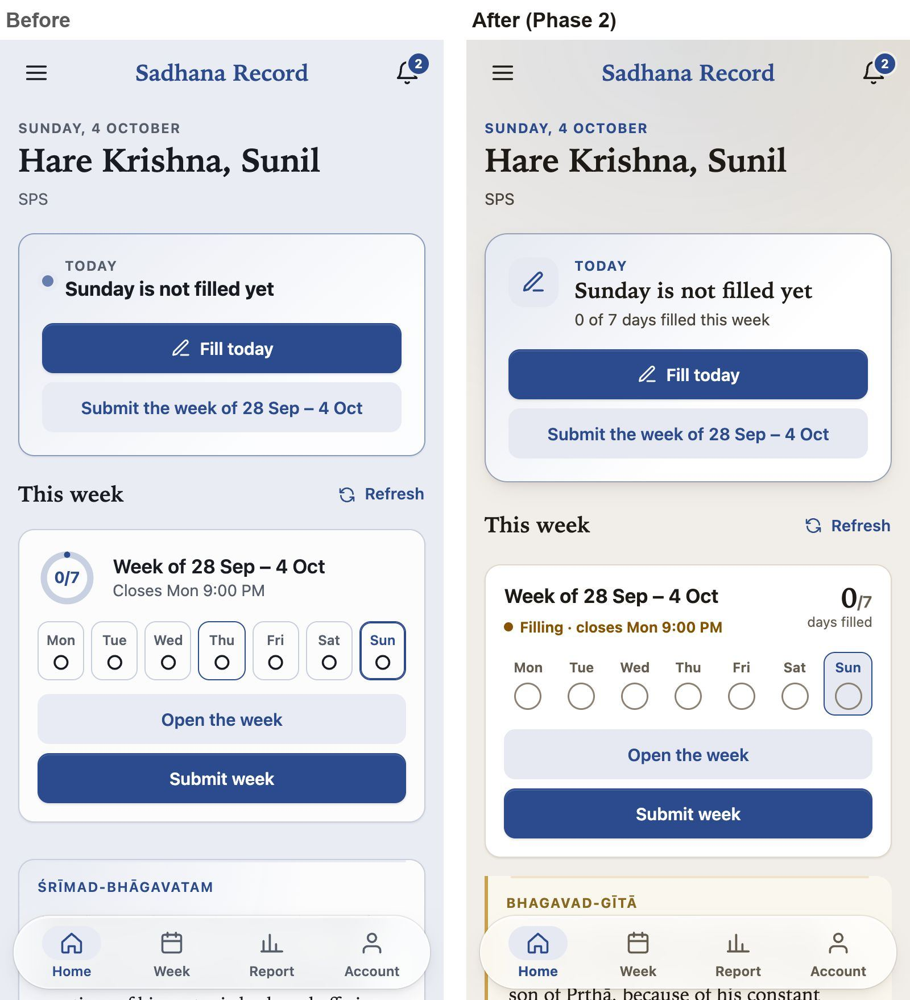
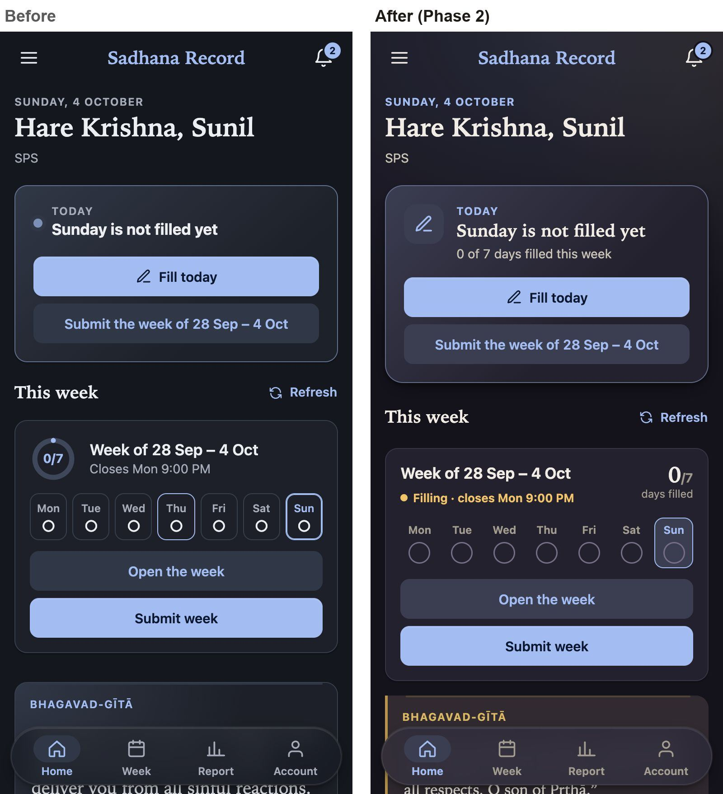
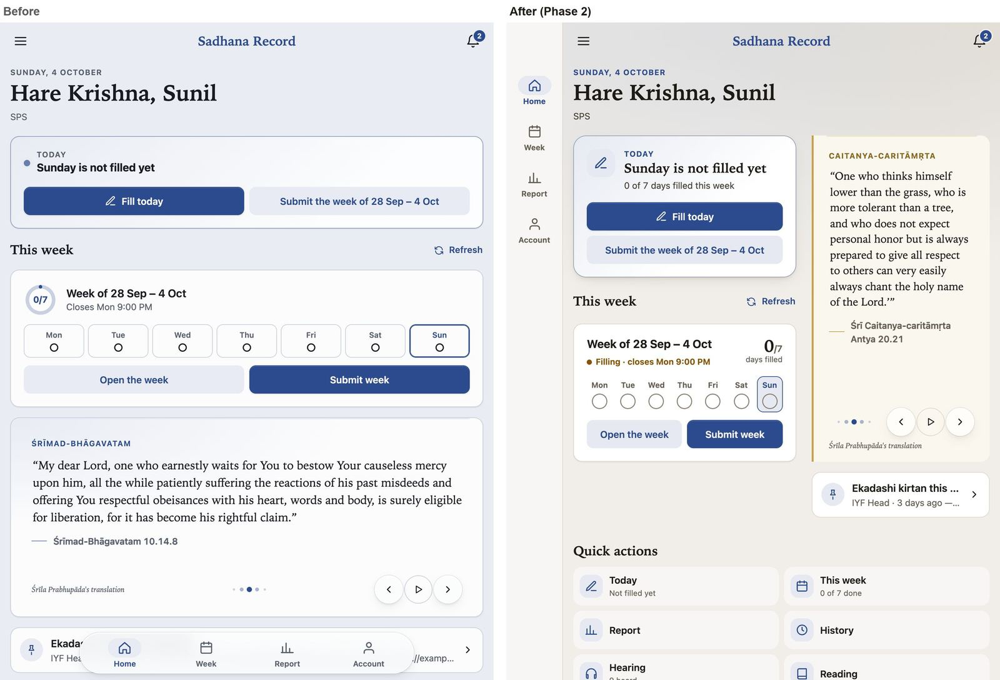
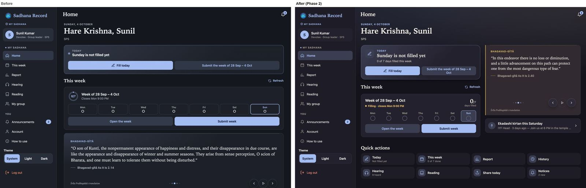
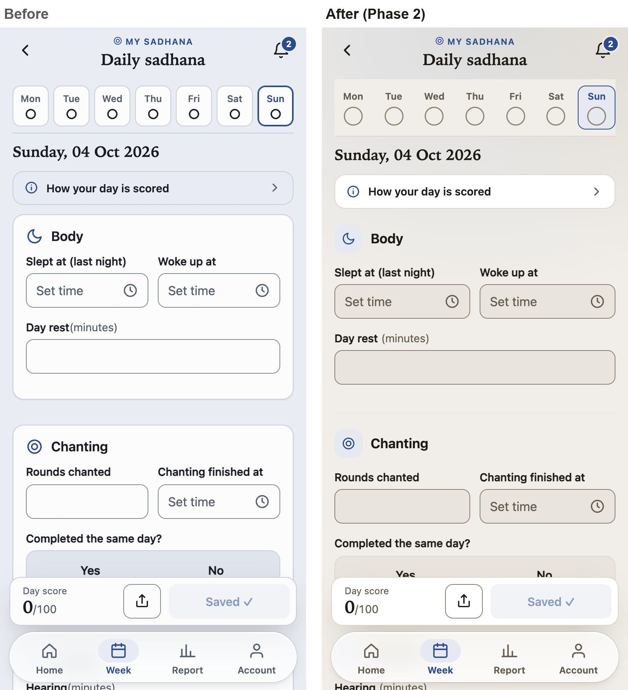
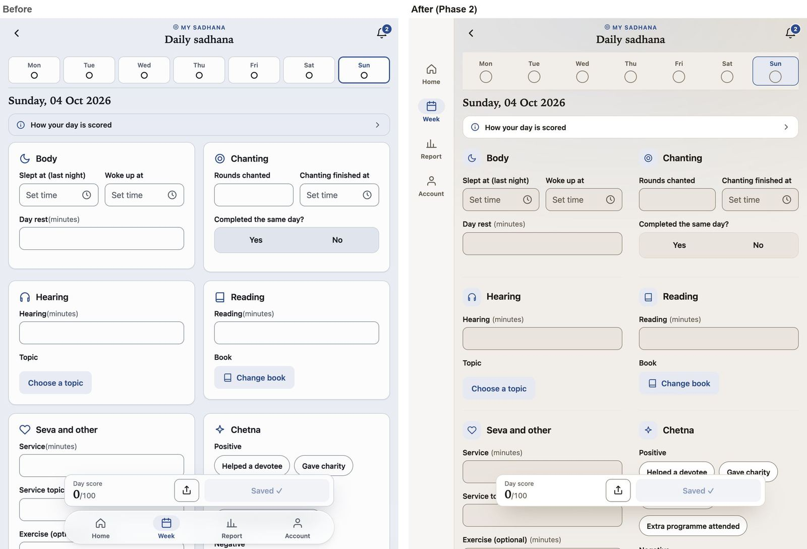
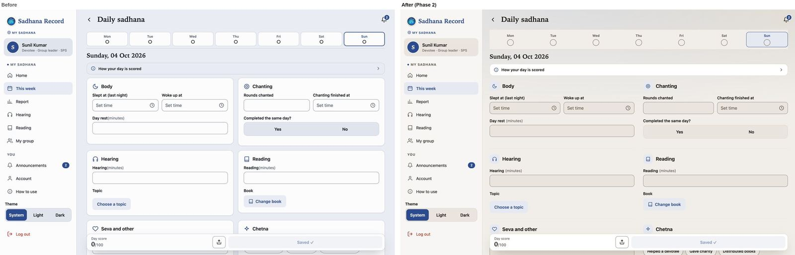
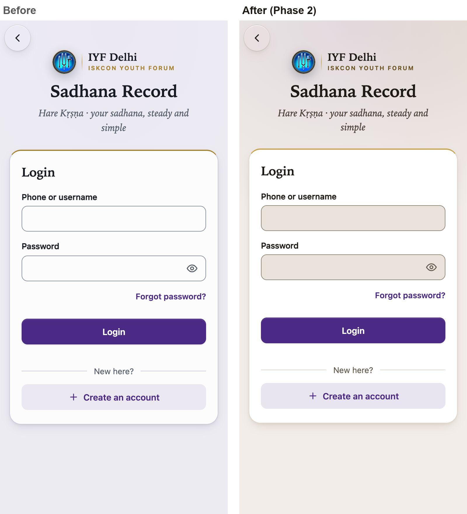

# Sadhana Record: status of the screens after the visual refresh (phase 2)

**IYF Delhi · 4 October 2026 · ready for review, not yet live**

This note sets out where each screen of the Sadhana Record app stands after the visual refresh (phase 2 of the modernization roadmap). It also shows how the new look compares with the version people use today, with screenshots of the same screens taken from both versions using the same sample data.

---

## 1. The answer in one page

**Status:** the new look is finished and tested on this computer. **It is not live yet.** It goes live after you approve the screenshots, together with phase 1 (faster opening), which a second session is preparing.

**Which screens changed:**

| Screens | Status |
|---|---|
| **Login**, **Home** and **Daily sadhana** (the day form) | **Fully redesigned** |
| Welcome, Sign up, Forgot password | New look for the frame around them (background, card, logo line); the forms themselves are unchanged |
| Every other screen | New colours and the shared parts (notices, empty lists, pop-up windows); layout unchanged |

**What is better, in short:**
- **Calmer and warmer.** A warm ivory background instead of cool grey, and a deep indigo-night dark mode. Gold is used as a second colour for details.
- **Less clutter.** Fewer boxes: on Home, boxed areas went from 27 to 18, and the day form went from 7 boxed sections to none.
- **Today comes first.** Home opens with one clear "Today" card showing what is missing and the one button to fix it.
- **Built for tablets.** On tablets and small laptops (600–1023 px wide), a side menu replaces the floating bottom bar, and Home and the day form use two columns. Before, these screens showed a stretched phone layout.
- **Easier to read.** Every text colour is now tested automatically against every background, in light and dark mode and in all four colour areas. Each one passes the accessibility standard (WCAG AA, 4.5:1).
- **Lighter to open.** The styles downloaded when the app opens fell from 14.45 KB to 13.50 KB, and the code from 55.38 KB to 51.19 KB.
- **Nothing else changed.** Scoring, saving, sign-in, offline use, the time wheels and every button stay where they were.

---

## 2. Status of every screen

| Area | Screen | Status |
|---|---|---|
| Before sign-in | Login | **Redesigned** |
| | Welcome | New frame and colours; the verse sits on a gold-ruled parchment card |
| | Sign up, Forgot password | New frame and colours; forms unchanged |
| Devotee | **Home** | **Redesigned** |
| | **Daily sadhana** (day form) | **Redesigned** (also when a coordinator fills a day for a devotee) |
| | Week, Report, History | New colours; side menu on tablets; layout unchanged (next phase) |
| | Hearing, Reading, Announcements, My group, Account | New colours; side menu on tablets; layout unchanged |
| Coordinator, facilitator | Batch status, Members, Requests, Filling chart, Group leaders, My students | New colours only; layout unchanged (staff phase) |
| Head (admin) | Overview, Devotees, Batches, Coordinators, Facilitators, IDs, Reopens, Activity, Settings | New colours only; layout unchanged (staff phase) |
| Everywhere | Notices, empty lists, pop-up windows, menu, toasts | New look (shared parts) |

The area colours that tell people where they are stay exactly as before: lapis blue for the devotee, saffron for the coordinator, wine for the head, royal purple before sign-in.

---

## 3. Before and after

All pictures show the same screen, at the same size, with the same sample data. The left side is the version in use today. The right side is the new one.

### Home on a phone

- **The background is warm ivory instead of cool blue-grey.** A soft wash of the area colour and gold sits at the top of the page.
- **"Today" is the one main card.** It has an icon, a serif title ("Sunday is not filled yet"), how far the week has got ("0 of 7 days filled this week") and the button to act.
- **The week card shows a large count and a status.** "0/7 days filled" is a large number, and "● Filling · closes Mon 9:00 PM" is a coloured dot with words, instead of a small grey line.
- **The days are a clean row of circles.** Before, each day sat in its own box. A filled day shows a green circle with a tick, and the selected day is softly highlighted.
- **The verse is set apart.** It sits on a parchment-tinted card with a gold rule, and its book name is in gold.

Dark mode is a deep indigo night instead of plain charcoal. The background, cards and pop-ups now sit on three clear steps of tone, so the layout reads without heavy borders.

### Home on a tablet

Before, a tablet showed the phone layout stretched wide, and the floating bottom bar covered the content.

Now:
- **A side menu replaces the floating bar.** It has the same four items, with labels.
- **The page uses two columns.** The day's work is on the left, the verse and the latest announcement on the right.
- **Quick actions fill the width below.** They are flat tiles instead of eight bordered boxes.

### Home on a computer

On large screens, the content stays within 1,280 px so lines never get too long to read comfortably.

### Daily sadhana (the day form)

- **No boxes around sections.** Body, Chanting, Hearing, Reading, Seva and Chetna were each a bordered card. Now each is a heading with a small icon tile, separated by a thin line. The form reads as one page instead of a stack of cards.
- **Fields stand out from the page.** Each answer box has a light sand fill with a clear outline.
- **Status is a dot with a word.** "Still needed" is shown as "● Still needed" in amber, instead of a grey pill.
- **Small fixes.** Labels with units now read "Day rest (minutes)" with a space, where before it read "Day rest(minutes)".
- **Unchanged:** the Save bar, the day score, the time wheels, "How your day is scored" and every field.

### Login

The layout is the same. The changes:
- **A warm background** with a soft wash.
- **A pure white card** with the gold top rule.
- **A deeper gold** for "ISKCON YOUTH FORUM", so it stays readable on the tinted background.

---

## 4. Measured differences

| | Before | After |
|---|---|---|
| Styles downloaded when the app opens | 14.45 KB | **13.50 KB** |
| Code downloaded when the app opens | 55.38 KB | **51.19 KB** |
| Home: areas drawn as a full box | 27 | **18** |
| Day form: sections drawn as a box | 7 | **0** |
| Tablets (600–1023 px) | Phone layout, floating bar over the content | **Side menu; two columns on Home and the day form** |
| Readability check | Not tested automatically | **72 automatic checks: all text ≥ 4.5:1, controls ≥ 3:1, light and dark, all four colour areas** |
| Hover effects that "stick" after a tap on a phone | 27 | **0** (hover now only on devices with a mouse) |
| Dark mode depth | One step between background and cards | **Three steps** (page → card → pop-up) |
| Sign-in screens with no internet | Open | **Still open** (checked after the change) |

---

## 5. Trade-offs and what is not done yet

- **Answer boxes look slightly heavier.** They now have a light sand fill instead of white, which separates them clearly from the page but adds more colour. It is a one-line change if you prefer white.
- **The verse card can be tall on a tablet.** In Home's narrower right column it is sized to the longest verse, so the page never jumps when the verse changes. Short verses leave some space below.
- **The background wash is lighter than the audit's suggestion** (10% instead of 14–16% in light mode). The stronger wash made small grey text at the top of the page harder to read.
- **Staff and head screens have the new colours but the old boxes.** Their redesign is a later phase. Until then they mix the new palette with the earlier box style.
- **On a tablet, a devotee who is also a coordinator sees two kinds of menu.** Their own pages have the side menu; batch pages keep the bottom bar. This evens out when the staff screens are redesigned.
- **Week, Report, Account and History keep their current layout.** They have new colours, and two-column versions come next.

---

## 6. How it was checked

| Check | Result |
|---|---|
| App logic tests (including 72 new readability checks) | 215 passed, 0 failed |
| Full browser test of every screen and role (devotee, coordinator, head, facilitator, group leader) | 1,276 passed, 0 failed, no errors in the browser |
| Layout test of Login, Home and Day at 8 sizes (320, 390, 600, 768, 900, 1024 and 1440 px, and a phone held sideways at 740 × 360), light and dark | 220 passed, 0 failed |
| Sign-in screens with no internet | Welcome and Login open, fully styled |
| What the layout test looks for | No sideways scrolling; buttons at least 44 px; at most one main card; no box inside a box; the Save bar never under the menu; the time wheel opens with Cancel and Done |

All 64 screenshots (3 screens, 8 sizes, light and dark, plus the time wheel) are in `frontend/screenshots/phase2/`.

---

## 7. Next steps

1. **You review** the pictures in this note and in `frontend/screenshots/phase2/`, and approve or ask for changes.
2. **Release together with phase 1.** After approval, it goes live along with the faster-opening work, coordinated between the two sessions.
3. **Later phases:**
   - the device-speed setting (phase 3);
   - redesigning Week, Report, Account and History;
   - redesigning the staff and head screens.
